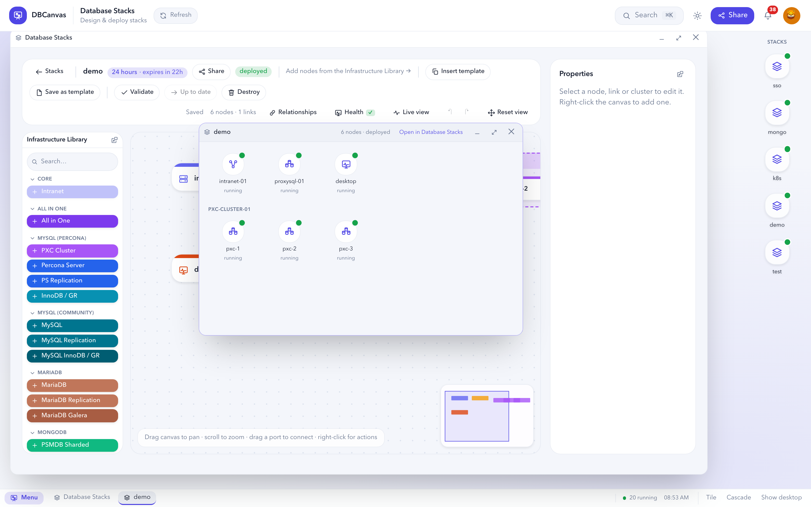
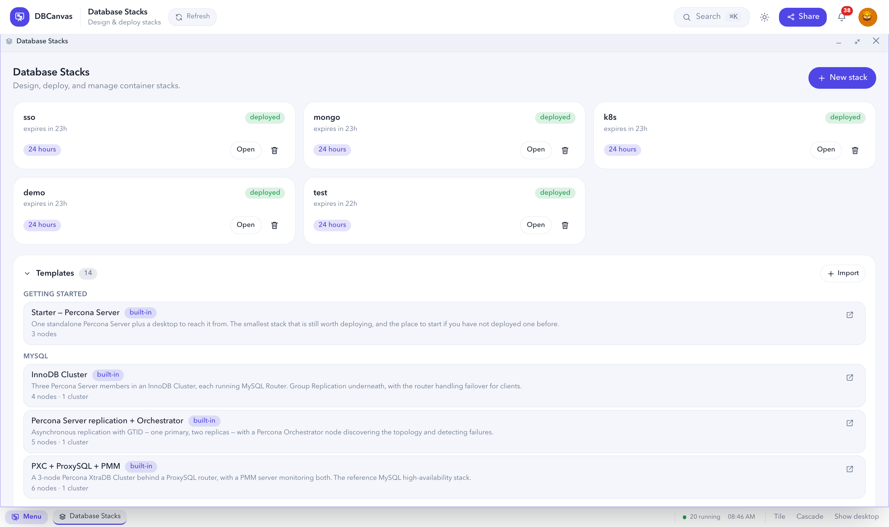
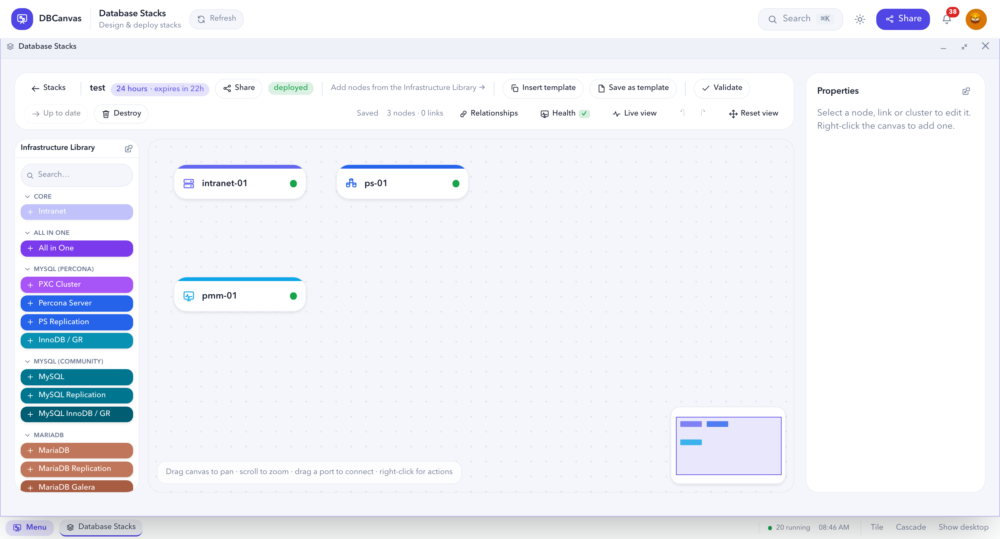
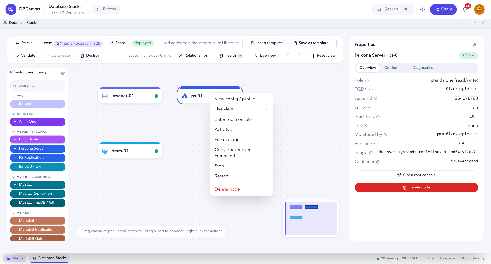

# DBCanvas — Database Interaction Lab

Draw a database topology on a canvas, click **Deploy**, and get running nodes with DNS, TLS,
LDAP, replication, monitoring and backups already set up. Then load them, watch them and
diagnose them with the tools that come with it.

All of it can also be done from a terminal: [`dbcanvas-cli`](#dbcanvas-cli) composes, deploys,
loads and diagnoses stacks without opening the browser.

Use it for testing, demos, training, troubleshooting, benchmarking and application development.

## What you can build

A stack is more than one database. Frames link to frames, one certificate authority and one key
store serve both container nodes and Kubernetes pods, and a proxy, a pool and an application can
be chained in front of a cluster. Each recipe below names what to place, what to connect and what
to switch on. [Stacks](docs/STACKS.md) has every option.

### Replicate across clusters and sites

**Two MySQL clusters replicating, one way or both ways.** Place two PXC or Percona Server
Replication frames (PXC and Percona Server can be mixed) and draw a replication link from a member
of one to a member of the other. An arrow at one end is one channel. A head at both ends is a
channel on each side, and both clusters take writes. The channel uses GTID auto-positioning when
both clusters have GTIDs on, and file and position otherwise. Every deploy reconciles it. Set
added latency, jitter or packet loss on the members to put a WAN between the two clusters.
→ [Build and deploy a stack](docs/STACKS.md#build-and-deploy-a-stack)

**Two PXC operator clusters on Kubernetes.** Place two K3D frames running the PXC operator, each
backing up to a SeaweedFS node, and draw a link from one frame to the other. Both clusters build
at the same time. The source's database pods get LoadBalancer addresses, a backup of the source
is restored onto the replica, and only then is the replica's channel attached. *Replicate over
SSL* verifies the source against the Intranet CA. Binlog point-in-time recovery on the replica
turns on once replication runs. The **Replication** tab shows the channel and its last error, and
**Re-seed** restores the replica again. Template: *Kubernetes — PXC operator, two clusters
replicating*. → [Replicate one PXC cluster into another](docs/STACKS.md#replicate-one-pxc-cluster-into-another)

**A Patroni standby cluster.** Place two Patroni frames of the same major and build and draw a
link between them. The frame the arrow points at becomes a read-only standby cluster. Its leader
streams from every member of the source, so a failover on the source does not break it, and the
standby has its own failover. Standbys can be chained. **Promote** on the link makes the standby
writable. From the CLI: `--node 'patroni:3,name=site-a' --node 'patroni:3,name=site-b,standbyOf=site-a'`.
→ [Patroni standby cluster](docs/STACKS.md#patroni-standby-cluster)

**A PostgreSQL operator standby on Kubernetes.** Draw the same link between two K3D frames running
the Percona Operator for PostgreSQL. The standby streams from the source's primary. When both
frames back up to the same SeaweedFS bucket, the standby is also created from the source's
pgBackRest repository and catches up from its archived WAL. With the Intranet CA or OpenBao as
both frames' certificate issuer, the two clusters already share a CA.
→ [Run a PostgreSQL cluster as a standby of another](docs/STACKS.md#run-a-postgresql-cluster-as-a-standby-of-another)

**MongoDB from container nodes into Kubernetes.** Place a PSMDB 8.0 replica set or sharded cluster
and a K3D frame running the MongoDB operator (1.23.0 or newer), turn on *ClusterSync* on the frame
and pick the PSMDB frame as its source. Percona ClusterSync copies it into the operator's cluster:
a replica set into a replica set, a sharded cluster into a sharded cluster. The **ClusterSync** tab
starts, pauses, resumes and finalizes it. Between two clusters on the canvas, a Linux Client with
ClusterSync installed does the same with live clone progress and lag.
→ [Kubernetes (K3D)](docs/STACKS.md#kubernetes-k3d), [Linux Client](docs/STACKS.md#linux-client)

### Secure the whole stack

**One certificate authority for container nodes and pods.** The Intranet CA signs every database,
proxy, PgBouncer, LDAPS, Keycloak, PMM and SeaweedFS S3 certificate. On a K3D frame, turn on
*cert-manager* and choose the Intranet CA, or OpenBao PKI holding the same CA, as the
*Certificate issuer*. *Host names in the certificates and the Intranet DNS* adds the cluster's
endpoint names to its certificates and publishes its LoadBalancers in the stack's DNS. A client
anywhere in the stack can then connect with `verify-full` or `VERIFY_IDENTITY` to a container node
or an operator pod against one root. Each node's certificate lifetime is set in minutes, hours or
days, and a certificate can be re-issued. The k3s node's **Certificates** tab checks every TLS
Secret's dates, chain and key.
→ [cert-manager and certificate issuers](docs/STACKS.md#cert-manager-and-certificate-issuers)

**Encryption keys in OpenBao.** Add one OpenBao node and turn on encryption on:

- a Percona Server node or replication cluster, or a PXC cluster;
- a standalone PSMDB node;
- PostgreSQL or Patroni with pg_tde, WAL included if you choose;
- a K3D frame running the PXC, MongoDB or Percona PostgreSQL operator.

Each database gets its own KV mount and a token scoped to it. An encrypted PXC cluster also
encrypts its cluster traffic. The deploy checks that every member loaded its keyring and creates
an encrypted test table, and a member that cannot fails instead of coming up unencrypted.
→ [Encrypt data at rest with OpenBao](docs/STACKS.md#encrypt-data-at-rest-with-openbao)

**Directory sign-in and single sign-on.**

- A Samba AD DC provides LDAP sign-in on Percona Server, PXC, PostgreSQL, PSMDB and PMM, and
  Kerberos (GSSAPI) on PostgreSQL and PSMDB.
- Keycloak provides OIDC sign-in on Percona Server and PXC (8.4.11-11 / 9.7.2-2 or newer),
  PostgreSQL 18, PSMDB and PMM's Grafana. The deploy creates the realm, the client, sample users
  and the database roles their groups map to.

→ [Sign in with a directory or single sign-on](docs/STACKS.md#sign-in-with-a-directory-or-single-sign-on)

### Run databases on Kubernetes

**Operator clusters on k3s.** A K3D frame of one to three k3s nodes with MetalLB addresses from
the stack subnet runs one of:

- the Percona Operator for PXC, with HAProxy or ProxySQL in front;
- the Percona Operator for Percona Server, with group replication or async under Orchestrator;
- the Percona Operator for MongoDB, as a replica set or sharded, with mongot;
- the Percona Operator for PostgreSQL, with pgvector, logical replicas or pg_tde;
- CloudNativePG, with a PgBouncer Pooler and kube-prometheus-stack;
- Crunchy PGO, with pgMonitor;
- OpenEverest, with the operators you choose.

Each tier gets its own Service type. Volumes can be on a Ceph node, where they can grow. Backups
and point-in-time recovery go to SeaweedFS, and PMM sidecars register on their own. The panel
edits the live `cr.yaml` as a form built from the CRD, creates X.509 users with kubeconfigs, and
opens a database client in any pod. → [Kubernetes (K3D)](docs/STACKS.md#kubernetes-k3d)

**An operator under a debugger.** *Run the operator under Delve* builds a Percona operator from
its release source and runs it under Delve. The Operator Debugger sets breakpoints and forces a
reconcile from the browser, or an IDE attaches on port 40000.
→ [Operator Debugger](docs/OPERATOR_DEBUGGER.md)

**Kubernetes built with kubeadm.** A control plane and up to three workers as systemd hosts with
containerd. The cluster can be deployed Ready (with Calico or Flannel), Initialized without a pod
network, or Prepared, which leaves `kubeadm init` and the joins to you. Deploying a release one
minor behind the newest gives a cluster to upgrade with kubeadm's own procedure.
→ [Kubernetes (kubeadm)](docs/STACKS.md#kubernetes-kubeadm)

### Put something in front

**Proxies, routers and pools in a chain.** A cluster frame links to the proxy in front of it, and
the proxy links to the application behind it:

- **ProxySQL**, as one node or a cluster frame sharing one configuration, in front of PXC, Percona
  Server or MySQL replication. The package is Percona's or upstream's, configured by
  `proxysql-admin` or natively.
- **Upstream ProxySQL 3** in front of PostgreSQL, with read/write split.
- **HAProxy** in front of a MySQL or PostgreSQL cluster, with a write port and a read port.
- **MySQL Router** on Group Replication, and **Orchestrator** watching replication.
- **PgBouncer**, which follows the writable member after a failover, has a pool per role (`rw`,
  `rw-ro`) or per Spock member (`mesh`), and supports `auth_query` and `verify-full` TLS to the
  backend.

From the CLI: `--node 'patroni:3,pgvector,monitor' --node haproxy --node 'pgvectorsim,to=haproxy-01' --node pmm`.
→ [Proxies and HA](docs/STACKS.md#proxies-and-ha), [PgBouncer](docs/STACKS.md#pool-postgresql-connections-with-pgbouncer)

### Back up and restore

**Backups to S3 in the stack.** A SeaweedFS node, with TLS from the Intranet CA and up to ten
buckets, is the target for:

- XtraBackup full and incremental backups with binlog point-in-time restore (Percona Server, PXC,
  MySQL);
- pgBackRest or Barman, with pg_tde-encrypted WAL archived through pgBackRest's decrypt hooks;
- PBM on MongoDB replica sets and sharded clusters;
- the operators' own backups.

→ [Back up and restore](docs/STACKS.md#back-up-and-restore)

### Shape the lab

**An air-gapped site.** A Repository node mirrors the Percona repositories you list, for the OS
releases and architectures you pick. It can also carry debug symbols, operator releases (manifests,
images and Helm charts) and extra container images. Nodes install from it and K3D frames pull
through its registry. In *Strict* mode a package the mirror lacks fails the install, so the mirror
has to carry every Percona repository a node draws on: Percona Server 8.4 needs `ps-84-lts`,
`telemetry` and `pxb-84-lts`.
→ [Repository](docs/STACKS.md#mirror-packages-and-images-with-a-repository-node)

**A bad network or a slow disk.** Any database node or member takes CPU and memory limits, disk
read and write caps, and added latency, jitter, packet loss and a bandwidth cap on its database
ports. They can be changed without recreating the node:
`--node 'pxc:3,netLatencyMs=80,netJitterMs=20,netLossPct=1'`.
→ [Resource limits and network conditions](docs/STACKS.md#resource-limits-and-network-conditions)

**Many databases in one container.** An All in One node runs standalones and clusters of one
MySQL flavor, PostgreSQL (Patroni, repmgr, Spock), PSMDB and Valkey side by side with ProxySQL,
HAProxy and Orchestrator. Each instance has its own port, directory and systemd unit, and
instances can be added to a running node.
→ [All in One](docs/ALL_IN_ONE.md)

**Database nodes as VMs.** The hybrid backend runs database nodes as VirtualBox VMs and everything
else as containers in the same stack.
→ [Deployment backends](docs/STACKS.md#deployment-backends--docker-or-vagrant-hybrid)

**A core-dump bench.** A Linux Client mounts a `mysqld` core and the crashed host's libraries
read-only and installs gdb with the matching debug symbols, for the Core Dump Analyzer.
→ [Core Dump Analyzer](docs/CORE_DUMP_ANALYZER.md)

**An application to run against it.** Link a simulator to any of the above:

- Stock Market Sim on MySQL, PostgreSQL, MongoDB or Valkey;
- Ledger Sim over JDBC;
- the Support Sims on MongoDB vector search or pgvector;
- Performance Sim, whose stressors cause replication lag, lock contention, connection storms and
  I/O pressure and chart the effect.

→ [Application simulators](docs/STACKS.md#application-simulators)

Fourteen built-in templates start from a working design, including PXC with ProxySQL and PMM,
Patroni with HAProxy, sharded PSMDB, vector search with the Support Sim and the two-cluster PXC
operator replication.

## Database stacks

Every database runs on Oracle Linux 8, 9 or 10 or on Ubuntu 22.04 or 24.04, unless a row says
otherwise. The **compose kind** is what `dbcanvas-cli stack compose --node` takes.

| Engine | Topologies | Versions | Compose kind |
| --- | --- | --- | --- |
| **Percona Server for MySQL** | Standalone · async or semi-sync replication · InnoDB Cluster / Group Replication | 5.7, 8.0, 8.4, 9.7 | `ps` · `ps-repl` · `innodb` |
| **Percona XtraDB Cluster** | Galera cluster of 1–9 members, optional garbd arbitrator | 8.0, 8.4, 9.7 | `pxc` |
| **MySQL Community** | Standalone · async or semi-sync replication · InnoDB Cluster / Group Replication | 8.0, 8.4, 9.7 | `mysql` · `mysql-repl` · `mysql-innodb` |
| **MariaDB** | Standalone · async or semi-sync replication · Galera | 10.6, 10.11, 11.4, 11.8, 12.3 | `mariadb` · `mariadb-repl` · `mariadb-galera` |
| **Percona Distribution for PostgreSQL** | Standalone · streaming replication · Patroni | 13 – 18 | `pg` · `pg-stream` · `patroni` |
| **PostgreSQL (PGDG)** | Standalone · streaming replication · Patroni · repmgr · Spock active-active (Oracle Linux only) | 13 – 18; Spock 15 – 18 | `pg-pgdg` · `pg-stream-pgdg` · `patroni-pgdg` · `repmgr` · `spock` |
| **Percona Server for MongoDB** | Standalone · replica set · sharded cluster: 1 mongos, 1 config server and 3 single-member shards (5 nodes), or 1 mongos, 3 config servers and 3 shards of 3 (13 nodes) | 6.0, 7.0, 8.0, 8.3 | `psm` · `psmrs` · `psmdb` |
| **MongoDB Community** | Standalone · replica set · sharded cluster (5 or 13 nodes, as for Percona Server for MongoDB) | 6.0, 7.0, 8.0, 8.2 | `mdb` · `mdb-rs` · `mdb-sharded` |
| **Valkey** | Standalone · Valkey Cluster (3–7 shards) · Sentinel | 9.1 | `valkey` · `valkey-cluster` · `valkey-sentinel` |
| **Kubernetes (K3D)** | k3s with one operator: Percona Operator for MySQL based on Percona XtraDB Cluster, Percona Operator for MySQL based on Percona Server, Percona Operator for MongoDB, Percona Operator for PostgreSQL, CloudNativePG, Crunchy Postgres for Kubernetes (PGO) or OpenEverest | k3s releases | designer or template |
| **Kubernetes (kubeadm)** | Control plane + up to 3 workers, Calico or Flannel; ready, initialized, or prepared for a manual init | Kubernetes releases | designer or template |
| **All in One** | Several of the engines above as instances in one node | as above | designer or template |

### What DBCanvas installs and configures

`yes` = set up at deploy from a switch or a line on the canvas. A number refers to the note
under the table.

**Security and monitoring**

| Engine | TLS | PMM 3 | LDAP | Kerberos | OIDC | OpenBao keys |
| --- | :-: | :-: | :-: | :-: | :-: | :-: |
| Percona Server | yes | yes | yes ¹ | — | yes ² | yes ³ |
| PXC | yes | yes | yes | — | yes ⁴ | yes |
| MySQL Community | yes | yes | — | — | — | — |
| MariaDB | yes | yes | — | — | — | — |
| Percona PostgreSQL | yes | yes ⁵ | yes ⁶ | yes ⁶ | yes ⁶ | yes ⁷ |
| PostgreSQL (PGDG) | yes | yes ⁸ | yes ⁶ | yes ⁶ | — | — |
| PSMDB | yes | yes | yes ⁶ | yes ⁶ | yes ⁶ | yes ⁶ |
| MongoDB Community | yes | yes | — | — | — | — |
| Valkey | — | yes | yes | — | — | — |
| Kubernetes (K3D) | yes ⁹ | yes | — | — | — | yes ¹⁰ |

1. Standalone and replication; not 5.7.
2. Standalone and replication; 8.4.11-11, 9.7.2-2 or newer.
3. Standalone and replication.
4. 8.4.11-11, 9.7.2-2 or newer.
5. Query Analytics from pg_stat_statements or pg_stat_monitor.
6. Standalone only.
7. pg_tde, WAL included; standalone and Patroni.
8. Query Analytics from pg_stat_statements.
9. Certificates through cert-manager.
10. PXC, MongoDB, and Percona PostgreSQL with pg_tde.

TLS certificates come from the stack's CA, keys go to OpenBao, sign-in goes to the Intranet's
OpenLDAP or a Samba AD DC (LDAP, Kerberos) or Keycloak (OIDC).

**Backups and what sits in front**

| Engine | Backups to SeaweedFS S3 | In front |
| --- | --- | --- |
| Percona Server | XtraBackup, full + incremental, binlog point-in-time restore (standalone, replication) | ProxySQL, HAProxy, Orchestrator (replication); MySQL Router (InnoDB Cluster / Group Replication) |
| PXC | XtraBackup, full + incremental, binlog point-in-time restore | ProxySQL, HAProxy |
| MySQL Community | XtraBackup, full + incremental, binlog point-in-time restore (standalone, replication) | ProxySQL, HAProxy, Orchestrator (replication); MySQL Router (InnoDB Cluster / Group Replication) |
| MariaDB | — | Orchestrator (replication) |
| Percona PostgreSQL | pgBackRest | HAProxy (clusters), PgBouncer |
| PostgreSQL (PGDG) | pgBackRest (not Spock); Barman on repmgr | HAProxy (clusters), PgBouncer |
| PSMDB | PBM (replica set, sharded) | MClusterAdmin |
| MongoDB Community | PBM (replica set, sharded) | MClusterAdmin |
| Valkey | — | — |
| Kubernetes (K3D) | Operator backups; binlog point-in-time recovery on PXC | — |

Also per engine:

- **MySQL family**: GTIDs, InnoDB sizing and durability (`innodb_buffer_pool_size`, redo log,
  `sync_binlog`, `innodb_flush_log_at_trx_commit`), and innodump, binlogsum, mydumper and
  gcache-inspector on request. Replication between two PXC or Percona Server clusters, one-way
  or both ways.
- **PostgreSQL**: pgvector, pgAudit, set_user, synchronous standbys, `pg_hba` methods
  (scram-sha-256, md5, cert, trust), a pgbench dataset at deploy, and a Patroni cluster as a
  standby cluster of another.
- **MongoDB**: Percona Search (`$search` / `$vectorSearch`) on 8.3.
- **Kubernetes (K3D)**: volumes on k3s local-path or on a Ceph node (RBD, resizable),
  replication between two PXC clusters, and a Percona PostgreSQL cluster as a standby of another.
- **Every database node**: a DNS name, CPU and memory limits, disk throughput limits, added
  latency, jitter, packet loss and bandwidth caps, and a port published on the host.

### Once it is running

| Cluster | Switchover | Rolling restart | Failure drills | Users across members | Config drift | Diagnostics |
| --- | :-: | :-: | :-: | :-: | :-: | --- |
| MySQL, MariaDB replication and Group Replication | yes | yes | yes | yes | yes | Activity, deadlocks, pt-stalk |
| PXC and MariaDB Galera | no | yes | yes | yes | yes | Activity, deadlocks, pt-stalk |
| Patroni | yes | yes | yes | yes | yes | Activity, locks, pg_gather |
| PostgreSQL streaming replication, repmgr | yes | yes | no | yes | yes | Activity, locks, pg_gather |
| Spock | no | no | no | no | yes | Activity, locks, pg_gather |
| MongoDB replica sets and sharded clusters | yes | yes | yes | yes | yes | Activity, FTDC |
| Valkey Cluster and Sentinel | no | no | no | no | yes | Config drift only |
| Kubernetes (K3D) | no | no | no | no | no | Live object board, pod consoles, operator debugger |

Every node also has a console, a file manager, its log, start / stop / restart and rebuild.

## `dbcanvas-cli`

Everything above, from a terminal. Download it from your installation's **API** page or build it
with `make cli` (which installs it as `~/.local/bin/dbcanvas-cli`); the command is `dbcanvas-cli`.

| Task | Commands |
| --- | --- |
| Build a stack from one line per node | `stack kinds`, `stack compose NAME --node 'pxc:3,version=8.4,os=el9,monitor' --node pmm --deploy --wait` |
| Manage stacks | `stack list`, `get`, `create --template`, `validate`, `deploy --wait`, `destroy`, `delete`, `export` |
| Work on a node | `node list`, `console`, `exec … -- CMD`, `cp`, `start` / `stop` / `restart`, `tunnel`, `pods` |
| Share designs | `template list`, `export`, `import` |
| Load | `datagen run`, `query run` (several nodes at once), `benchmark run` (oltp, olap, rw, ro) |
| Diagnose | `logs collect`, `capture start` (decoded packets, `.pcap` download), `stalk start` / `analyse`, `ftdc node` |
| Watch | `dashboard --live`, `notifications`, `updates` |
| Administer | `login`, `token`, `password`, `user`, `group` |
| Anything else | `endpoints` to search the API, `api METHOD PATH` to call it |

Kubernetes, kubeadm and All in One stacks come from a template or a design file rather than
`stack compose`. Tables accept `--json`. → [`dbcanvas-cli` reference](docs/CLI.md)

> [!IMPORTANT]
> **DBCanvas is for testing and learning, not production.** Everything it deploys is disposable:
> default credentials, containers built for quick setup rather than durability, and stacks
> meant to be torn down.



---

## Install

You need **Docker** and access to its daemon socket.

```sh
git clone https://github.com/jaimesicam/dbcanvas.git && cd dbcanvas
make install-pull
```

DBCanvas starts at **http://localhost:8080**. `make install-pull` pulls this release's node
images from `ghcr.io/jaimesicam` instead of building them, so it takes minutes. They are
published for `linux/amd64`, and the Kubeadm node for `linux/amd64` and `linux/arm64`. The demo
application images are pulled with them.

To build every image yourself instead, for another platform or a changed image, run
`make install`. It takes a while. If an image fails to build, DBCanvas still starts, and only the
node types that need that image are unavailable.

Open the URL and create an account. **The first account becomes the administrator**, and an
administrator must approve later sign-ups.

Every setting has a working default. Before you open DBCanvas to anyone else, change the
passwords in `.env` (see [Configuration](docs/CONFIGURATION.md)).

## Upgrade

```sh
git pull
make pull-images      # this release's node images, from ghcr.io/jaimesicam
make compose          # rebuild and restart DBCanvas
```

Instead of `make pull-images`, `make adopt-images` tags the images you already have for the new
release, without downloading or rebuilding anything.

Running stacks keep running during the restart.

If you build your own images and the release changed an image definition, rebuild that image. `git diff --stat ORIG_HEAD -- images`
lists the changes, and the release notes in [CHANGELOG.md](CHANGELOG.md) name the `make` target
to run. If an image is missing, **Validate** tells you which one.

## Your first stack

1. Open **Database Stacks** → **New stack**, name it, and pick a template under **Start from**.
2. Press **Validate** to check the design, then **Deploy**.
3. Wait for the nodes to show `running`.





To build a stack from scratch, add the **Intranet** node first. It provides the DNS,
certificate authority, LDAP and package proxy that the other nodes need, so the rest of the
node library stays disabled until it is on the canvas.

Give each stack a **TTL** (time to live). DBCanvas tears the stack down when it expires.

→ [Getting started](docs/GETTING_STARTED.md) covers this end to end.

## Working with nodes

- **Right-click a running node** to open a root console, open a file manager, copy its
  `docker exec` command, start, stop or restart it, or (on a server install) copy an
  `ssh -L` tunnel command.
- **Click a node** to see its panel: address, credentials, certificate, and engine-specific
  management such as replication, users, backups and diagnostic captures.
- **Hover any `?`** to see what a field, value or button does.



Ways to connect:

| From | How |
| --- | --- |
| **The browser** | Right-click → *Enter root console*. The database client is already installed. |
| **Another node** | Nodes reach each other by name, for example `mysql -h ps-01.example.net -u root -p`. The **VNC** node gives you a desktop with a browser inside the stack. |
| **Your machine** | Tick *Export … port to the host* before deploying. The node's panel shows the host port. |
| **An SSH tunnel** | When DBCanvas runs on a server, set `SSH_FORWARDING_HOST` and copy the command from the node's menu. |

## Around the databases

The [database stacks](#database-stacks) above run alongside these nodes:

**Infrastructure**: Intranet (DNS, mail, OpenLDAP, Squid proxy, certificate authority), PMM,
ProxySQL, HAProxy, PgBouncer, Orchestrator, SeaweedFS (S3), Ceph, Keycloak, OpenBao, Samba AD DC,
a package Repository, MClusterAdmin, a VNC desktop and a Linux Client.

**Simulated load**: applications that send realistic traffic to your databases — support desk,
ledger and stock market simulators — and Performance Sim, whose stressors make a server or
cluster misbehave on purpose and show the impact live.

## Tools

| | |
| --- | --- |
| [**Stacks**](docs/STACKS.md) | Design, deploy and manage stacks, and every node from its panel. |
| [**Data Generator**](docs/DATA_GENERATOR.md) | Fill tables with realistic data. |
| [**Query Runner**](docs/QUERY_RUNNER.md) | Run SQL on several nodes in parallel. |
| [**Database Explorer**](docs/DATABASE_EXPLORER.md) | Browse and query MySQL, PostgreSQL, MongoDB, Valkey, and PMM's internal databases. |
| [**Benchmark**](docs/BENCHMARK.md) | Run workloads and measure throughput and latency. |
| [**Sample Client Code**](docs/SAMPLE_CODE.md) | Generate and run client code for a node in your choice of language and driver. |
| [**Packet Inspector**](docs/PACKET_INSPECTOR.md) | Capture traffic on a node and decode the database protocol. |
| [**Log Summary**](docs/LOG_SUMMARY.md) | Several nodes' logs on one timeline, sorted into errors, warnings and the rest. |
| [**Stalk Summary**](docs/STALK_SUMMARY.md) | Charts and recommendations from a pt-stalk capture. |
| [**FTDC Summary**](docs/FTDC_SUMMARY.md) | Read MongoDB's diagnostic data. |
| [**Kubernetes States**](docs/KUBERNETES_STATES.md) | A live board of every object in a Kubernetes cluster. |
| [**Operator Summary**](docs/OPERATOR_SUMMARY.md) | Read a pt-k8s-debug-collector dump. |
| [**Operator Debugger**](docs/OPERATOR_DEBUGGER.md) | Set breakpoints in a running Kubernetes operator. |
| [**Core Dump Analyzer**](docs/CORE_DUMP_ANALYZER.md) | Read a `mysqld` core dump: threads, stacks and arguments. |
| [**All in One**](docs/ALL_IN_ONE.md) | Many database instances in one node, side by side. |
| [**Shared Sessions**](docs/SHARED_SESSIONS.md) | Share a live session through a link; others can follow, chat and take control. |
| [**Kanban**](docs/KANBAN.md) | Private or shared boards of cards. |
| [**HTTP API**](docs/API.md) | Every feature as an HTTP endpoint, with tokens you create. |
| [**`dbcanvas-cli`**](docs/CLI.md) | Compose, deploy and drive stacks from a terminal. |

## Documentation

- **[Getting started](docs/GETTING_STARTED.md)**: from install to a running cluster
- [Feature guides](docs/README.md): one page per tool
- [Configuration & commands](docs/CONFIGURATION.md): `.env`, `make` targets, troubleshooting
- [Security model](docs/SECURITY.md): what an account can do to the host, guest sign-in, limits, tokens
- [HTTP API](docs/API.md) and the [API & CLI reference](docs/API_REFERENCE.md)
- [`dbcanvas-cli`](docs/CLI.md)
- [Agent Skill](.claude/skills/dbcanvas/SKILL.md) for driving DBCanvas from Claude Code. It loads
  automatically in this checkout. To use it elsewhere:

  ```sh
  mkdir -p ~/.claude/skills/dbcanvas
  cp .claude/skills/dbcanvas/SKILL.md ~/.claude/skills/dbcanvas/
  ```
- [Architecture](docs/ARCHITECTURE.md): for contributors

## Requirements

- **Docker** with access to the daemon socket. DBCanvas uses it to create your stacks, which
  is a privileged capability, so run DBCanvas somewhere you trust.
- Enough CPU, memory and disk for what you deploy. An HA cluster is several containers.
- Linux (recommended) or macOS, including Apple Silicon.
- **Vagrant + VirtualBox**, only if you use the hybrid backend, which runs database nodes as VMs.

## License

Copyright © 2026 Jaime Sicam. DBCanvas is free software under the
[GNU General Public License, version 3 only](LICENSE) (GPL-3.0-only), with no warranty.

It bundles third-party software, each component under its own licence — all of them
GPLv3-compatible. [THIRD_PARTY_NOTICES.md](THIRD_PARTY_NOTICES.md) lists them. A running
installation publishes the full texts at `/licenses/` (linked from the sign-in screen and the
Dashboard), and the container image carries them under `/usr/share/doc/dbcanvas/`.

---

## What's new

Release notes for every version are in [CHANGELOG.md](CHANGELOG.md).
