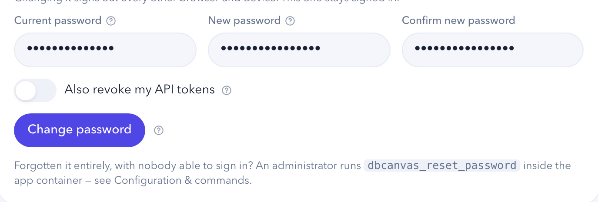

# `dbcanvas-cli`

Drive DBCanvas from a terminal: compose and deploy a stack, open a console on a node, run a
benchmark, tear it down. It uses the same [HTTP API](API.md) as the web interface, and
`dbcanvas-cli api` reaches any endpoint that has no subcommand.

---

## Install

**From a running installation** (no checkout needed): the **API** page has download links, or

```sh
curl -fL -o dbcanvas-cli "http://localhost:8080/api/cli/download?os=linux&arch=amd64"
chmod +x dbcanvas-cli && sudo mv dbcanvas-cli /usr/local/bin/
```

Builds exist for `linux` (`amd64`, `arm64`), `darwin` (`amd64`, `arm64`) and `windows`
(`amd64`).

**From a checkout:**

```sh
make cli                      # → dist/dbcanvas-cli_<os>_<arch>, and ~/.local/bin/dbcanvas-cli
```

`make cli` builds every platform into `dist/` and installs this machine's build as
`~/.local/bin/dbcanvas-cli`. Install it elsewhere with `sudo make cli CLI_INSTALL_DIR=/usr/local/bin`,
or only build with `make cli CLI_INSTALL_DIR=`.

`dbcanvas-cli` with no arguments lists every command; the **API** page shows the same list.
`-h` on any command or subcommand prints its arguments and flags and runs nothing:
`dbcanvas-cli node exec -h`, or `dbcanvas-cli help node exec`. `dbcanvas-cli help node` lists a
group's subcommands.
`dbcanvas-cli version` prints the CLI's version and, when signed in, the server's.

## Signing in

```
$ dbcanvas-cli login --url http://localhost:8080
Username: alex
Password: ********
Created token "dbcanvas-cli on laptop" (dbc_a1b2c3d4…), write scope, expires 2026-12-01.
Saved to ~/.config/dbcanvas/config.json as profile "default".
```

`login` signs in with your password, creates an API token, and signs the password session out.
Only the token is saved (file mode `0600`); the password is never stored. The token appears
under your API tokens, where you can revoke it.

```sh
dbcanvas-cli login --expires 30 --scope read   # a short-lived read-only token
dbcanvas-cli whoami                            # account, role, server, token scope and expiry
dbcanvas-cli logout                            # revoke the token and remove the profile
```

Where an administrator has turned on guest sign-in, `dbcanvas-cli login --guest` signs in as a
new guest account of your own instead, with no username or password. The Guests security group needs the
**API** feature for this, which it does not have by default (see [Security groups](#security-groups)). Everything else is the same: it
stores a write-scope token. Each guest account's stacks are its own; the account is removed with
its stacks after a period unused, and the token stops working if guest sign-in is turned off (unless
the administrator keeps existing guests). When guest sign-in is off, the server refuses with
`guest sign-in is turned off`.

```sh
dbcanvas-cli login --url http://localhost:8080 --guest --profile guest
```

| `login` flag | Default | Meaning |
| --- | --- | --- |
| `--url` | — | DBCanvas base URL. |
| `--user` | prompted | Username. |
| `--profile` | `default` | Name for this installation in the config file. |
| `--scope` | `write` | `read`, `write` or `admin`. |
| `--expires` | `90` | Lifetime in days; `0` = never (administrators only). |
| `--name` | `dbcanvas-cli on <hostname>` | Token name. |

Use `logout` rather than deleting the config file — deleting it leaves the token valid.

## API tokens

```sh
dbcanvas-cli token list                 # your tokens; --all for every token (administrators)
dbcanvas-cli token create --name ci --scope write --expires 30
dbcanvas-cli token revoke 12            # --admin to revoke somebody else's (administrators)
```

`token create` asks for your password: a token cannot create another token.

## Changing your password



```sh
dbcanvas-cli password                    # prompts for the current password, then the new one twice
dbcanvas-cli password --revoke-tokens    # also revoke every API token, including this CLI's
dbcanvas-cli password --user alex        # when the profile does not name an account
```

`password` asks for your current password: a token cannot change a password. The change signs
out your other browsers and devices. API tokens keep working unless you pass `--revoke-tokens`;
then the CLI removes its own token and asks you to sign in again.

Forgotten your password? An administrator can set a new one or send a reset link from
**Manage Users**. If no administrator can sign in, see
[Recovering an admin password](CONFIGURATION.md#recovering-an-admin-password).

## Accounts (administrators)

Create an account for somebody, who then signs in with it:

```
$ dbcanvas-cli user create sam --first Sam --last Lee --email sam@example.net
Creating an account requires an administrator's password (a token cannot create accounts).
Password for admin: ********
Temporary password for sam: ********
Temporary password for sam again: ********
Created sam (id 2, user).

They must replace the temporary password at their first sign-in, which this does:

  dbcanvas-cli login --url http://localhost:8080 --user sam --profile sam
```

When `sam` runs that `login`, the CLI asks for a new password before creating the token.

```sh
dbcanvas-cli user list                                      # every account and its state
dbcanvas-cli user create pat --first Pat --last Kim --email pat@example.net --role admin
dbcanvas-cli user create kai --first Kai --last Oh --email kai@example.net --invite
dbcanvas-cli --profile sam whoami                           # act as another profile
```

| `user create` flag | Meaning |
| --- | --- |
| `--first`, `--last`, `--email` | Required. |
| `--role` | `user` (default) or `admin`. |
| `--invite` | No temporary password; print a one-time link (valid 7 days) for the owner to set one in a browser. |
| `--admin NAME` | The administrator signing in, when the profile does not name one. |

`user create` asks for your password even when signed in: a token cannot create accounts.
`user list` works with an admin-scoped token (`dbcanvas-cli login --scope admin`). For approving,
disabling, changing roles or deleting accounts, use `dbcanvas-cli api` with an admin-scoped token
(see the [API reference](API_REFERENCE.md#users-admin)). Setting another account's password and
issuing reset links are browser-only.

## Security groups

Which pages each group (`admin`, `user`, `guest`) may use is enforced for the CLI too: a command
whose endpoint belongs to a feature your group lacks fails with `your security group (…) does not
have access to …`, and a group without the **API** feature cannot sign in with `dbcanvas-cli login` or
use a token at all. Administrators manage it:

```sh
dbcanvas-cli group list                                   # every feature, and which groups have it
dbcanvas-cli group set guest kanban=on api=on             # let guests use Kanban and the CLI
dbcanvas-cli group set user benchmark=off                 # take Benchmark from regular users
```

Granting a tool grants Database Stacks with it. `(fixed)` cells cannot be changed: administrators
always keep Settings and Manage Users, and only administrators can have Manage Users. See
[the API guide](API.md#security-groups).

## Configuration and profiles

The config file is `~/.config/dbcanvas/config.json` (`%AppData%\dbcanvas\config.json` on
Windows), mode `0600`:

```json
{
  "current": "default",
  "profiles": {
    "default": { "url": "http://localhost:8080", "token": "dbc_…", "user": "alex" },
    "lab":     { "url": "https://dbcanvas.example.com", "token": "dbc_…", "user": "alex" }
  }
}
```

| Setting | Effect |
| --- | --- |
| `--profile lab` | Use another installation for this command. |
| `dbcanvas-cli login --profile lab --url …` | Add or replace a profile. |
| `--url`, `--token` | Override for one command. |
| `DBCANVAS_URL`, `DBCANVAS_TOKEN` | Override the profile. Use these in CI — nothing is written to disk. |
| `DBCANVAS_CONFIG` | Path to the config file. |
| `--json` | Print the server's JSON response unchanged instead of a table. |

## Composing a stack

`stack compose` builds a stack from a short description; the server fills in the rest.

```sh
dbcanvas-cli stack kinds          # every kind, its options, relationships and OS aliases

dbcanvas-cli stack compose pxc-lab --ttl 8h \
  --node 'pxc:3,version=8.4.5,os=el8,monitor' \
  --node 'ps,version=8.0.45,os=el9,ldap,monitor' \
  --node 'pmm,version=3' \
  --deploy --wait
```

```
KIND      NAME            OS             VERSION      NODES  MONITORED BY  DIRECTORY
intranet  intranet-01     -              -            1      -             -
pxc       pxc-cluster-01  oraclelinux 8  8.4.5-5.1    3      pmm-01        -
ps        ps-01           oraclelinux 9  8.0.45-36.1  1      pmm-01        intranet-01
pmm       pmm-01          -              3            1      -             -

  + an Intranet node (DNS, CA, LDAP, package proxy) — every stack needs one
```

Each `--node` is **`kind[:count][,option][,key=value]`**:

| Option | Meaning |
| --- | --- |
| `:3` | Member count, for cluster kinds. |
| `version=` | A release (`8.4.5`), a series (`8.4`) or a full package version. Omit for the latest. |
| `os=` | `el8`, `ol9`, `rhel9`, `noble`, `jammy`, `ubuntu24.04`, `oraclelinux:10`, … |
| `arch=` | CPU architecture. |
| `monitor`, `ldap`, `oidc`, `kerberos`, `vault`, `backup`, `orchestrator` | Relationships: connect this node to the matching provider in the spec. |
| `monitorWith=`, `ldapWith=`, `oidcWith=`, `kerberosWith=`, `vaultWith=`, `backupWith=`, `orchestratorWith=` | Which provider, when the spec has more than one. |
| `to=` | The node this one is wired to — the backend a proxy fronts, the database a demo app drives. |
| `export`, `cert`, `proxy`, `gtid`, `mysqlRouter`, `tls`, `pgvector`, `pgaudit`, `setUser`, `tdeWal`, `mca`, `viewOnly` | Switches; `gtid=false` turns a default off. `pgvector` installs pgvector and creates the extension. `mca` creates the MClusterAdmin accounts on a MongoDB node; `viewOnly` starts an MClusterAdmin panel with writes disabled. |
| `name=`, `count=`, `cpus=`, `memoryGb=`, `exportPort=`, `certTtl=` | Values. |
| `replMode=`, `mode=`, `setup=`, `dataset=`, `pgauditLog=`, `pgbench=`, `syncStandbys=`, `alertEmail=`, `buckets=a+b` | Per-kind values. `syncStandbys=` is how many standbys of a `pg-stream` cluster confirm each commit (0, the default, is asynchronous). `alertEmail=` is the mailbox an Orchestrator sends failure alerts to. |
| `netLatencyMs=`, `netJitterMs=`, `netLossPct=`, `netRateMbit=`, `netAllTraffic` | Network shaping. |
| `deviceReadMbps=`, `deviceWriteMbps=` | Disk throughput limits. |

Options are checked against the kind: one a kind does not support (`cpus=` on Keycloak, say) is
refused, not ignored. `dbcanvas-cli stack kinds` lists what each kind accepts.

| `stack compose` flag | Meaning |
| --- | --- |
| `--node` | A node, as above. Repeatable. |
| `--spec FILE` | A JSON spec (or `-` for stdin) instead of `--node`. Use it for options the `--node` form does not accept. |
| `--ttl` | `2h`, `4h`, `8h` (default), `24h`, `2w` or `infinity`. |
| `--dry-run` | Print and validate the plan without creating anything. Exits non-zero if the design has an error. |
| `--deploy` | Deploy once composed. |
| `--wait` | With `--deploy`, wait for every node to come up. |

What compose adds for you, and says so:

- **An Intranet node**, if the spec has none.
- **Prerequisites of what you asked for** — for example a VNC desktop for Keycloak (whose admin
  console publishes no host port) and a certificate on Keycloak (an OIDC issuer must use HTTPS).
- **A single obvious `to=` target.** When there is more than one possible target, compose asks
  you to choose.

It does **not** add a PMM server for `monitor` — add `--node pmm` yourself.

Use `--dry-run` to see what a version string resolves to (`8.4.5` is `8.4.5-5.1` on Oracle
Linux and `8.4.5-5-1` on Ubuntu).

### Example: single sign-on

Percona Server with Keycloak SSO and PMM:

```sh
dbcanvas-cli stack compose sso-lab --ttl 8h \
  --node keycloak \
  --node 'ps,version=8.4.11,os=el9,oidc,monitor' \
  --node 'pmm,version=3' \
  --deploy --wait
```

This deploys five nodes: the Intranet, Keycloak, Percona Server, PMM and a VNC desktop.
OIDC needs Percona Server 8.4.11-11 or 9.7.2-2 or later; compose refuses an older version.

To check SSO works, open a console on the node and log in as a sample Keycloak user (`jane` or
`john`, password `KEYCLOAK_USER_PASSWORD` from `.env`):

```sh
dbcanvas-cli node console sso-lab ps-01
oidc-login jane
```

```sql
SET ROLE accounting;                 -- the role from the Keycloak group is granted but not active
SELECT CURRENT_USER(), CURRENT_ROLE();
SELECT * FROM oidc_demo.invoices;
```

Without `SET ROLE` the `SELECT` fails with *SELECT command denied*. Over TCP instead of the
socket, add `--ssl-mode=REQUIRED`. The node's panel shows the same steps, and Keycloak's admin
console is reachable from a browser on the VNC desktop.

### Example: a proxy and a demo app

```sh
dbcanvas-cli stack compose pg-lab \
  --node 'patroni:3,os=el9,netLatencyMs=40,netLossPct=0.5,monitor' \
  --node 'haproxy,os=el9' \
  --node 'pgvectorsim,to=haproxy-01' \
  --node pmm
```

The HAProxy has only one possible backend, so it needs no `to=`. The pgvector Support Sim could
use the cluster directly or through the proxy, so `to=` chooses.

### Example: slow network and slow disk

```sh
dbcanvas-cli stack compose flaky --node 'pxc:3,os=el9,netLatencyMs=80,netJitterMs=20,netLossPct=1'
dbcanvas-cli stack compose slowdisk --node 'ps,os=el9,deviceReadMbps=20,deviceWriteMbps=10'
```

Network shaping applies to the node's database and cluster ports. `netAllTraffic` shapes every
packet, which can make the node fail its own provisioning. `dbcanvas-cli stack validate` shows what
each shaped node will get.

### Example: sharded MongoDB

A sharded cluster has a fixed shape, so it takes `setup=` instead of a count:
`setup=standard` (13 nodes) or `setup=minimum` (5).

```sh
dbcanvas-cli stack compose mongo-lab --node 'psmdb,setup=minimum,os=el9,mca' --node supportsim \
  --node mclusteradmin
```

The Support Sim needs no `to=`: the cluster is the only database it can use. `mclusteradmin` is
the MClusterAdmin panel, and `mca` creates its accounts on the MongoDB (on a `psm`, `psmrs` or
`psmdb` node). Add `viewOnly` to the `mclusteradmin` entry to start the panel with writes
disabled.

## Stacks

```sh
dbcanvas-cli stack list                          # id, name, status, nodes, expiry
dbcanvas-cli stack get pxc-lab                   # the design and every node's state
dbcanvas-cli stack create pxc-lab --template "PXC + ProxySQL + PMM" --ttl 4h
dbcanvas-cli stack validate pxc-lab              # check the design, build nothing
dbcanvas-cli stack deploy pxc-lab --wait         # deploy and wait for every node
dbcanvas-cli stack destroy pxc-lab               # remove the containers, keep the design
dbcanvas-cli stack delete pxc-lab                # remove both (asks first; --yes to skip)
dbcanvas-cli stack export pxc-lab > lab.json
```

| Command | Flags |
| --- | --- |
| `stack create` | `--template` (name or id), `--design FILE` (or `-`), `--ttl` (default `8h`), `--deploy`, `--wait` |
| `stack deploy` | `--wait`, `--timeout` (default `1h`) |
| `stack delete` | `--yes` |

A stack can be named by **name or id**. Names match exactly first, then case-insensitively; if
two stacks share a name, use the id.

`--wait` prints node state changes until every node is `running` or one fails, and exits `4` if
the deploy did not finish. Without it, `deploy` returns as soon as provisioning starts.

## Nodes

```sh
dbcanvas-cli node list pxc-lab                                # name, node id, state, container
dbcanvas-cli node stop pxc-lab pxc-01                         # also start, restart
dbcanvas-cli node console pxc-lab pxc-01                      # interactive root shell
dbcanvas-cli node exec pxc-lab pxc-01 -- mysql -e 'SHOW STATUS LIKE "wsrep%"'
dbcanvas-cli node cp ./my.cnf pxc-lab:pxc-01:/etc/my.cnf.d/
dbcanvas-cli node cp pxc-lab:pxc-01:/var/log/mysqld.log ./
dbcanvas-cli node tunnel pxc-lab pxc-01                       # print the ssh -L command
```

A node can be named by its **hostname** (`pxc-01`, as on the canvas) or its **node id**; `node
list` shows both. Leave `console` with `Ctrl-D` or `exit`.

`node exec` runs one command and **exits with that command's status**. Its stdout and stderr come
back separately and exactly as written, with no console in between, so it works in scripts:

```sh
dbcanvas-cli node exec pxc-lab pxc-01 -- test -f /var/lib/mysql/auto.cnf && echo present
dbcanvas-cli node exec pxc-lab pxc-01 --stdin -- mysql test < schema.sql
dbcanvas-cli node exec pxc-lab pxc-01 -- bash -c 'tail -n 50 /var/log/mysqld.log | grep -i error'
```

| Flag | Meaning |
| --- | --- |
| `--stdin` | Send this terminal's standard input to the command (at most 16 MiB). Without it the command reads nothing. |
| `--timeout` | Stop the command after this long (default `10m`, at most `1h`). |
| `--user` | Run as this user (a name or uid) instead of root. |

The command and its arguments are passed as given — no shell splits or expands them. For pipes,
redirections or variables, run a shell: `-- bash -c '…'`. Each of stdout and stderr is cut at
16 MiB; copy larger files with `node cp`. Against a DBCanvas server older than the exec endpoint,
`node exec` types the command into the console instead, says so, and cannot report the status.

### Consoles inside Kubernetes pods

On a K3D frame's k3s server node, `--pod` opens the console inside a pod's container instead of
the node. Nothing needs configuring on your machine.

```sh
dbcanvas-cli node pods k8s-lab k3s-01                            # pods and container states
dbcanvas-cli node console k8s-lab k3s-01 \
  --namespace default --pod cluster1-pxc-0 --container pxc   # a shell in the pod
dbcanvas-cli node console k8s-lab k3s-01 \
  --pod cluster1-pxc-0 --container pxc --shell mysql         # a mysql prompt in it
```

| `node console` flag | Default | Meaning |
| --- | --- | --- |
| `--pod` | — | Open the console in this pod. |
| `--container` | — | Which container; required with `--pod`. |
| `--namespace` | `default` | The pod's namespace. |
| `--shell` | `auto` | `auto` (bash if present, else sh), `bash`, `sh`, or a database client: `mysql`, `psql`, `mongosh`. |
| `--user` | image's user | Exec as this uid or username. |

`--shell mysql|psql|mongosh` opens the client already logged in as an administrator, using
credentials found inside the container — you type no password. If the container has
no such client, you get a shell with a message instead. Check `node pods` first: only a running
container can be entered. The canvas offers the same through right-click → **Enter pod
console**.

## Templates

```sh
dbcanvas-cli template list
dbcanvas-cli template export "PXC + ProxySQL + PMM" > pxc.json
dbcanvas-cli template import pxc.json
```

## Load

```sh
dbcanvas-cli datagen connections
dbcanvas-cli datagen databases pxc-lab pxc-01
dbcanvas-cli datagen tables pxc-lab pxc-01 --database sbtest
dbcanvas-cli datagen run pxc-lab pxc-01 --database sbtest --table sbtest1 --rows 5000000 --wait

dbcanvas-cli query targets
dbcanvas-cli query run --stack pxc-lab --nodes pxc-01,pxc-02 \
                   --sql 'SELECT @@hostname, @@server_id' --json
dbcanvas-cli query history

dbcanvas-cli benchmark targets
dbcanvas-cli benchmark run pxc-lab pxc-01 --workload oltp --duration 60 --wait
dbcanvas-cli benchmark history
```

| Command | Flags |
| --- | --- |
| `datagen tables` | `--database` (required) |
| `datagen run` | `--table`, `--rows` (both required), `--database`, `--wait`, `--timeout` (default `2h`) |
| `query run` | `--stack`, `--nodes`, `--sql` (all required; `--sql @file.sql` reads a file), `--database`, `--count` (default `1`; `0` repeats until `--time-limit`), `--threads` (default `1`), `--time-limit` seconds (default `60`), `--wait` (default on), `--timeout` (default `30m`) |
| `benchmark run` | `--workload` `oltp` (default), `olap`, `rw` or `ro`; `--duration` seconds (default `60`); `--threads`; `--database` (default `dbcanvas_bench`); `--create-db` (default on); `--scale`; `--warmup` seconds; `--wait` |

## Diagnosis

```sh
# Log Summary: several nodes' logs as one timeline
dbcanvas-cli logs targets
dbcanvas-cli logs collect pxc-lab --nodes pxc-01,pxc-02,pxc-03   # omit --nodes for every node with logs
dbcanvas-cli logs list
dbcanvas-cli logs get <bundle-id>
dbcanvas-cli logs events <bundle-id> --severity bad,warn --limit 50   # bad, warn, ok, info
dbcanvas-cli logs delete <bundle-id>

# Packet Inspector: capture on a node, decoded
dbcanvas-cli capture targets
dbcanvas-cli capture start pxc-lab pxc-01 --seconds 30 --label login-burst
dbcanvas-cli capture list
dbcanvas-cli capture get <id>
dbcanvas-cli capture stop <id>
dbcanvas-cli capture packets <id> --limit 50
dbcanvas-cli capture download <id> --out cap.pcap     # the raw .pcap, for Wireshark

# Stalk Summary: pt-stalk
dbcanvas-cli stalk start pxc-lab pxc-01
dbcanvas-cli stalk status pxc-lab pxc-01
dbcanvas-cli stalk download pxc-lab pxc-01 --out ./
dbcanvas-cli stalk archives
dbcanvas-cli stalk analyse <archive-id>

# FTDC Summary: MongoDB diagnostic data
dbcanvas-cli ftdc targets
dbcanvas-cli ftdc node mongo-lab psmdb-01
```

## Watching

```sh
dbcanvas-cli dashboard              # the dashboard counters
dbcanvas-cli dashboard --live       # plus a live CPU/memory/network sample per node
dbcanvas-cli updates                # is a newer DBCanvas release available, and what changed
dbcanvas-cli updates --full         # with each release note's full text
dbcanvas-cli notifications
dbcanvas-cli notifications --read-all
```

Commands that print a table also accept `--json`. The diagnosis commands always print JSON.

## Any other endpoint

```sh
dbcanvas-cli endpoints                       # the whole catalogue
dbcanvas-cli endpoints --group Stacks -q backup
dbcanvas-cli api GET /api/stacks/12
dbcanvas-cli api POST /api/stacks/12/deploy
dbcanvas-cli api POST /api/templates/import --data @pxc.json
dbcanvas-cli api PUT  /api/me/settings --data '{"theme":"forest"}'
```

| Command | Flags |
| --- | --- |
| `endpoints` | `--group`, `-q` (match method, path, summary or group), `--scope` (`read`, `write`, `admin`), `--long` (include summaries) |
| `api` | `--data` or `-d` (inline JSON, `@file`, or `@-` for stdin), `--out FILE` (save the response, for downloads), `--raw` (print unformatted) |

## Versions and compatibility

Each DBCanvas release is tagged `v<version>` in git, and its CLI is built from the same commit.
`dbcanvas-cli version` prints both versions and warns when the CLI and the server it talks to are
different releases. `dbcanvas-cli --json version` gives `{"cli", "server", "url", "match"}`.
Download the matching CLI from the server: `GET /api/cli/download?os=…&arch=…`.

A program that drives the CLI should read what this build accepts, not keep its own list:

```sh
dbcanvas-cli --json commands      # every command, its arguments, and each flag's name, type, default and usage
dbcanvas-cli --json endpoints     # every API endpoint the server serves, with its method, path and scope
```

Commands, flags and API paths are not renamed or removed without the old spelling being kept as
an alias for at least one release. The release notes say when an old spelling will go away.

## Exit codes

| Code | Meaning |
| --- | --- |
| `0` | Success. |
| `1` | The request failed; the server's message is printed to stderr. |
| `2` | Wrong command line. |
| `3` | Not signed in, or the token expired or was revoked — run `dbcanvas-cli login`. |
| `4` | `--wait` gave up: the deploy or job failed, or did not finish in time. |

`node exec` is the exception: once the command has run, the CLI exits with the command's own
status, whatever it is, and prints nothing of its own.

## Scripting tips

- **In CI, set `DBCANVAS_URL` and `DBCANVAS_TOKEN`** from your secret store.
- **Give CI tokens `write` scope and a short expiry.**
- **Use `--wait`** so the next step does not run against a stack that is still coming up.
- **Set `--ttl` on anything a script creates**, so a failed job does not leave a stack running.

---

See also: [HTTP API](API.md) for tokens, scopes and the endpoint catalogue, and
[API & CLI reference](API_REFERENCE.md) for each feature's endpoints and CLI equivalents.
