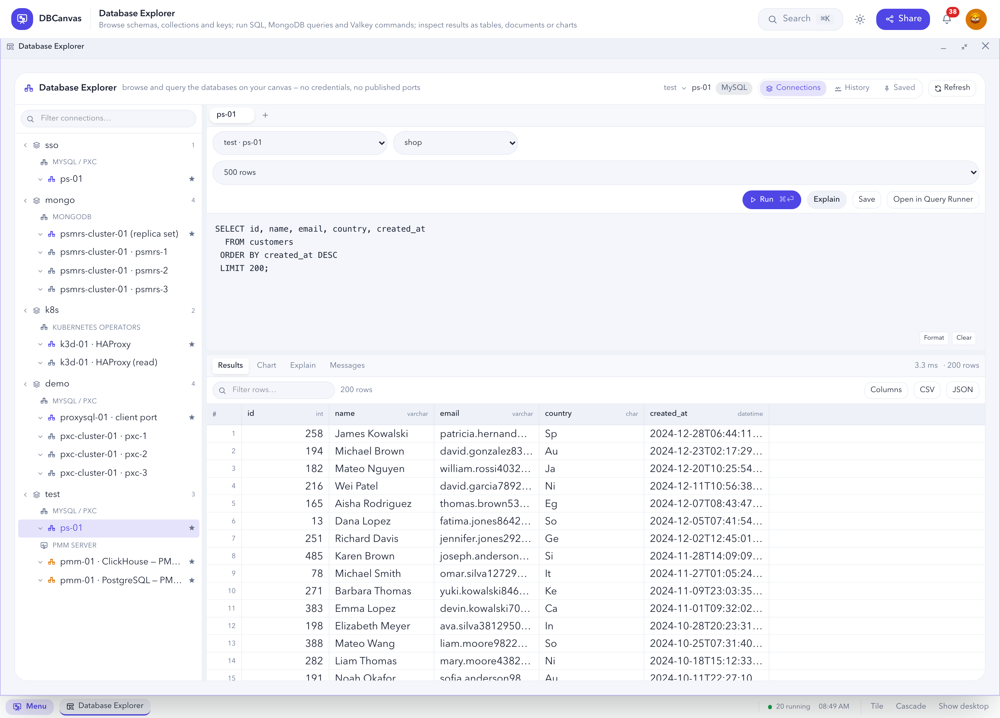

# Database Explorer

A database client in the browser for the databases your stacks deployed. Browse schemas,
collections and keys; run SQL, MongoDB queries and Valkey commands; view results as tables,
documents or charts. There is nothing to configure: DBCanvas already knows every node's address
and credentials, and no port has to be published to your host.

Open **Database Explorer** from the Menu.



> [!IMPORTANT]
> It will let you `DROP` a table. Use it only on lab databases.

## What it can reach

Every running database in your stacks (every stack, for an administrator):

| Tree heading | Includes |
| --- | --- |
| **MySQL / PXC** | Percona Server, PXC, MySQL Community, MariaDB, Group Replication/InnoDB Cluster members, and the proxies in front of them: HAProxy (write and read ports), ProxySQL (client port), MySQL Router (6446/6447) |
| **PostgreSQL** | Standalone, Patroni, repmgr and Spock nodes; HAProxy in front of a cluster; a PgBouncer pool |
| **MongoDB** | Standalones, a replica set as a whole and each member, a sharded cluster through `mongos` |
| **Valkey** | Standalones, and each shard of a Valkey cluster |
| **PMM Server** | PMM's internal PostgreSQL and its ClickHouse Query Analytics store, read-only — see [PMM Server](#pmm-server) |
| **Kubernetes operators** | Databases created by an operator in a K3D frame — see [Kubernetes clusters](#kubernetes-clusters) |

All-in-One nodes list each database instance inside them separately.

A ★ marks the endpoint an application would use — HAProxy's write port rather than one PXC
member, the replica set rather than a member, `mongos` rather than a shard. It sorts first.

The tree loads as you expand it: databases, then schemas or objects, then columns. A node that
is stopped or removed disappears on the next click. **Refresh** re-reads everything.

## Run SQL

MySQL, PostgreSQL and ClickHouse connections get a SQL editor and a result grid.

1. Pick a **Connection…**, then a **Database…** (and **Schema…** where there is one).
2. Choose the row limit (100 to 50,000; default 500).
3. Type a statement and press **Run**.

| Action | How |
| --- | --- |
| Run | **Run**, or `Ctrl`/`Cmd` + `Enter` |
| Run the selection, or the statement under the cursor | `Ctrl`/`Cmd` + `Shift` + `Enter` |
| Cancel a running query | **Cancel** |
| Tidy the whitespace | **Format** |
| Show the plan | **Explain** — `EXPLAIN FORMAT=JSON` on MySQL, `EXPLAIN (FORMAT JSON)` on PostgreSQL, `EXPLAIN` on ClickHouse. Never `ANALYZE`, so the statement does not run. |
| Keep a query | **Save** — listed under **Saved queries** |
| Send it to the Query Runner | **Open in Query Runner** (MySQL and PostgreSQL) |

Several statements can run together; each gets its own result set. The **Messages** tab lists
what each did: duration, rows returned or affected, and server warnings.

DBCanvas asks for confirmation before running a statement that starts with
`DROP`, `TRUNCATE`, `DELETE`, `ALTER`, `RENAME`, `GRANT`, `REVOKE`, `SHUTDOWN`, `FLUSH`,
`RESET` or `KILL`.

Each query times out after 30 seconds by default (maximum 300).

## Browse a table

Click a table to open it in a tab. The first 500 rows load in **Results**, with the `SELECT`
in the editor.

| Tab | Shows |
| --- | --- |
| **Overview** | Estimated row count (marked `~`), size, primary key, engine, owner, foreign keys, constraints, triggers |
| **Results** | The rows |
| **Columns** | Name, type, nullability, key, default, comment |
| **Indexes** | Columns, uniqueness, type, size |
| **DDL** | The table definition. PostgreSQL's is rebuilt from the catalogue, so it describes the table rather than repeating the original statement. |

## Work with results

- Large results scroll smoothly; only visible rows are drawn.
- `NULL` shows as `∅`; an empty string shows as nothing. CSV export keeps the difference
  (`NULL` is an empty field, `""` a quoted one).
- Binary values show as hex (`BINARY[3] 0x000102`); the value viewer has the full value in
  base64.
- Large integers (MySQL `BIGINT UNSIGNED`, ClickHouse `UInt64`) keep every digit.
- Numbers are right-aligned, booleans show as ✓ / ✗, timestamps as UTC RFC 3339 with
  milliseconds.
- Each column header shows the database type.
- Sort (a third click restores the original order), resize, drag to reorder, and hide columns.
- Search within the result, and download it as **CSV** or **JSON**.
- Values longer than 220 characters are cut; open the value viewer for the whole value, with
  JSON pretty-printed.

Right-click a cell for: **Copy cell**, **Copy row (TSV)**, **Copy column name**, **View full
value**, **View as JSON**, **Sort ascending/descending**, **Filter by this value**, and — where
the row can be edited — **Edit row…** and **Delete row…**.

When a result hits the row limit it is marked **truncated**.

## MongoDB

Pick a collection and an operation:

| Operation | Input |
| --- | --- |
| **find** | Filter, projection, sort and skip, as JSON |
| **aggregate** | A pipeline |
| **count**, **indexes**, **stats** | — |
| **command** | A command document, e.g. `{ "serverStatus": 1 }` |

```json
[
  { "$match": { "status": "active" } },
  { "$group": { "_id": "$country", "count": { "$sum": 1 } } }
]
```

Input is **Extended JSON**, so `{"_id": {"$oid": "507f1f77bcf86cd799439011"}}` matches a
document by id.

Results appear as **Documents** (a collapsible tree), **Raw JSON**, and a **Results** table with
top-level fields as columns, so charts, filters and exports work too.

A collection's columns are inferred from a sample of 100 documents. A field that is a string in
some documents and a number in others shows up as such.

## Valkey

The key browser lists keys with `SCAN` (never `KEYS`), filtered by pattern and type. Typing a
prefix such as `users:` searches for `users:*`. Each key shows its type, TTL and size.

| Type | View |
| --- | --- |
| string | The value, pretty-printed if it is JSON |
| hash | Field / value table |
| list | Indexed rows |
| set | Members |
| sorted set | Member / score table |
| stream | Entry ID / field / value table |

The console runs one command at a time — `GET foo`, `HGETALL user:100`, `INFO`,
`SLOWLOG GET 20` — and shows replies as tables (`INFO` as section / key / value). `KEYS` is
refused, as are commands that turn the connection into a stream (`SUBSCRIBE`, `PSUBSCRIBE`,
`SSUBSCRIBE`, `MONITOR`, `SYNC`, `PSYNC`). Errors such as `WRONGTYPE`, `NOAUTH`, `CROSSSLOT` and
`MOVED` are shown as returned; on a cluster, `MOVED` notes that the key is on another shard.

## Charts

Any result with a numeric column can be charted from the **Chart** tab: **Bar**, **Horizontal
bar**, **Line**, **Area**, **Pie**, **Donut**, **Scatter** or **Histogram**.

DBCanvas suggests a chart from the result's columns (`country | count` suggests a bar chart);
change any of it. Choose the category or X field, value or Y field, an optional series, an
aggregation (None, Sum, Average, Minimum, Maximum, Count of rows), a sort and a Top N.

Grouping, sorting and Top N apply only to the rows already returned — the query is not changed —
and the chart header says when they are on (*"1,204 rows grouped into 12 by country"*). Charts
have tooltips and a legend, follow the light or dark theme, and export as SVG.

## Edit data

A row can be edited only when it can be identified exactly: the table has a primary key, or a
unique index on non-nullable columns. Otherwise the **Overview** says why editing is not
available.

1. Right-click a cell → **Edit row…** or **Delete row…**, or press **+ Row** above the grid to insert.
2. Change the values. Tick **NULL** to write SQL `NULL` rather than an empty string.
3. Review the statement shown, then apply it. Deletes ask for a second confirmation.

| Engine | Editing |
| --- | --- |
| **MySQL, PostgreSQL** | Insert, edit and delete rows. |
| **MongoDB** | Insert, replace and delete documents by `_id`. Editing replaces the whole document. |
| **Valkey** | Set a string, set a hash field, push or replace a list element, add or remove a set member, add a sorted-set member with a score, set or clear a TTL, delete a key. |
| **ClickHouse** | No row editing. Use `ALTER TABLE … UPDATE` / `DELETE` in the editor. |

## Kubernetes clusters

Databases created by an operator inside a K3D frame appear under **Kubernetes operators**, one
entry per Service:

```
Kubernetes operators
├─ k3d-01 · pgBouncer      ★  LoadBalancer 172.20.255.238:5432
├─ k3d-01 · primary           ClusterIP — read through its pod
└─ k3d-01 · replicas          ClusterIP — read through its pod
```

Supported operators: Percona Operator for MySQL (PXC and Percona Server), Percona Operator for
MongoDB, Percona Operator for PostgreSQL, CloudNativePG and Crunchy Postgres for Kubernetes.
Services, pods and credentials are read from the cluster (refreshed at most every 20 seconds);
credentials come from the operator's own Secrets.

> [!NOTE]
> Endpoints have been verified on live Percona Operator for PostgreSQL clusters. For the other
> operators, a Service or Secret named differently in some operator version can leave an
> endpoint missing or failing.

How each Service type is reached:

| Service type | How |
| --- | --- |
| **LoadBalancer** | Connected directly — its address is on the stack's network. |
| **NodePort** | Connected at a k3s node's address. |
| **ClusterIP** | No outside address, so the database's own client runs inside one of its pods (`kubectl exec`). The entry says so. |

The `kubectl exec` route takes roughly 100 ms per statement and cannot cancel a running query.

Which tools can use them:

| Tool | LoadBalancer / NodePort | ClusterIP only |
| --- | --- | --- |
| **Database Explorer** | Yes | Yes |
| **Data Generator** | PostgreSQL primary and MongoDB | PostgreSQL primary |
| **Query Runner** | Yes | No — use Expose for tools |
| **Benchmark** | Yes | No — use Expose for tools |

MySQL clusters inside Kubernetes are not offered to the Data Generator.

### Expose for tools

To give a ClusterIP database an address the Query Runner and Benchmark can use, press **Expose
for tools** on its entry in the tree. DBCanvas adds a Service named `<service>-dbcanvas` next to
the operator's, with the same selector and port — a LoadBalancer, or a NodePort when the
cluster's eight LoadBalancer addresses are used up. The operator's own objects are not changed.

**Exposed — remove** deletes that Service again. Only Services DBCanvas created can be removed
this way.

A Service without a selector (how the PostgreSQL operators publish the primary) cannot be
exposed. Expose another tier, such as the pooler or the replicas, or change the Service type in
the frame's settings and redeploy.

## PMM Server

A PMM Server node shows two of PMM's internal databases:

| Entry | Contents |
| --- | --- |
| **PostgreSQL — PMM Internal** | PMM's inventory (nodes, services, agents, settings) and the `grafana` database (dashboards, users, data sources) |
| **ClickHouse — PMM Query Analytics** | The QAN store; `pmm.metrics` holds every collected query digest with its per-minute metrics |

Both are marked **(read only)** and carry this warning:

> These databases are used internally by PMM. DBCanvas exposes them for inspection and
> troubleshooting. Modifying PMM internal data may corrupt or break the PMM installation.

They listen only on loopback inside the PMM container, so DBCanvas runs the clients inside the
container. Writes are refused by the databases themselves: PostgreSQL statements run in a
read-only transaction (SQLSTATE 25006 on a write), and ClickHouse queries run in read-only mode
(error 164, `READONLY`). DBCanvas also refuses write statements before sending them
(`REFUSED: DROP is not allowed on a read-only connection`) and runs only one statement at a time
on a read-only connection.

### Writing to PMM's databases

Both of these are needed:

1. An administrator turns on **Settings → Writes to internal databases** (off by default; takes
   effect on the next query).
2. You press **Arm writes…** on the query tab's banner and confirm.

While armed, the banner is red, results are badged **ran with writes armed**, and row editing
works on tables with a usable key. **Disarm** ends it; changing the tab's connection also
disarms. Disarm and turn the setting off when you are done — edited PMM data can break PMM's
dashboards.

## History and saved queries

Every query you run is recorded for you: time, connection, database, statement, duration, row
count and success. Rerun, copy or delete an entry, or **Clear** them all. The latest 500 are
kept. An entry whose stack no longer exists cannot be rerun. Passwords are never stored.

**Saved queries** keep a name, engine, database and statement.

## Database Explorer or Query Runner?

| [Query Runner](QUERY_RUNNER.md) | Database Explorer |
| --- | --- |
| One statement, many times, in parallel | Many statements, once each |
| Concurrency, threads, time limits | Browsing, inspecting, charting |
| Processlist gating — "only while an `ALTER` is running" | Schemas, DDL, documents, keys, editing |

## Security

- Credentials stay on the server. No request or response carries a host, user or password.
- Every request is re-authorized against the stack's current state and your access to it.
- Results are capped and queries time out.
- Row editing requires an exact row identity, checked on the server.
- PMM's databases are read-only at the database; writing needs the administrator setting and an
  armed tab.

## TLS

For a node deployed with a certificate, the connection is verified against the stack's own CA
without checking the hostname (PostgreSQL calls this `verify-ca`), because DBCanvas connects by
IP address. A certificate not issued by the stack's CA is rejected. Nodes without a certificate
use encryption when the server offers it.

## Known limitations

- PostgreSQL DDL is rebuilt from the catalogue, not the original statement.
- A replica set is reached through one member; the driver does not fail over.
- A Valkey cluster is browsed one shard at a time.
- MongoDB columns are inferred from 100 documents.
- ClickHouse row estimates are zero for a table that has never been written to.
- Explain shows the plan as text or JSON, not a diagram.
- On a connection that runs the client inside the container (PMM, Kubernetes ClusterIP),
  cancelling stops the client process; on Kubernetes ClusterIP endpoints, Cancel is not offered.
