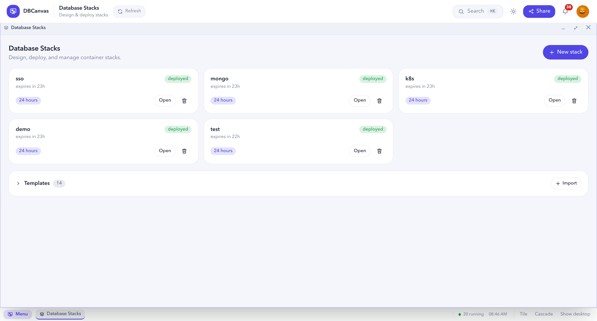

# Getting started

From an empty machine to a running cluster you can connect to. Already installed? Skip to
[Your first stack](#your-first-stack).

> [!IMPORTANT]
> **DBCanvas is for previewing features, testing and learning — not for production.** It
> deploys disposable lab infrastructure with default credentials from a `.env` file. Nothing is
> hardened. Do not deploy production infrastructure with it or keep data you care about on it.

- [Install](#install)
- [Create the admin account](#create-the-admin-account)
- [Where things are](#where-things-are)
- [Your first stack](#your-first-stack)
- [Building one by hand](#building-one-by-hand)
- [Operating a running node](#operating-a-running-node)
- [Connecting to your databases](#connecting-to-your-databases)
- [Putting load on it](#putting-load-on-it)
- [Watching it work](#watching-it-work)
- [Saving a topology for next time](#saving-a-topology-for-next-time)
- [Cleaning up](#cleaning-up)
- [When something goes wrong](#when-something-goes-wrong)

---

## Install

You need **Docker**. DBCanvas uses the Docker daemon's socket to create your stacks, which is a
privileged capability — run it on a machine you trust.

```sh
git clone https://github.com/jaimesicam/dbcanvas.git && cd dbcanvas
make install
```

`make install` builds the node images and starts DBCanvas at **http://localhost:8080**. The
first run takes a while. An image that fails to build does not stop the install; the node types
that need it say so when you validate a stack.

| Command | What it does |
| --- | --- |
| `make install` | First-time setup: every image, then start. |
| `make compose` | Rebuild the app and start it. The everyday command. |
| `make up` / `make down` | Start / stop without rebuilding. |
| `make logs` | Follow the application log. |
| `make versions` | Refresh the version pickers with newly released versions. Optional and slow (hours). Run `make restart` afterwards. |

Every setting has a working default. **Before exposing DBCanvas beyond your own machine, change
the passwords in `.env`** — see [Configuration](CONFIGURATION.md).

## Create the admin account

Open http://localhost:8080. The first account you create **becomes the administrator**.

By default, later sign-ups wait until an administrator approves them under **Manage Users**
(**Settings → Registration** changes this).

Lost the admin password? See
[Recovering an admin password](CONFIGURATION.md#recovering-an-admin-password).

## Where things are

Every page opens from the **Menu** button on the taskbar, or by double-clicking its desktop
icon. (Prefer a sidebar and tabs? Open **Appearance**, the sun icon at the top right, and choose
**Layout → Classic**.)

| Section | Pages |
| --- | --- |
| **Workspace** | **Dashboard** (what is running), **Database Stacks** (design, deploy and operate stacks — the main page), **Kanban** |
| **Data and queries** | **Data Generator**, **Database Explorer**, **Query Runner**, **Benchmark**, **Sample Client Code** |
| **Diagnose** | **Packet Inspector**, **Operator Debugger**, **Core Dump Analyzer**, **Stalk Summary**, **Log Summary**, **FTDC Summary**, **Operator Summary**, **Kubernetes States** |
| **System** | **Profile**, **API**, **Settings**, and for administrators **Manage Users** |

- **Choosing a page that is already open switches to it.** Right-click an entry to open another
  copy — two stacks side by side, say.
- **Open pages keep their state** (scroll position, filters, running work) while you look
  elsewhere. Up to 20 can be open at once; change this in **Settings → Tabs** (2–40). At the
  limit a new page does not open, and nothing is closed for you.
- **Hover a `?`** next to any field, panel value, toolbar button or library entry for what it is
  for and when to change it. Turn these off in **Settings → Tooltips → Hidden**.

## Your first stack

The fastest route is a template.

1. Go to **Database Stacks** → **New stack**.
2. Enter a **Name** and pick a template under **Start from**.
3. Pick a **Lifetime** — the stack is torn down when it elapses. Choose the shortest that covers
   your work; **Infinity** never expires.
4. Press **Create**. The topology appears on the canvas, ready to edit.


> *Picking a template shows what it builds and how many nodes it takes.*

5. Press **Validate** to check the design without building anything (missing links, impossible
   topologies, clashing host ports).
6. Press **Deploy**. Nodes come up in dependency order and the deployment console shows each
   step.
7. Wait for the node cards to show **running**.


> *`running` means the container is up and provisioning finished. A node that failed shows
> `error`, and the deployment console shows the failed step.*

A first deploy downloads packages, so it takes minutes. Later deploys are faster, especially
with **Use Intranet proxy** left on, which caches packages.

## Building one by hand

**Add the Intranet node first.** Other node types stay greyed out until it is on the canvas,
because it provides DNS, the certificate authority, OpenLDAP, mail and a package proxy for the
whole stack.

1. **Add nodes:** right-click the canvas and pick from the **Infrastructure Library** menu; the
   node lands where you clicked. Hover an entry to see what it provides, or why it is greyed
   out. (For a searchable column instead: **Settings → Adding nodes → Docked library**.)
2. **Connect them:** drag from one node's port to another — a database to a PMM server, a
   cluster to the ProxySQL in front of it, a backup tool to a SeaweedFS S3 node.
3. **Set options** in the **Properties** panel: OS and version, port export, TLS certificate,
   monitoring.
4. **Validate**, then **Deploy**.

Clusters live inside **frames** — a dashed box around the members. The frame's panel sets
cluster-wide options (name, version, replication mode); each member's panel sets that node's
options.

## Operating a running node

**Right-click a node** for its actions:


| Action | What it does |
| --- | --- |
| **View config / profile** | Image, version, credentials, certificate and the provisioning steps that ran. |
| **Enter root console** | A root shell inside the node, in the browser. |
| **File manager** | Browse files — upload, download, edit, change permissions. |
| **Copy docker exec command** | The command for a shell from your own terminal. |
| **Copy SSH tunnel command** | Only when `SSH_FORWARDING_HOST` is set — see [Connecting](#connecting-to-your-databases). |
| **Stop** / **Restart** / **Start** | Lifecycle. Data survives a stop. |
| **Delete node** | Removes the node and its container, and its data. |

**Click a node** to open its panel:


> *The **Overview** tab: what the node is, its network address, what monitors it, and the image
> and container it runs in.*

The tabs depend on the node type — for example **Overview**, **Credentials** and
**Diagnostics** on a database node, LDAP users and mail on the Intranet, a bucket browser on
SeaweedFS. On database nodes, **Diagnostics** captures a `pg_gather` report or a `pt-stalk`
archive for [Stalk Summary](STALK_SUMMARY.md).

## Connecting to your databases

**1. Web terminal.** Right-click → **Enter root console**. The database client is already
installed. **Settings → Terminal** chooses whether consoles open docked or in their own window.

**2. From another node.** Nodes resolve each other by name, so from any shell in the stack
`mysql -h ps-01.example.net -u root -p` works. The **Ubuntu VNC** node is a desktop with a
browser that resolves the stack's names and trusts its CA — use it for consoles not published
to the host, such as PMM or Keycloak.

**3. From your machine.** Tick **Export DB port to the host** before deploying. Leave **Host
port** at `0` to get a free port; the node's panel shows which. Connect to
`127.0.0.1:<port>`.

Credentials are on the node's **Credentials** tab:


> *Click a password to reveal it. Passwords come from `.env` and are the same on every node.*

**4. Through an SSH tunnel, when DBCanvas runs on a server.** Published ports bind to the
server's loopback by default (`CONTAINER_BIND_IP`), so your laptop cannot reach them directly.
Set `SSH_FORWARDING_HOST` in `.env` and right-click a running node → **Copy SSH tunnel
command**. It forwards every port the node publishes to the same port locally, so every address
DBCanvas shows works through the tunnel. The SSH login is your DBCanvas user name (signed in as
`alex`, you get `alex@10.0.0.7`) unless `.env` names a fixed `user@`.

## Putting load on it

| Tool | What it does |
| --- | --- |
| [**Data Generator**](DATA_GENERATOR.md) | Fills tables with realistic data at scale. Start here. |
| [**Database Explorer**](DATABASE_EXPLORER.md) | Browse and query any database in your stacks. |
| [**Query Runner**](QUERY_RUNNER.md) | Runs SQL across nodes in parallel, optionally gated on the processlist. |
| [**Benchmark**](BENCHMARK.md) | OLTP, OLAP, read-write and read-only workloads with throughput and latency. |
| **Demo applications** | Canvas nodes that drive continuous traffic — Hotel Sim, Airline Sim, Car Rental Sim, Stock Market Sim and others. Connect one to a database and it runs on its own. |

## Watching it work

| Tool | What it shows |
| --- | --- |
| **PMM** | Add a PMM node and set **Monitored by (PMM)** on your databases; they register at deploy. Open PMM from the VNC desktop, or from your browser if you exported its port. |
| **Dashboard** | Containers, CPU, memory and recent activity across your stacks. |
| [**Log Summary**](LOG_SUMMARY.md) | Several nodes' logs on one timeline, sorted by severity. |
| [**Packet Inspector**](PACKET_INSPECTOR.md) | Captures traffic on a node and decodes MySQL, PostgreSQL, MongoDB or Valkey. |
| [**Stalk Summary**](STALK_SUMMARY.md) / [**FTDC Summary**](FTDC_SUMMARY.md) | Charts and findings from a pt-stalk archive or MongoDB diagnostic data. |
| [**Kubernetes States**](KUBERNETES_STATES.md) | A live board of every object in a Kubernetes cluster — red when broken, highlighted when it changes. |

## Saving a topology for next time

- **Save as template** (designer toolbar) saves the canvas as a reusable template. Passwords,
  host paths and fixed host ports are not saved, so a template can be shared as a `.json` file.
- **Insert template** adds a saved topology to the current canvas. Nodes you can only have one
  of (Intranet, Keycloak, VNC desktop) are reused, clashing hostnames are renumbered, and the
  changes are reported.

Details: [Templates](STACKS.md#templates--save-a-topology-deploy-it-again).

## Cleaning up



- **Destroy** (designer toolbar) removes every container and volume but keeps the design, so you
  can deploy again. Data is lost.
- **Delete** (bin icon in the stack list) removes the stack and its containers.
- **Lifetime** — a stack is torn down automatically when it expires.

If the Dashboard shows more running than you expect, look there first.

## When something goes wrong

| Problem | What to do |
| --- | --- |
| **A deploy failed** | Open the deployment console and read the step that failed. The rest of the stack keeps running so you can investigate. |
| **A node shows `error`** | Right-click → **Enter root console** and check the service (`systemctl status`, then its log). **View config / profile** shows how far provisioning got. |
| **"Add an Intranet node first"** | Add the Intranet node; the rest of the library becomes available. |
| **A port is already taken** | A fixed **Host port** clashes with something else. Set it back to `0`. |
| **A version is missing from a picker** | Run `make versions`, then `make restart`. See [Troubleshooting](CONFIGURATION.md#troubleshooting). |
| **A published port is unreachable** | Check **Export … to the host** is ticked. If DBCanvas runs on another machine, use an [SSH tunnel](#connecting-to-your-databases). |

---

## Next

- [Stacks](STACKS.md) — every node and cluster type, and everything the canvas can do
- [Feature guides](README.md) — one page per tool
- [Configuration & commands](CONFIGURATION.md) — `.env`, `make` targets, troubleshooting
- [Architecture](ARCHITECTURE.md) — how it is built
