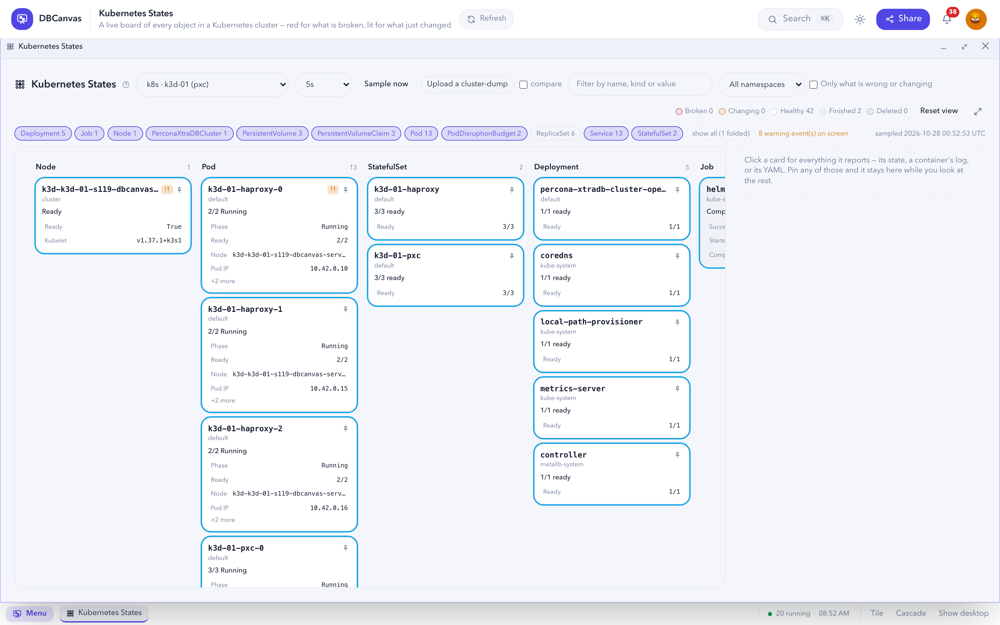

# Kubernetes States

**Kubernetes States** is a live board of every object in a Kubernetes cluster: one card per object,
red for what is broken, highlighted for what just changed, and a tombstone for what was deleted.
Keep it open while a failover, a rolling update or a backup runs. To read a captured cluster after
the fact, see [Operator Summary](OPERATOR_SUMMARY.md).

## Open it

- **Kubernetes States** in the sidebar (`#k8s-states`), then pick a source.
- **Watch Kubernetes states** on a K3D cluster's **server** node panel opens it on that cluster.

The page only reads. It never scales, deletes, restarts or patches anything.

## Sources

| Source | What it is |
| --- | --- |
| **Live clusters** | Any running Kubernetes frame in your stacks, sampled on a timer. |
| **Captures (pt-k8s-debug-collector)** | A `cluster-dump` kept by a cluster's **Diagnostics** tab. Captures remain after the cluster is gone. |
| **Uploaded** | A `cluster-dump.tar.gz` from your computer, via **Upload a cluster-dump**. It can come from any cluster. Uploads are kept in memory for one hour, visible only to you. |

A capture shows the same cards, colours and panes as a live cluster, with these differences:

- It is one moment in time, so nothing is highlighted as changed and there is no sample rate.
- It holds only what the collector could reach. If the collector logged errors, the board shows
  how many and quotes the first.
- Pod logs are the files the collector saved (see [Logs](#logs)).

### Compare two captures

Tick **compare**, then load another source. The board is kept instead of cleared: what changed is
highlighted with its old value, and what was in the first capture but not the second becomes a
tombstone.

### What a capture contains

| In the capture | Where you see it |
| --- | --- |
| Every resource type the collector saved, including custom resources from any operator | A card per object |
| Secrets | A card per Secret (key counts only) |
| Namespace events | Warning events in the **State** pane |
| Pod logs — one per container, or one per pod from older collectors | **Logs** pane |
| `pt-mysql-summary`, `pt-mongodb-summary` or pg_gather output | **Logs** pane |
| PXC pods: `mysqld-error.log`, the `innobackup.*.log` backup logs, `grastate.dat`, `gvwstate.dat` | **Logs** pane, backup logs listed first |
| PostgreSQL pods: server logs, pgBackRest logs, `pgbackrest info` and `patronictl list` output at capture time | **Logs** pane |
| TLS certificate details (`openssl x509 -text`) and the collector's `errors.txt` | **Capture files** |

**Capture files** (the chip next to the kind chips) lists every file in the archive, what it
belongs to, and its contents.

## Read the board

Built-in kinds each get a column: **Nodes**, **Pods**, **StatefulSets**, **Deployments**,
**ReplicaSets**, **Jobs**, **CronJobs**, **PersistentVolumeClaims**, **PersistentVolumes**,
**Services**, **PodDisruptionBudgets**, then the operator's custom resources (the cluster, its
backups and restores). A capture adds everything else it holds — ConfigMaps, Secrets,
StorageClasses, RBAC objects and any other custom resource.

Noisy kinds such as RBAC, ConfigMaps and ReplicaSets start **folded**: their chip shows the count,
and a click puts them on the board. **show all** unfolds every kind.

| Kind | Card shows |
| --- | --- |
| Pod | phase, ready *n*/*m*, restarts, node, IP, and a row for each container that is not simply running (`CrashLoopBackOff`, `ImagePullBackOff`, `Error (exit 3)`, `Running, not ready`) |
| StatefulSet / Deployment | ready *n*/*m*, updated *n*/*m* during a rollout, available |
| Job | active, succeeded, failed, start and finish times |
| CronJob | schedule, whether suspended, last run and last success |
| PersistentVolumeClaim | phase, capacity, storage class, volume |
| PersistentVolume | phase (**Released** means its claim is gone), capacity, reclaim policy, claim |
| Service | type, cluster IP, ports, LoadBalancer address |
| Node | Ready, any pressure condition that is True, cordoned, kubelet version |
| PodDisruptionBudget | healthy *n*/*m*, and `disruptionsAllowed: 0` (why a rolling restart may be waiting) |
| ConfigMap / Secret | number of keys and Secret type — never key names or values |
| Custom resource | its status, e.g. `state: ready`, and any condition that is not True |
| Kinds with no status (Roles, StorageClasses, …) | an uncoloured inventory card |

### Colours

| Colour | Meaning | Examples |
| --- | --- | --- |
| **Red** | The object reports itself broken | `Failed` pod · container in `CrashLoopBackOff` or `ImagePullBackOff` · container exited non-zero · `Lost` claim · `NotReady` node · custom resource in `error` · `Ready` condition `False` · workload with zero ready replicas |
| **Amber** | In progress, or short of its target | `Pending` · `ContainerCreating` · `Terminating` · ready 2/3 · restarts > 0 · LoadBalancer with no address yet · custom resource `initializing` |
| **Green** | Healthy | running, fully ready pod · 3/3 replicas · `Bound` claim · `state: ready` |
| **Grey** | Finished on purpose | `Succeeded` pod · completed Job · workload scaled to 0 |
| **Dashed grey** | Deleted | an object that disappeared between two samples |

Red only ever comes from the object's own status, never from events. A completed backup pod is
grey, not red. Inside a card, coloured rows come first, so you can see which container is failing.

### Changes and deletions

Each sample is compared with the previous one. A changed value is highlighted for about twelve
seconds with its old value, for example `Ready 2/3 (was 3/3)`. A new object gets its own highlight.

A deleted object stays on the board, dashed and struck through, showing its last state. Remove it
with the **✕** on its card, or **Dismiss *n* deleted** for all. Tombstones also show under **Only
what is wrong or changing**. They live in the browser tab: switching source or reloading starts a
fresh board.

## Inspect an object

Click a card to open it as a **pane** in the rail beside the board.

| Tab | Shows |
| --- | --- |
| **State** | Every property with its colour and change note, the owner, and up to five recent warning events (`BackOff`, `FailedScheduling`, `Unhealthy`, …) with repeat counts |
| **Logs** | One container's log (pods only) |
| **YAML** | The object as `kubectl get -o yaml` prints it, read-only |

Warning events explain a card's colour but never set it.

**Pin** a pane (the pin in its header, or on a card) to keep it in the rail while you click through
other objects. Pinned panes keep updating. Drag the divider to widen the rail, or maximize one pane
to fill the page (<kbd>Esc</kbd> to return).

### Logs

The pane opens on the container most worth reading — an unhealthy one if there is one, otherwise
the first regular container. Init containers are listed and marked.

| Control | What it does |
| --- | --- |
| Container | Which container's log. Broken containers are listed first and marked. |
| Lines | 100, 200 (default), 1000 or 5000 — the newest lines only. |
| follow | Re-read the log at every board sample. On by default. |
| previous | The log of the previous run (`kubectl logs --previous`). Offered once a container has restarted; for a `CrashLoopBackOff` it is the useful one. |

The pane scrolls to the newest line unless you have scrolled up. Notes from `kubectl` (which
container it defaulted to, or why a previous log is missing) are shown above the log.

From a capture the picker lists the files the collector kept for that pod, and the pane says which
file it is showing. If you ask for a file the capture does not have, it shows the pod's first file
and lists the rest.

### YAML

Read-only. `follow` is off by default here so the view does not jump while you read. From a capture
the YAML is the object as it was when the capture was taken. Change a cluster from its
[cr.yaml and Secrets editors](STACKS.md) instead.

## Controls

| Control | What it does |
| --- | --- |
| Source | A live cluster, a capture or an upload. Switching clears the board unless **compare** is ticked. |
| Sample rate | Live only: 2s, 5s (default), 15s, 1m or paused. |
| Sample now / Reload | Take one sample now, even when paused. Re-reads the archive for a capture. |
| Upload a cluster-dump | Load a `cluster-dump.tar.gz` from your computer. |
| compare | Keep the board when the source changes. |
| Filter box | Matches name, kind, summary or any property value — `crashloop` finds every crash-looping pod. |
| Namespace | One namespace, or **All namespaces**. |
| Only what is wrong or changing | Show only red, amber and deleted objects. |
| Kind chips | Fold or unfold a kind; the chip shows the count. |
| Capture files | Captures only: browse every file in the archive. |
| Dismiss *n* deleted | Clear all tombstones. |
| Reset view | Recentre the board at 100%. |
| Fill the window | Use the whole window. <kbd>Esc</kbd> returns. |

Drag the background to pan and use the mouse wheel to zoom.

Sampling pauses while the tab is hidden and takes a fresh sample when you return.

## Limits

- **Sampled, not watched.** An object created and deleted between two samples is never seen.
- **Logs are a tail.** The pane shows the newest lines only. Use the node's console for the full
  log.
- **Warning events** are limited to five per object, newest first.

## API

| To do this | Endpoint |
| --- | --- |
| List the clusters you can watch | `GET /api/k3d/states/targets` |
| Take one sample of a cluster | `GET /api/stacks/{id}/frames/{fid}/k3d/states` |
| Tail one container's log | `GET …/k3d/states/logs?namespace=&name=&container=&tail=&previous=1` |
| Read one object as YAML | `GET …/k3d/states/manifest?kind=&namespace=&name=` |
| Build the board from a kept capture | `POST /api/k8sstates/dumps/{did}` |
| Build it from an uploaded archive | `POST /api/k8sstates/upload` (multipart field `file`) |
| Read an object's YAML from an archive | `GET /api/k8sstates/archive/manifest?dump=&upload=&kind=&namespace=&name=` |
| Read a pod's saved files from an archive | `GET /api/k8sstates/archive/logs?dump=&upload=&namespace=&name=&file=` |
| List every file in an archive, or read one | `GET /api/k8sstates/archive/files?dump=&upload=&path=` |

A sample is `{objects, namespaces, kinds, clusterNamespace, operator, capturedAt, warnings}`. Each
object is `{uid, kind, namespace, name, tone, summary, owner, createdAt, props[], events[], containers[]}`
(`containers` on pods only), and each property is `{key, value, tone}`. `warnings` lists what the
sample could not read.

A log reply is `{text, note, error, truncated, tail, container, readAt}`. `note` is what `kubectl`
reported about a successful read; `error` is a read that did not happen (for example `previous` on
a container that never restarted). Neither is an HTTP error.
