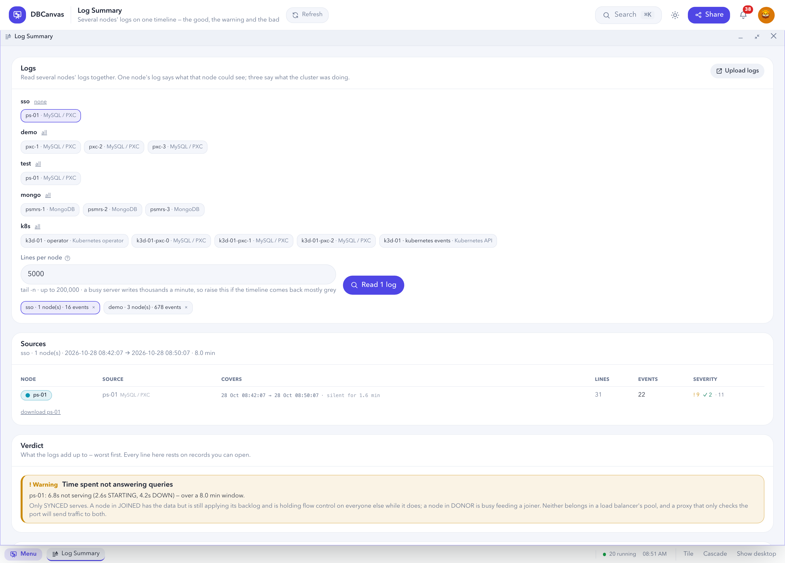

# Log Summary

Log Summary reads several database servers' logs together on one timeline, sorts every
record into **Good**, **Warning**, **Bad** or **Background**, and writes a verdict on what
the logs add up to. Use it when one node's log is not enough to explain what a cluster did.



Open it from the sidebar (**Log Summary**), from **Menu → Diagnose** on the desktop, or at
`#log-summary`. It complements the [Packet Inspector](PACKET_INSPECTOR.md): that page shows
what crossed the wire; this one shows what the servers said about themselves.

---

## Read logs from a stack

1. Deploy a stack, or open one that is already running.
2. In the **Logs** card, click each node you want. Use **all** beside a stack name to pick
   every node in it.
3. Set **Lines per node** — how much of each log to read back (default 5,000, maximum
   200,000).
4. Click **Read N logs**.

All the picked logs are read in one request and become one **bundle**. Pick nodes from a
single stack; if you pick from more than one, only the first stack's nodes are read.

> [!TIP]
> If the timeline comes back mostly grey, raise **Lines per node**. A busy server writes
> thousands of lines a minute, and a short tail may not reach back to the event you want.

### Which logs are read on each node

| Engine | Where the log comes from |
| --- | --- |
| MySQL, Percona Server, PXC | the server's error log (for example `/var/log/mysqld.log` or `/var/log/mysql/error.log`) |
| PostgreSQL | PostgreSQL's log file, **plus** the Patroni or repmgr journal when one of those runs on the node, as one source |
| MongoDB | the `mongod` / `mongos` log |
| Valkey | the log file if one exists, otherwise the systemd journal (which also carries systemd's own records, such as a process killed by signal) |

### Kubernetes (K3D) stacks

For a K3D frame running one of the supported operators, the picker lists every log the
cluster has:

| Source in the picker | What it is | Offered for |
| --- | --- | --- |
| `<cluster> · operator` | the operator's own log | all six operators |
| one entry per member pod | each member's database log | all six operators |
| `<pod> · backup agent` | the member's `pbm-agent` sidecar | Percona Operator for MongoDB |
| `<cluster> · binlog collector` | the point-in-time-recovery collector | Percona Operator for MySQL (PXC), when PITR is on |
| `<cluster> · kubernetes events` | the namespace's Kubernetes Events (`kubectl get events`) | all six operators |

Supported operators: Percona Operator for MySQL based on PXC, Percona Operator for MySQL
based on Percona Server, Percona Operator for MongoDB, Percona Operator for PostgreSQL,
Crunchy PGO, and CloudNativePG.

Member pods are listed from the running cluster, not from the custom resource, so a pod
that is mid-restart or unschedulable shows up as it really is. For PXC members the error
log is read from the data volume; if the member is not running, the copy kept by the pod's
log sidecar is used instead.

> [!NOTE]
> Kubernetes Events expire (one hour by default). An incident investigated the next day
> will usually have none, and their absence does not mean nothing happened.

---

## Upload log files

1. Click **Upload logs** in the **Logs** card.
2. Choose or drop up to **12** files, one per node, each up to **128 MB**.
3. Click **Read N logs**.

You do not need to name or label the files: the format is detected from the content. The
detector recognises MySQL/PXC, PostgreSQL (including Patroni), MongoDB and Valkey logs,
the six operators' logs, the PXC binlog collector's and `pbm-agent`'s logs, and the JSON
output of `kubectl get events -o json`.

Upload every member's log from the same period, not only the one that looks broken. A node
reporting that a peer went away is describing its own network as much as the peer, and only
the peer's log for the same seconds can tell the two apart.

---

## Manage bundles

- Each bundle appears as a chip under the **Logs** card (`<label> · N events`, marked
  `uploaded` for uploads). Click a chip to reopen it; click **×** to forget it.
- Bundles are kept in memory: the 12 most recent are kept, and all are lost when DBCanvas
  restarts.
- The raw text of every source is kept with the bundle. **download** links under the
  **Sources** table save each source exactly as it was read.
- From the [Operator Summary](OPERATOR_SUMMARY.md), **Open the timeline in Log Summary →**
  opens that archive's logs here as a bundle.

---

## Read the page

The page is laid out top to bottom as: **Sources**, **What the work cost** (MongoDB only),
**Verdict**, **Cluster timeline**, **Events** with the selected **Record**, and **What
happened most**.

### Sources

One row per log: **Node**, **Source** (file or container, with the engine), **Covers**
(first and last record), **Lines**, **Events**, and the count of each severity.

- A badge beside the node names what kind of member it is — for example *Galera member*,
  *Group Replication member*, *replica-set member*, *mongos router*, *Patroni member*,
  *Valkey Cluster member*, *backup agent* or *Kubernetes Events*.
- **silent for 2.1 h** after a range means the log was read from the node and nothing was
  written between its last record and the moment it was read. On a database that is usually
  good news: a healthy PXC member writes nothing under normal load.
- **No common period** means the logs do not overlap in time, so nothing on the timeline
  can be compared across nodes. Typical causes are files from different days, a rotated log,
  or a pod whose log starts after another's ends.
- Each node gets its own colour (cyan, blue, periwinkle, violet, magenta) on every chip,
  lane and row, always next to its name. A sixth source and beyond share a neutral chip.

### Severity

Severity comes from what a record **means**, not from the log's own level. A PXC node can
log a crash, an eviction and a full state transfer without one `[ERROR]`, while a healthy
InnoDB Cluster build logs many `[ERROR]` lines that are just MySQL Shell probing the
instance.

| Severity | Meaning | Examples |
| --- | --- | --- |
| ✓ **Good** | the cluster reached a healthy state | `Synchronized with group, ready for connections`, `Member synced with group`, `State transfer complete` |
| **!** **Warning** | degraded, transitional, or costly but working | `Shifting SYNCED -> DONOR/DESYNCED`, SST in progress, a probe failed |
| ✕ **Bad** | broken, gone, or refusing to serve | `Received NON-PRIMARY`, `declaring node … inactive`, a crash, a container OOM-killed |
| · **Background** | real records that are not news | quorum results, configuration dumps, pod lifecycle |

A record the log itself marked as an error, and that Log Summary does not recognise, is
never shown as Background. Every row shows the glyph and word as well as the colour.

### Verdict

Conclusions drawn from the whole bundle, worst first. Each one has a severity, a title,
what was found, and usually advice. **— show me** narrows the timeline to that moment and
shows every node's state there. See [What the verdict can report](#what-the-verdict-can-report).

When you drag a window on the timeline, the verdict narrows too:

- conclusions about a period are kept if they **overlap** the window;
- conclusions about an instant are kept if they fall **inside** it;
- conclusions about the bundle as a whole (configuration, "this log cannot show lag",
  "no common period") move to **About the whole bundle** and are never hidden.

**whole window** returns to the full bundle.

### Cluster timeline

One lane per node. The filled bar is the **state** the node was in; the ticks above it are
events, coloured by the worst one in each bucket.

- **Click** a point to see every node's state at that instant, side by side.
- **Drag** to narrow the verdict, the ticks and the event list to that window.
- **Zoom in**, **Zoom out**, **◀ Pan**, **Pan ▶**, **Whole window**, and **Resolution**
  (60–720 buckets) adjust the view.

A state the log states outright is drawn solid. A state Log Summary deduces — for example a
member that logged no transition and reports itself in the primary component must have
been `SYNCED` — is drawn faded and marked *deduced* in the tooltip. A deduced state never
extends before the source's first record; before that the lane is `UNKNOWN`.

See [Node states](#node-states) for every state and its colour.

### Events

The classified records, filtered and paged.

| Control | What it does |
| --- | --- |
| **Merged** / **By node** | one time-ordered column, or one column per node with the times on the left. **By node** makes it easy to see what each node was saying at the same moment. |
| **Show:** | toggle Bad, Warning, Good, Background |
| **Node:** | **Every node** or one node |
| **Kind** | one class of event: Start-up, Shutdown, Crash, Membership, Node state, State transfer, Network, Quorum, Flow control, Replication, Conflicts, Client connections, Storage, Configuration, Security, Reconcile, Backup, Restore, Rolling restart, Point-in-time recovery, Other |
| **Search** | match message, code, peer, or the plain-English meaning, for example `donor`, `SST`, `4567` |
| **Previous** / **Next** | page through the matches |

Two things change how rows look:

- **Repeats collapse.** Identical records fold into one row with a count and a span, such as
  `×24 over 47.3s`. State changes, membership changes and state transfers are never folded.
- **Multi-line records stay together.** A Galera view block, a crash report with its stack,
  or an operator error with its stack trace is one event, not one per line. Lines with no
  timestamp of their own take the neighbouring record's time and are marked `≈`.

### Record

Selecting an event shows its class, label, what it **means**, the time (local and UTC),
the source file and line, and any extracted facts (peer, state after, members, primary,
seqno). Below that are the record text and its **Continuation lines**.

**Show this in the file** shows the surrounding lines of the original log, so you can check
the reading. **scratchboard** sends those lines to the Scratchboard's Log filter.

Member UUIDs are replaced with node names wherever any log in the bundle names them, with
the UUID kept alongside.

### What happened most

The most common event types, worst first. Click one to filter the event list to it.

### What the work cost (MongoDB)

For each `mongod` with slow-operation lines: how many documents were examined against
returned, bytes read from disk, collection scans, the share of time spent waiting, the
busiest collections and the plans used. It also notes when the member is logging at debug
verbosity.

---

## What each log type covers

### MySQL and Percona XtraDB Cluster (Galera)

- **Flags:** crashes (including the signal handler's report, with the signal, build and
  whether a backtrace resolved), aborts and assertions, non-primary views, nodes declared
  suspected or inactive, evictions, state transfers (IST and SST) and their failures,
  desyncs, bootstraps, and a low flow-control interval.
- **Tells apart** a member that left cleanly from one that was lost: a lost member is
  preceded in the survivors' logs by reconnect attempts and a suspect timeout.
- **Cannot see:** flow-control pauses. Read `wsrep_flow_control_paused`, `_sent`, `_recv`
  and `wsrep_local_recv_queue_avg`, or the same series in PMM.

### MySQL asynchronous replication

- **Flags:** replication stopped (duplicate key, authentication failure, source purged
  binary logs the replica needed), whether it recovered, and source or replica crashes.
- **Reports** a replica that reconnected with nothing saying it had disconnected — the only
  trace an outage of the network path leaves.
- **Cannot see:** replication lag. Read `Seconds_Behind_Source` or
  `performance_schema.replication_applier_status_by_worker`.

### Group Replication and InnoDB Cluster

- **Flags:** members unreachable or expelled, loss of majority (all writes blocked) and
  whether it ever recovered, members refused at join, members that left and went back to
  accepting writes, servers that restarted and never rejoined, primary elections, clone
  recoveries, and members stuck recovering.
- **Files as Background** the `[ERROR]` lines MySQL Shell writes while it checks an
  instance (for example the `mysqlsh.test` channel), with an explanation.
- **Cannot see:** flow control. Read `performance_schema.replication_group_member_stats`.

### MongoDB (standalone, replica set, sharded cluster)

- **Flags:** elections and how long the set had no primary, members unreachable, rollbacks
  (with the operation count, collections and rollback file path), initial syncs, members
  that fell off the oplog, unclean shutdowns, sync-source churn, dropped connections, index
  builds, cache-size and host-setting warnings, and slow-operation costs.
- **mongos and config servers:** shards with no primary, and changes to the cluster's
  shape (shards added, collections sharded, chunks split, moved or merged — recorded by the
  config server primary).
- **Cannot see:** replication lag (use [FTDC Summary](FTDC_SUMMARY.md) on
  `diagnostic.data`), or failed routing on a `mongos`.

### PostgreSQL (standalone, streaming replication, Patroni, repmgr)

- **Flags:** promotions and failovers (planned or not), time with no primary, members
  rebuilt from the leader, diverged members whose writes were discarded, replication that
  cannot resume, standby queries cancelled by recovery, connection limit reached, Patroni
  losing the DCS, and checkpoints forced by WAL volume.
- **Severity note:** PostgreSQL's `FATAL` ends one connection, not the server, and most
  important records (promotions, timeline switches) are `LOG`. Severity follows meaning.
- **Performance advice** per member, from what the server reported: `max_wal_size` too
  small, checkpoint sync stalls, `work_mem` spills (with sizes), slow statements, lock
  waits and deadlocks — and a note when `log_min_duration_statement`, `log_temp_files` or
  `log_lock_waits` are off, because then a quiet log proves nothing.
- **Language:** messages are matched in English. A server with non-English `lc_messages`
  is only partly readable; adding `%e` (SQLSTATE) to `log_line_prefix` helps.
- **Cannot see:** replication lag. A standby logs `waiting for WAL to become available`
  whether it is up to date or receiving nothing.

### Valkey and Valkey Cluster

- **State comes from the role letter** on every line (`M`, `S`, …), so lanes are filled
  even for short excerpts.
- **Flags:** automatic and manual failovers, a cluster refusing every client because slots
  are uncovered (`CLUSTERDOWN`), a shard failing with nothing to take over, a returning
  primary whose writes were discarded, a server killed rather than stopped (from systemd's
  record), failed background saves, avoidable full resyncs, and promotions by hand.
- **Files as Background** the memory-overcommit and THP warnings every start prints.
- Cluster formation (slots not yet covered) is not reported as an outage.
- **Cannot see:** evictions, `MISCONF` write refusals, or failed logins. A failed
  background save in the bundle raises this note to a warning.

### Percona Operator for MySQL (PXC)

Read the operator, every member, the binlog collector and the Events together.

- **Operator:** restores and point-in-time restores (with the outage measured), backups
  that started and never succeeded, rolling restarts (order, duration, the pod treated as
  primary), and failures to reconcile. Retried `Reconciler error` records are grouped per
  fault.
- **Binlog collector:** PITR gaps (with the missing GTID range), source switches away from
  an unhealthy member, and a bundle with no collector at all (PITR may be off).
- **Members:** everything in the Galera section, plus a member shut down while it had no
  primary component — on Kubernetes that is the liveness probe, not an operator.
- **Configuration:** the effective `wsrep_provider_options` each member prints at start,
  reported as **What this cluster is actually configured with**, with advice on
  `gcache.size`, `gcs.fc_limit`, `gcs.fc_debug` and `evs.suspect_timeout`.
- **Honest note:** *The operator's log says nothing about N of the M incidents in the
  members' logs.* A quiet operator does not mean a healthy database.
- After a restore, the members' error logs restart from the restore, and PITR cannot
  cross it. Take a fresh full backup.

### Percona Operator for MongoDB (PSMDB)

Read the operator, every member, every backup agent and the Events together.

- **Operator:** cluster state (`ready`, `initializing`, `error`), how long it was held in
  `initializing`, blocked rolling restarts, restores, and the PITR span setting.
- **Backup agents:** which member is slicing the oplog (only one per replica set does;
  the others are idle by design), PITR enabled but not running (for example after a
  restore, until a new backup is taken), agents that cannot reach the cluster, and backups
  finished or failed.
- **Restores:** a logical restore runs with the cluster still accepting writes. Stop the
  application before restoring.
- **Configuration advice:** `spec.backup.pitr.oplogSpanMin` (your recovery point) and
  `storage.wiredTiger.engineConfig.cacheSizeGB`.

### Percona Operator for PostgreSQL, Crunchy PGO and CloudNativePG

- **Members:** Percona and Crunchy members run Patroni and are read like any Patroni node.
  CloudNativePG members' logs carry PostgreSQL's records inside the instance manager's
  JSON; they are unwrapped and read as PostgreSQL.
- **Operator:** CloudNativePG switchovers (with the write outage measured), WAL archiving
  failures, backups succeeded or none in the repository, restores (with the outage), and
  recoveries that created a new cluster beside the original.
- **Honest note:** the Percona and Crunchy operators log nothing about a failover — the
  story is in the members' Patroni records.

> [!NOTE]
> On the Percona Operator for PostgreSQL, change settings on the outer `PerconaPGCluster`.
> Edits to the inner `PostgresCluster` are reverted on the next reconcile.

### Percona Operator for MySQL (Percona Server)

The operator's log names the pod that receives the primary label after a failover. The
members' logs are Group Replication logs and are read as above.

### Kubernetes Events

Severity comes from the event's reason, not from Normal/Warning: **Killing** (a container
killed, for example after a failed liveness probe), **CrashLoopBackOff**,
**FailedScheduling**, failed mounts and evictions, and **OOMKilled** are Bad; failed probes
and node pressure are Warnings; pod lifecycle and volume provisioning are Background.
Repeated events are one row with a count and span.

---

## What the verdict can report

Not every bundle produces every item; each appears only when the logs support it. Titles
below are as shown on the page (N and durations are filled in).

| Area | Verdict titles |
| --- | --- |
| Any bundle | These logs do not cover a common period · Only one member's log is here · Nothing was written in this window · No problems found in this window |
| PXC / Galera | A server stopped abnormally · A node restarted after an unclean stop · A member was lost, not shut down · A member left the cluster cleanly · A node lost the primary component · The cluster split — one side kept quorum, the other did not · The nodes did not agree on who was in the cluster · Time spent not answering queries · A rejoin needed a full SST because the gcache was too small · A full state snapshot transfer ran · A state transfer failed · A member desynced itself from the group · A new cluster was bootstrapped · Flow-control pauses are not recorded in this log |
| Async replication | Replication stopped · Replication is still broken at the end of the log · A replica reconnected without anything saying it had disconnected · Replication lag is not recorded in this log |
| Group Replication | A member left the group and went back to accepting writes · A member has transactions the group does not, and was refused · A server restarted and never rejoined its group · The group elected a new primary · A member rebuilt itself from a clone · A member is stuck recovering and is not serving · Some of these errors are MySQL Shell testing the instance, not failures · Flow control leaves no trace in this log at all |
| MongoDB | Acknowledged writes were rolled back and lost · The set had no primary for … · The set elected a primary · A member could not be reached by the rest of the set · A member rebuilt itself from another member's data · … fell off the end of the oplog · Members could not settle on a sync source · Connections to … were dropped and re-made · Index builds in this window · WiredTiger cache configured at … · Replication lag is not in this log |
| MongoDB sharded | A shard had no primary to route writes to · A shard changed primary · The cluster's shape changed · Failed routing is not in the router's log |
| PostgreSQL | The cluster changed primary · The cluster had no primary for … · A member was rebuilt from the leader · A diverged member had its writes discarded · Replication cannot resume by itself · Patroni could not reach the DCS · … queries were cancelled on a standby by recovery · The connection limit was reached N time(s) · Checkpoints are being forced by WAL volume · How … was performing, from its own log · Replication lag is not in this log |
| Valkey | The cluster refused every client for … · A server was killed, not stopped · A returning primary had its writes discarded · A shard failed and nothing took over · A background save failed — writes were being refused · A full dataset copy ran N time(s) where a partial resync would have done · A node was promoted to primary by hand · A clean stop and a crash look identical from the other nodes · Evictions, MISCONF refusals and failed logins are not in this log |
| PXC operator | A restore / point-in-time restore — the cluster was down for … · N backup(s) completed · N backup(s) started and no success was recorded · Point-in-time recovery has a gap and cannot cross it · No binlog collector log is in this bundle · A rolling restart applied a configuration change to every member · The operator could not reconcile the cluster · A member was shut down while it had no primary component · The operator's log says nothing about N of the M incident(s) in the members' logs · What this cluster is actually configured with |
| PSMDB operator | Point-in-time recovery is switched on and is not running · The oplog is being sliced by … · No member recorded slicing the oplog · A restore ran with the cluster still accepting writes · A rolling restart was blocked for … · The operator held the cluster in `initializing` for … · A backup agent could not reach its cluster · N backup(s) finished / failed · What this cluster is actually configured with |
| PostgreSQL operators | CloudNativePG moved the primary — no writes for … · WAL archiving has been failing for … · N backup(s) succeeded · pgBackRest reports no backups in the repository · A restore took the cluster down for … · A recovery created a new cluster beside the original · The operator's log says nothing about N of the M incident(s) in the members' logs |

---

## Node states

| State | Severity | Meaning |
| --- | --- | --- |
| **Galera** | | |
| `SYNCED` | Good | serving queries, up to date with the group |
| `JOINED` | Warning | has the data, still applying its backlog; not in the read pool |
| `JOINER` | Warning | receiving a state transfer; answers nothing |
| `DONOR` | Warning | feeding a state transfer, desynced while it does |
| `PRIMARY-COMP` | Warning | in the primary component, not yet joined |
| `OPEN` | Bad | no primary component; refuses every query with error 1047 |
| `CLOSED` | Bad | the provider is shut down |
| **Group Replication** | | |
| `ONLINE` | Good | in the group, caught up, serving |
| `RECOVERING` | Warning | in the group, still applying the backlog |
| `BLOCKED` | Bad | cannot see a majority; writes refused, reads return stale data |
| `ERROR` | Bad | the plugin stopped on an error and the member left |
| `OFFLINE` | Bad | mysqld is up, Group Replication is not running |
| **MongoDB** | | |
| `PRIMARY` | Good | the member accepting writes (also used for PostgreSQL) |
| `SECONDARY` | Good | applying the oplog, serving reads |
| `ROUTING` | Good | a `mongos`, up and routing |
| `STARTUP2` | Warning | initial sync; serves nothing |
| `ARBITER` | Warning | votes, holds no data |
| `ROLLBACK` | Bad | discarding acknowledged writes |
| `REMOVED` | Bad | not in the replica-set configuration |
| **PostgreSQL** | | |
| `STANDBY` | Good | replaying WAL, read-only |
| `PROMOTING` | Warning | promotion requested, not finished |
| **Valkey** | | |
| `REPLICA` | Good | following a primary, answering reads |
| `SYNCING` | Warning | receiving a full copy of the dataset |
| `LOADING` | Warning | loading data from disk; refuses commands with `-LOADING` |
| `CLUSTERDOWN` | Bad | healthy, but refusing every command because another shard's slots are uncovered |
| **Servers not in a cluster** | | |
| `RUNNING` | Good | up and accepting connections |
| `STARTING` | Warning | starting up |
| **Kubernetes sources** | | |
| `LEADER` | Good | the operator holds the leader lease |
| `NOT-LEADER` | Warning | the operator is running and not reconciling |
| `COLLECTING` | Good | PXC binlogs are being uploaded |
| `PITR-GAP` | Bad | the binlog sequence has a gap; recovery cannot cross it |
| `PITR-OFF` | Bad | no binlog collector is running |
| `CR-READY` | Good | the MongoDB operator considers the cluster to match its spec |
| `CR-INIT` | Warning | the MongoDB operator is changing the cluster |
| `CR-ERROR` | Bad | the MongoDB operator could not reach its spec |
| `SLICING` | Good | this backup agent is streaming the oplog |
| `PBM-IDLE` | Warning | agent up; another member is slicing (normal) |
| `PBM-LOST` | Bad | agent cannot reach the cluster |
| `MANAGING` | Good | a CloudNativePG instance manager is running |
| `SWITCHOVER` | Warning | CloudNativePG is moving the primary; no writes until it finishes |
| **Any** | | |
| `DOWN` | Bad | the server is not running |
| `UNKNOWN` | grey | the log does not say |

---

## Clocks and time zones

MySQL timestamps carry their zone, so MySQL logs from servers in different time zones line
up without configuration.

Log Summary cannot correct host clock skew automatically. To shift one source, send its
offset in seconds through the API (there is no control for it on the page):

```
POST /api/logsummary/bundles/{id}/offset
{"src": 1, "offset": -2.5}
```

The bundle is re-read with the corrected times.

---

## CLI and API

From [`dbcanvas-cli`](CLI.md):

```
dbcanvas logs targets
dbcanvas logs collect <stack> --nodes pxc-01,pxc-02,pxc-03
dbcanvas logs list
dbcanvas logs get <bundle-id>
dbcanvas logs events <bundle-id> --severity bad,warn --limit 50
dbcanvas logs delete <bundle-id>
```

Without `--nodes`, `logs collect` reads every node in the stack that has logs to read.

| Method | Path | Purpose |
| --- | --- | --- |
| GET | `/api/logsummary/targets` | nodes and Kubernetes sources you can read |
| POST | `/api/logsummary/collect` | read nodes' logs: `{"stackId", "nodeIds", "lines", "label"}` |
| POST | `/api/logsummary/upload` | multipart upload: `files` (up to 12), optional `label` and `engine` |
| GET | `/api/logsummary/bundles` | list bundles |
| GET | `/api/logsummary/bundles/{id}` | one bundle with its verdict |
| DELETE | `/api/logsummary/bundles/{id}` | forget a bundle |
| GET | `/api/logsummary/bundles/{id}/events` | events: `sev` (comma list of `bad,warn,ok,info`), `src`, `class`, `q`, `fromTs`, `toTs`, `limit` (1–2000, default 200), `offset` |
| GET | `/api/logsummary/bundles/{id}/timeline` | lanes and ticks: same filters plus `buckets` (2–1000, default 180) |
| GET | `/api/logsummary/bundles/{id}/at?at=<unix-seconds>` | every node's state at one instant |
| GET | `/api/logsummary/bundles/{id}/sources/{src}/raw` | download a source; with `line` and `context`, just the lines around it |
| POST | `/api/logsummary/bundles/{id}/offset` | set a source's clock offset |

See [HTTP API](API.md) for authentication and the [API reference](API_REFERENCE.md) for
every endpoint.
