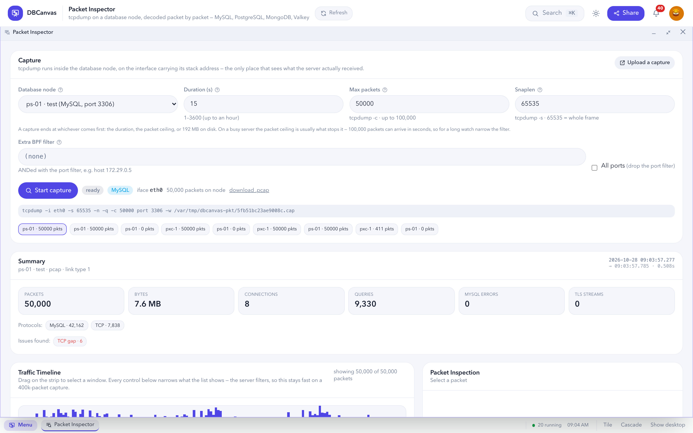
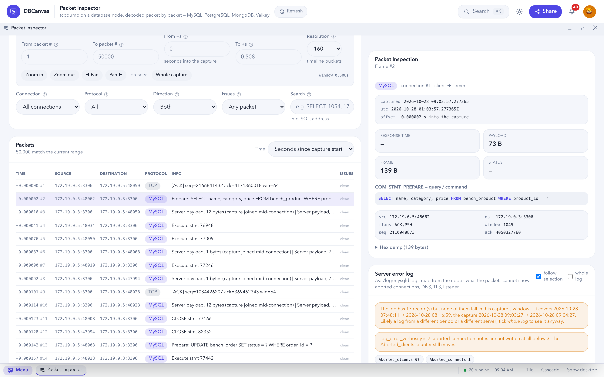
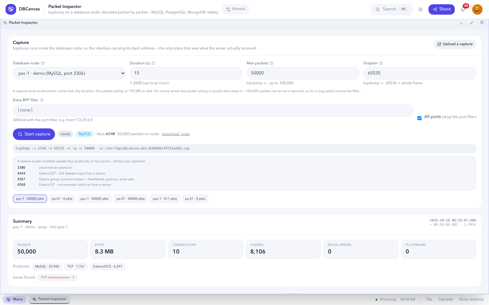

# Packet Inspector

Packet Inspector runs `tcpdump` on a database node and decodes what it captured. You see the
statements, the responses, the response times and the network problems underneath them:
retransmissions, gaps, resets and zero windows. Use it to find out what actually crossed the
wire and what the server sent back, which the slow log and `SHOW PROCESSLIST` cannot tell you.

Open it from the sidebar (**Packet Inspector**) or at `#packet-inspector`.



> *A 20-second capture on a Percona Server node in which every connection is encrypted. The
> summary says so and tells you what to do about it, instead of showing an empty query list.*

## Supported databases

| Family | Nodes | Cluster traffic captured as well |
| --- | --- | --- |
| **MySQL** | Percona Server, PXC, MySQL Community, MariaDB (including Galera), All-in-One MySQL instances | Galera on 4567, 4568 and 4444 (PXC and MariaDB Galera) |
| **PostgreSQL** | PostgreSQL, Patroni, repmgr, Spock, All-in-One PostgreSQL instances | Patroni REST API on 8008 and etcd on 2379/2380 (Patroni) |
| **MongoDB** | Percona Server for MongoDB: standalone, replica set and sharded cluster (mongod, mongos and config servers), All-in-One MongoDB instances | everything is on 27017 |
| **Valkey** | Valkey standalone or clustered, All-in-One Valkey instances | cluster bus on the client port + 10000 (16379) and Sentinel on 26379 (clustered nodes) |

Where each engine puts its traffic:

| | Clients | Replication | Cluster control |
| --- | --- | --- | --- |
| MySQL/PXC | 3306 | binlog stream on 3306 | Galera on 4567, 4568, 4444 |
| PostgreSQL/Patroni | 5432 | WAL streaming on 5432 | Patroni REST 8008, etcd 2379/2380 |
| MongoDB | 27017 | oplog tailing on 27017 | heartbeats, elections, routing on 27017 |
| Valkey | 6379 | PSYNC on 6379 | cluster bus on 16379 |

All-in-One instances use their own slot's ports instead of the defaults. The **Capture**
card lists every port a capture covered.

## Capture traffic on a node

1. In the **Capture** card, pick a **Database node**. Only running MySQL, PostgreSQL,
   MongoDB and Valkey nodes are listed.
2. Set the limits. The capture stops at whichever is reached first:

   | Field | Default | Range |
   | --- | --- | --- |
   | **Duration (s)** | 20 | 1–3600 |
   | **Max packets** (`tcpdump -c`) | 50,000 | 100–100,000 |
   | **Snaplen** (`tcpdump -s`) | 65535 (whole frame) | 64 and up |
   | Size on disk | 192 MB | fixed |

3. Optionally narrow it with an **Extra BPF filter**, for example `host 10.0.0.7`. The filter
   is ANDed with the port filter, so it can narrow the capture but never widen it. Tick
   **All ports** to drop the port filter.
4. Click **Start capture**. The exact `tcpdump` command is shown under the button, for example:

   ```
   tcpdump -i eth0 -s 65535 -n -q -c 50000 port 3306 -w …
   tcpdump -i eth0 -s 65535 -n -q -c 50000 (port 3306 or port 4444 or port 4567 or port 4568) -w …
   ```

5. Click **Stop capture** to end it early. When it is ready, **download .pcap** gives you the
   raw file.

What to know about where the capture runs:

- `tcpdump` runs **inside the database node**, on the interface that holds the node's stack
  address. It is installed on first use.
- **Clients on the node itself do not appear.** Traffic to the node's own address from inside
  the node goes over loopback. Generate the traffic from another node.
- **On a busy server the packet limit ends the capture first.** 100,000 packets can arrive
  in seconds. For a long watch, narrow the filter.
- **Loss on the server's own outgoing traffic is not visible.** Packets dropped after
  tcpdump's tap point are never recorded. To see retransmissions and gaps at the server,
  inject loss on the client.

## Decode a capture file you already have

1. Click **Upload a capture**.
2. Choose the **Capture file** (`.pcap`, `.pcapng` or `.cap`).
3. Optionally add a **Server log** covering the same period. Its records are shown against
   the capture's timeline (see [Read the server error log](#read-the-server-error-log)).
4. Leave **Protocol** on **Detect automatically**, or pick MySQL, PostgreSQL, MongoDB or
   Valkey.
5. Leave **Server port** blank to use the protocol's default port. Fill it in if the traffic
   was on a different port. All-in-One instances, for example, never use 3306 or 5432.
6. Click **Upload and decode**.

Automatic detection reads the bytes first. When a capture holds no database payload, such
as a Patroni capture that is all HTTP, the ports decide: 8008/2379/2380 mean PostgreSQL,
4567/4568/4444 mean MySQL, 27017 means MongoDB and 6379/16379/26379 mean Valkey. The
capture's badge shows which protocol it was decoded as.

To capture by hand in the same way:

```
tcpdump -i eth0 -s 65535 -n -q -c 50000 port 3306 -w /tmp/mysql.cap
tcpdump -i eth0 -s 65535 -n -q -c 50000 '(port 5432 or port 8008 or port 2379)' -w /tmp/pg.cap
tcpdump -i eth0 -s 65535 -n -q -c 50000 port 27017 -w /tmp/mongo.cap
tcpdump -i eth0 -s 65535 -n -q -c 50000 '(port 6379 or port 16379)' -w /tmp/valkey.cap
```

## Read the results



The page has five parts:

- **Summary**: packets, bytes, connections, queries, server version and TLS streams, the
  protocols seen and the issues found. Click a protocol or an issue to filter by it.
- **Traffic Timeline**: a density strip, with errors in red and warnings in amber.
- **Packets**: the decoded list, one page at a time.
- **Packet Inspection**: the selected frame's timing, TCP state, a payload summary and a hex
  dump. On a wide screen it stays in view while the list scrolls.
- **Server error log**: the node's log, narrowed to the capture's window.

### Pick a time range

| Control | Use |
| --- | --- |
| Drag on the strip | Select a window. |
| **From packet # / To packet #** | Exact packet numbers. |
| **From +s / To +s** | Seconds into the capture, to the millisecond. |
| **Zoom in / Zoom out · ◀ Pan / Pan ▶** | Halve, double or slide the window. |
| **last 1s / 5s / 10s · Whole capture** | Presets. |
| **Resolution** | Timeline buckets: 40, 80, 160, 320 or 640. |

### Filter packets

| Filter | Options |
| --- | --- |
| **Connection** | All connections, or one connection (shows client address, TLS and user) |
| **Protocol** | Any protocol in the capture, e.g. `MySQL`, `Galera/GCS`, `MongoDB/heartbeat` |
| **Direction** | Both, Client → server, Server → client |
| **Issues** | Any packet, Only packets with issues |
| **Search** | Free text over the info line, the SQL and the addresses |

### Choose how times are shown

The **Time** selector above the packet list sets the format:

| Mode | Example |
| --- | --- |
| **Seconds since capture start** (default) | `+5.500000` |
| **Time of day** | `19:19:01.501234` |
| **Date and time** | `2026-08-03 19:19:01.501234` |
| **UTC (ISO)** | `2026-08-03 11:19:01.501234Z` |
| **Delta from previous row** | `+0.000181` |

Times are shown in your browser's timezone. Hover over a time to see it in UTC. The detail
panel shows local time, UTC and the offset.

## Issues that are flagged

These apply to every engine:

| Issue | Meaning |
| --- | --- |
| **TCP retransmission** | Bytes were sent again because something dropped them. |
| **TCP gap** (N bytes missing) | The capture never saw bytes that the sequence numbers account for. |
| **TCP duplicate ACK** | The peer is signalling loss. |
| **TCP zero window** | The receiver's buffer is full. |
| **TCP reset** | The connection was closed abruptly. |
| **Connection refused** | A SYN was answered with a reset. |
| **Connection attempt unanswered** | Nothing ever answered a SYN. |
| **High latency** / **Slow response** | More than 100 ms to the first response byte (50 ms for Valkey). |
| **Heavy result set** / **Heavy reply** | A single response over 1 MB. |
| **TLS alert** | A TLS handshake or session was rejected. |

The sections below list what each engine adds.

### Connections already open when the capture starts

Most connections on a busy server are older than the capture. Until the decoder can tell
where a message starts, those frames are labelled *"capture joined mid-connection"*.
Normally the stream lines up again within one round trip. Error packets, replication
streams and MongoDB messages are recognised even before that.

## MySQL

**Decoded:** the server greeting (version, connection id), login user, `COM_QUERY` and the
other commands, OK/ERR/EOF, result sets (columns, rows, bytes), prepared statements and
replication (`COM_BINLOG_DUMP` and the binlog events). Messages that are split across TCP
segments, including packets over 16 MiB, are put back together and reported on the frame
that completed them.

Warnings in an OK packet are shown in the info line but not flagged.

### MySQL errors you can see in a capture

These server errors reach the client, so they are in the capture. Each one is flagged with
its label and code:

| Code | Shown as |
| --- | --- |
| 1152 / 1184 | Aborted connection |
| 1153 | Packet bigger than max_allowed_packet (the server then resets the connection) |
| 1154 / 1155 | Read error from the connection pipe / fcntl() error |
| 1156 | Packets out of order |
| 1157 | Could not uncompress a packet |
| 1158 / 1159 | Error / timeout reading communication packets |
| 1160 / 1161 | Error / timeout writing communication packets |
| 1835 | Malformed communication packet |
| 1189 / 1190 | Replication: net error reading/writing source |
| 1040 / 1203 | Too many connections / user over max_user_connections |
| 1042 | Cannot resolve the client's address |
| 1043 | Bad handshake |
| 1045 | Authentication failed |
| 1047 | Unknown command, or on PXC **Node not ready for application use (1047 wsrep)** |
| 1053 | Server shutdown in progress |
| 1129 / 1130 | Host blocked / not allowed to connect |
| 1205, 1213 | Lock wait timeout, deadlock |
| 1290 / 1836 | Read-only |
| 1301 | Result truncated at max_allowed_packet (nothing oversized crossed the wire) |
| 1317 | Query interrupted |

Codes that are not in the table are still reported, with their message. A network error
during login is labelled **Connection dropped during handshake**.

Errors that the client library reports itself (2xxx codes) never cross the wire. The
capture shows the evidence for them instead:

| The client reports | The capture shows |
| --- | --- |
| `2003` CR_CONN_HOST_ERROR | **Connection refused** or **Connection attempt unanswered** |
| `2013` CR_SERVER_LOST | A reset while a command was waiting for its answer |
| `2006` CR_SERVER_GONE_ERROR | The same, with a FIN instead of a reset |
| `2026` / `2075` | **TLS alert** |
| `2027` CR_MALFORMED_PACKET | **MySQL packet sequence expected N, got M** |
| `2020` CR_NET_PACKET_TOO_LARGE | The server's `1153`, usually followed by a reset |
| `2065` / `2066` | **Compressed protocol negotiated** |

**Compressed connections** (zlib or zstd) cannot be read past the handshake. They are
labelled `MySQL/compressed`.

The third kind of MySQL network error (aborted connections, DNS and listener failures) is
written only to the server's error log. See
[Read the server error log](#read-the-server-error-log).

## PXC and MariaDB Galera



A capture on a Galera node covers four ports:

| Port | Carries | Protocol column |
| --- | --- | --- |
| 3306 | client traffic, fully decoded | `MySQL` |
| 4567 | group communication: heartbeats, quorum, write-set replication | `Galera/GCS` |
| 4568 | IST, the incremental catch-up of a rejoining member | `Galera/IST` |
| 4444 | SST, a full copy of the dataset from a donor | `Galera/SST` |

Galera's own protocols are not decoded. You see their volume, direction and continuity,
and for a state transfer its total size and stream format (xbstream, rsync, gzip/zstd or
SQL text). Flagged events are **Galera IST started**, **Galera SST started** and
**Galera SST is large** (once a transfer passes 1 MB). Retransmissions and gaps on 4567 are
the usual cause of a cluster that keeps evicting members.

## PostgreSQL

**Decoded:** startup (user, database, `application_name`), authentication (SCRAM, md5,
cleartext, GSSAPI), simple and extended queries (Parse/Bind/Describe/Execute/Sync), row
descriptions and data rows, `CommandComplete` tags, errors and notices with SQLSTATE, COPY,
`ReadyForQuery` with its transaction status, and physical and logical replication.

| Shown as | What it is |
| --- | --- |
| `StartupMessage 3.0: user=app database=rental application_name=app` | connection parameters |
| `AuthenticationSASL: SCRAM-SHA-256` → … → `AuthenticationSASLFinal` | authentication steps |
| `Query: SELECT id, plate FROM cars WHERE branch_id = 12` | a simple query |
| `Parse "s1": UPDATE …` / `Bind "s1" → …` / `Execute portal unnamed` | extended protocol; the Bind shows the SQL from its Parse |
| `Result set complete: 2 row(s), 3 column(s), 180 B — SELECT 2` | a finished result set |
| `ReadyForQuery (in transaction), 1.2 ms` | end of the cycle, with the round-trip time |
| `ERROR 40P01 (deadlock_detected): … \| detail: … \| hint: …` | an error in full |

A result set without a column count is normal: extended-protocol clients ask for the row
description only once per statement.

### PostgreSQL errors that are flagged

| Class | States |
| --- | --- |
| Connection | `08000` `08001` `08003` `08004` `08006` `08007` `08P01` |
| Authorization | `28000` `28P01` (a missing `pg_hba.conf` entry is reported separately from a wrong password) |
| Database does not exist | `3D000` |
| Resources | `53100` disk full, `53200` out of memory, `53300` too many connections, `53400` configuration limit |
| Object state | `55000` `55006` `55P03` (lock not available) |
| Operator intervention | `57014` cancelled, `57P01` admin shutdown, `57P02` crash shutdown, `57P03` cannot connect now, `57P05` idle session timeout |
| System error | `58000` `58030` `58P01` |
| Concurrency | `40001` serialization failure, `40P01` deadlock |
| Transaction state | `25006` read-only (a write reached a standby), `25P02`, `25P03` idle-in-transaction timeout |
| Permission | `42501` |
| Internal / corruption | `XX000` `XX001` `XX002` |

Ordinary SQL errors such as `23505`, `42601` and `42P01` are shown but not flagged. `57014`
is labelled by its message: statement timeout, client cancel, lock timeout or a recovery
conflict on a standby. A **FATAL** is marked separately because the server closes the
connection after it.

### Replication

| Shown as | Meaning |
| --- | --- |
| `XLogData: 1.4 KB WAL at 0/25211F38` | the primary streaming WAL |
| `Standby status: write …, flush …, apply …, 24.0 MB behind` | the standby's position, and how far behind it is |
| `Primary keepalive: WAL end …, reply requested` | the primary asking the standby to reply |
| `BEGIN xid 821` / `INSERT on public.cars` / `COMMIT at …` | logical replication with pgoutput |
| `Query: BASE_BACKUP (…)` | a new standby cloning this server |

**Replication lag** is flagged when a standby falls more than 16 MB behind. A primary still
waiting for a reply it asked for is flagged as well.

### Findings that only a capture can show

- Cleartext password authentication on an unencrypted connection
- A connection opened and closed without sending anything (a health check or port scan)
- A connection opened and closed without running a statement (pool churn)
- **Idle in transaction for N s**
- The same statement parsed N times as an unnamed prepared statement
- SSL refused by the server
- Unrecognised protocol version in a startup message
- Query cancellation requested for backend pid N

## Patroni

A capture on a Patroni node covers 5432, 8008, 2379 and 2380:

| Port | Carries | Protocol column |
| --- | --- | --- |
| 5432 | client sessions and WAL streaming | `PostgreSQL` |
| 8008 | Patroni REST API: HAProxy health checks, `patronictl`, `/cluster` | `Patroni/REST` |
| 2379 | etcd client API, where the leader lock is held | `etcd/client` |
| 2380 | etcd peer (raft) traffic, reported by volume | `etcd/raft` |

REST calls are explained by endpoint. For example, `GET /primary → 200 OK` means this
member is the leader. A **503** on `/primary` is normal for a replica and is not flagged.
A **500** is flagged. etcd calls such as `/v3/lease/keepalive` and `/v3/kv/txn` are named
and explained. An etcd **5xx** is flagged because a member that cannot reach etcd gives up
the leader lock. HTTP/2 traffic is described by frame type only.

## MongoDB

**Decoded:** OP_MSG, OP_QUERY/OP_REPLY and OP_COMPRESSED, including the BSON inside them.
That covers the command and its namespace, filters, sorts, pipelines, document sequences,
cursors and counts, errors, `writeErrors`, `writeConcernError`, sessions and transactions.
Snappy and zlib compression are decompressed. zstd is named but not decoded.

Everything shares port 27017, so each connection is classified by what it contains. You
can filter on these in the **Protocol** column:

| Protocol | Traffic |
| --- | --- |
| `MongoDB` | application commands |
| `MongoDB/monitor` | `hello` / `isMaster` polling |
| `MongoDB/heartbeat` | replica-set heartbeats |
| `MongoDB/oplog` | oplog tailing (replication) |
| `MongoDB/replpos` | `replSetUpdatePosition` |
| `MongoDB/election` | votes and step-ups |
| `MongoDB/config` | reads of the config servers |
| `MongoDB/routed` | mongos → shard |
| `MongoDB/internal` | other internal traffic |

On a busy replica-set member most frames can be `replpos` and heartbeats. Filter those out
to see the application traffic.

| Shown as | What it is |
| --- | --- |
| `find shop.orders — filter {status: "confirmed"}, sort {createdAt: -1}, limit 20` | a command |
| `insert shop.orders — 3 document(s) in a "documents" sequence, 1.2 KB` | a bulk insert |
| `aggregate shop.orders — 3-stage pipeline: $match → $group → $sort` | an aggregation |
| `hello admin — driver …, app …` | which driver and application opened the connection |
| `find → 2 doc(s) in firstBatch, cursor … stays open (2.4 ms)` | the reply and its round trip |
| `[snappy] find …` | a compressed message |

### MongoDB errors that are flagged

A failed command arrives as an ordinary reply with `ok: 0`. Partial failures
(`writeErrors`, `writeConcernError`) arrive inside replies that report success.

| Family | Codes |
| --- | --- |
| Primary | `10107` NotWritablePrimary, `189` PrimarySteppedDown, `11602` InterruptedDueToReplStateChange, `91` ShutdownInProgress |
| Read preference | `13435`, `13436`, `133` FailedToSatisfyReadPreference |
| Network | `6` HostUnreachable, `7` HostNotFound, `89` NetworkTimeout, `9001` SocketException |
| Durability | `64` WriteConcernFailed, `79` UnknownReplWriteConcern, `100` UnsatisfiableWriteConcern |
| Contention | `112` WriteConflict, `24` LockTimeout, `251` NoSuchTransaction, `225` TransactionTooOld |
| Sharding | `13388` StaleConfig, `63` StaleShardVersion, `82` NoProgressMade, `118` CannotSplit |
| Auth | `18` AuthenticationFailed (as `__system` it means a keyFile mismatch), `13` Unauthorized, `11` UserNotFound |
| Cursors | `43` CursorNotFound, `237` CursorKilled |
| Limits | `50` MaxTimeMSExpired, `262` ExceededTimeLimit, `292` QueryExceededMemoryLimitNoDiskUseAllowed |

These are never flagged: `11000` DuplicateKey, `26` NamespaceNotFound, `59` CommandNotFound,
`72` InvalidOptions, and time limits on a tailing cursor.

### Other MongoDB events that are flagged

- Election in progress (`replSetRequestVotes`), `replSetStepDown` / `replSetStepUp`
- Replica-set configuration change
- Chunk migration (`moveChunk`, `_shardsvrMoveRange`)
- `shutdown`
- Legacy opcodes (OP_INSERT, OP_UPDATE, OP_DELETE, OP_GET_MORE, OP_KILL_CURSORS), which were
  removed in MongoDB 5.1
- A connection opened and closed without sending anything
- Replies over 1 MB, and responses over 100 ms (`hello` waits and tailing `getMore` calls
  are excluded because they block on purpose)

On a mongos, connections in both directions use 27017. Each message's header shows which
side sent it.

## Valkey

**Decoded:** RESP2 and RESP3, including commands with their keys and arguments, every reply
type, pipelines (replies are matched to commands in order), error replies, pub/sub delivery,
and replication. The binary cluster bus is decoded as well.

| Port | Carries | Protocol column |
| --- | --- | --- |
| 6379 | clients and replication | `Valkey`, `Valkey/replication`, `Valkey/pubsub`, `Valkey/monitor` |
| 16379 | cluster bus (client port + 10000) | `Valkey/bus` |
| 26379 | Sentinel | `Valkey/sentinel` |

| Shown as | What it is |
| --- | --- |
| `SET session:abc ← … (16 bytes) [EX 1800]` | a command with its key, value size and expiry |
| `GET → "alice" (0.3 ms)` | a reply and its round trip |
| `HGETALL → {…4 fields}` | large replies are summarised |
| `AUTH user default, password (not shown)` | passwords are never displayed |
| `HELLO protocol 3` | the RESP version in use |
| `push: message on "news", 17 bytes` | a pub/sub message |

The password is never shown. A password sent over an unencrypted connection is flagged.

### Valkey errors that are flagged

| Family | Codes |
| --- | --- |
| Redirects | `MOVED` (the slot moved permanently), `ASK` (the slot is being migrated) |
| Cluster not serving | `CLUSTERDOWN`, `TRYAGAIN`, `CROSSSLOT`, `MASTERDOWN` |
| Writes refused | `LOADING`, `MISCONF`, `READONLY`, `OOM`, `NOREPLICAS` |
| Auth | `NOAUTH`, `WRONGPASS`, `NOPERM` |
| Scripting | `BUSY`, `UNKILLABLE` |

These are never flagged: `WRONGTYPE`, plain `ERR`, `NOSCRIPT` and `EXECABORT`.

### Commands that are flagged

These are flagged once per connection: `KEYS`, `FLUSHALL` / `FLUSHDB`, `SAVE`,
`DEBUG SLEEP`, `SCRIPT FLUSH`, `CONFIG SET`, `MONITOR`, `SHUTDOWN` / `FAILOVER` /
`CLUSTER FAILOVER`, and any reply slower than 50 ms. Blocking commands such as `BLPOP`,
`XREAD`, `WAIT`, `SUBSCRIBE` and `PSYNC` are excluded from the slow-reply check.

### Replication

You see the handshake (`REPLCONF`, `PSYNC`), `+FULLRESYNC` (a full copy of the dataset)
or `+CONTINUE` (only the missing data), the keep-alive newlines sent while the primary
forks, the RDB transfer (disk-based or diskless), the stream of propagated writes, and the
`REPLCONF ACK` offsets that show lag.

### Cluster bus

Each message shows its type, sender, how many slots the sender claims, its epochs and its
offset. `PING` and `PONG` are not flagged. These are: **MEET**, **FAIL**,
**FAILOVER_AUTH_REQUEST**, **FAILOVER_AUTH_ACK**, **UPDATE**, **MFSTART** and a rising epoch.

## DNS and ARP

Captures also decode the non-database traffic that often explains a failure:

| Event | Meaning |
| --- | --- |
| `DNS query A host.example.net` / `DNS response … (2.0 ms)` | a normal lookup, with its latency |
| **DNS NXDOMAIN / SERVFAIL / REFUSED** | the name did not resolve (MySQL client `2005`, libpq "could not translate host name") |
| **DNS returned no A record** | flagged for `A`, `SRV` and `PTR` only; empty `AAAA` answers are normal |
| **DNS query unanswered** / **Slow DNS response** (over 100 ms) | |
| **Gratuitous ARP** | an address announcing itself, as a virtual IP does when it moves |
| **ARP conflict** | two MAC addresses claiming one IP |
| **ARP unanswered** | the address cannot be reached at layer 2 |

## Read the server error log

Some failures are written only to the server's log: aborted connections, DNS failures,
TLS and certificate problems, and listener errors. A capture cannot contain them.

- **A capture taken on a node** reads that node's log automatically.
- **An uploaded capture** uses the **Server log** you uploaded with it. Timestamps in UTC
  or with an offset are both accepted.

The log is narrowed to the capture's window plus 30 seconds either side. Tick **whole log**
to see all of it. If no record overlaps the capture, the panel says so and shows both time
ranges.

**The log follows the packet list.** When you select a packet, the panel scrolls to the
nearest record and states the offset (for example `Nearest record to frame #1221:
−0.200 s`). Records within 2 seconds are tinted. Untick **follow selection** to stop the
scrolling. **Clicking a record** jumps the packet list to that moment. Your range and
filters stay as they are.

| | MySQL | PostgreSQL | MongoDB | Valkey |
| --- | --- | --- | --- | --- |
| Read from | `/var/log/mysqld.log`, `/var/log/mysql/error.log`, `/var/log/mysql/mysqld.log` | the newest `postgresql-*.log` under the data directory or `/var/log/postgresql`; also Patroni's own log file | `/var/log/mongo/mongod.log` (or `mongos.log`), `/var/log/mongodb/…` | `/var/log/valkey/*.log`, otherwise the systemd journal (`valkey@*`) |
| Also shows | `Aborted_clients`, `Aborted_connects`, `Connection_errors_*`, `log_error_verbosity` | — | — | the role letter (`M` primary, `S` replica) in each line |

Log records are grouped into the same classes for every engine: aborted, auth, dns,
listener, tls, replication, lifecycle and cluster. PostgreSQL `DETAIL`, `HINT`,
`STATEMENT` and `CONTEXT` lines are folded into the record above them. MongoDB `Slow query`
records include the plan summary and examined counts, which the wire does not carry.

For MySQL, keep in mind:

- With `log_error_verbosity` below 3, aborted connections are never logged. The panel
  warns you when this is the case.
- A client that simply disappears increments `Aborted_clients` without writing a log line.
  That is why the counters are shown next to the log.

## Encrypted traffic

Packet Inspector does not decrypt anything. For a TLS connection you see the handshake
steps, record sizes, timing, response latency and every TCP problem, but not the
statements.

Encryption is often on by default:

- **MySQL 8** clients default to `--ssl-mode=PREFERRED`, and `caching_sha2_password`
  refuses to send a password over an unencrypted connection.
- **psql and libpq** default to `sslmode=prefer`.
- **MongoDB** and **Valkey** have no in-band upgrade, so a TLS connection is unreadable
  from its first byte.

To read the statements, either:

1. **Turn TLS off for the diagnostic window** and capture again. On MySQL use
   `--ssl-mode=DISABLED` with a `mysql_native_password` account or with
   `--get-server-public-key`. On PostgreSQL use `PGSSLMODE=disable`. On MongoDB use
   `tls=false`. On Valkey use the plaintext port.
2. **Ask the server what it ran.** On MySQL that is the general log or
   `performance_schema`. On PostgreSQL it is `log_statement` or `pg_stat_statements`. On
   MongoDB it is `Slow query` log records or `system.profile`. On Valkey it is `SLOWLOG` or
   `MONITOR`.

On PostgreSQL, a server with `ssl = off` answers `SSLRequest` with `N`. Clients set to
`prefer` or `allow` then carry on in the clear and are fully decoded. Clients set to
`require` or `verify-*` disconnect. The refusal is flagged once per connection.

## Limits

- **Captures are kept in memory only.** The newest 12, whether taken here or uploaded,
  stay available, and all of them are lost when DBCanvas restarts. Download anything you
  want to keep. Uploaded files are not written to disk.
- **Capture limits:** 3600 s, 100,000 packets and 192 MB. A capture stopped by the size
  limit says so.
- **Decode limit:** 400,000 packets. A capture over the limit reports how many packets were
  skipped.
- **Dropped packets:** `packets dropped by kernel` in the summary means the traffic
  outran tcpdump. The decode is still valid for what was captured.
- **Snaplen:** a snaplen below 65535 cuts payloads short. The summary counts truncated
  frames.
- **One protocol per capture.** If a file holds two engines' traffic, one of them is shown
  as plain TCP.
- **Cut-off transfers:** a capture that ends during a large MySQL packet shows the rest as
  `[continuation] N bytes, M buffered`.
- **Large captures:** Valkey cluster captures are mostly bus traffic, and a full resync
  captures the whole dataset. MongoDB replica-set captures reach the packet limit quickly.
  Use the Protocol filter instead of capturing for longer.

---

See also: [Log Summary](LOG_SUMMARY.md) · [FTDC Summary](FTDC_SUMMARY.md) · [Stacks](STACKS.md)
