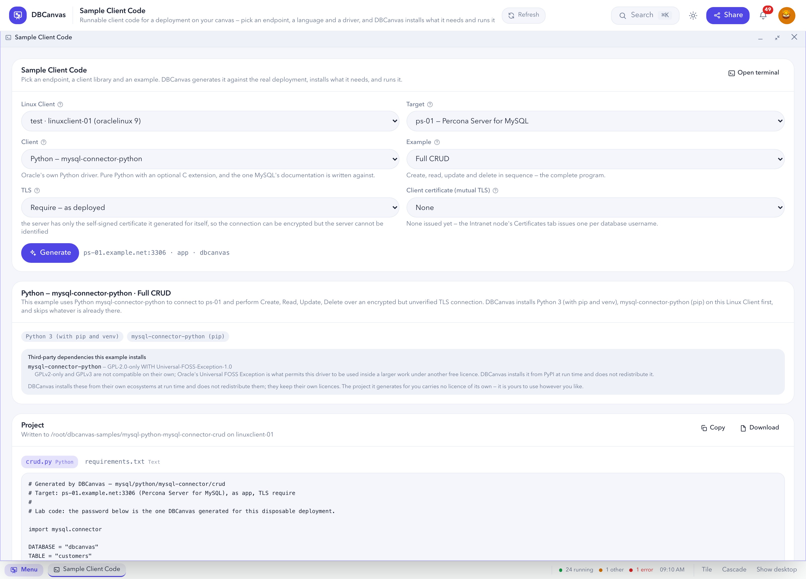

# Sample Client Code

**Sample Client Code** writes a runnable client program for a database you deployed, puts it on a
Linux Client, installs what it needs, and runs it. Host, port, account, password and TLS settings
come from the real deployment, so the program works without edits.



## Generate and run a sample

1. Deploy a database, and a **Linux Client** in the same stack (designer group **Storage &
   Clients**).
2. Open **Sample Client Code** — from **Menu → Data and queries**, at `#sample-code`, or with the
   **Sample Client Code** button in a deployed Linux Client's panel or right-click menu (this
   opens the page on that node).
3. Pick the **Linux Client**, the **Target**, the **Client** and the **Example**. Adjust **TLS** and
   **Client certificate (mutual TLS)** if you need to.
4. Press **Generate**. The page shows the project files, what the example requires, and the
   third-party dependencies it will install with their licences.
5. Press **Run**. DBCanvas installs whatever is missing, runs the program, and shows each command,
   its output and the exit code.

### Targets

Only endpoints in the Linux Client's own stack are offered, because the generated code reaches
hosts by their stack DNS names.

| Target | Notes |
| --- | --- |
| Every running database node | Including each member of a cluster |
| A MongoDB **replica set** | The member list and set name, so the driver follows a failover |
| A **Valkey cluster** | The seed list a cluster-aware client starts from |
| **HAProxy** · write port, · read port | Two endpoints; a write through the read port fails |
| **ProxySQL** · client port | ProxySQL splits reads and writes itself |
| **MySQL Router** 6446 and 6447 (Group Replication) | 6446 reaches the primary, 6447 a secondary |
| **PgBouncer** · pool, · read-only pool | The read-only pool appears when PgBouncer routes reads and writes separately; writes through it are refused |
| Each instance in an **All in One** node | Each with its own port and credentials |

### Clients

The **Client** list shows only the libraries for the target's engine.

| Language | MySQL family | PostgreSQL | MongoDB | Valkey |
| --- | --- | --- | --- | --- |
| Python | mysql-connector-python, PyMySQL | psycopg 3 | PyMongo | valkey-py |
| Node.js | mysql2 | pg (node-postgres) | mongodb (Node.js driver) | iovalkey |
| Go | database/sql + go-sql-driver/mysql | database/sql + pgx | mongo-driver | go-redis (UniversalClient) |
| Java | JDBC (MySQL Connector/J), JDBC + HikariCP | JDBC (pgJDBC), JDBC + HikariCP | MongoDB Java Driver (sync) | valkey-java |
| C# (.NET) | MySqlConnector | Npgsql | MongoDB C# Driver | StackExchange.Redis |
| Shell / native client | mysql (command line) | psql (command line) | mongosh | valkey-cli |

The **MySQL family** is Percona Server, PXC, MySQL Community and MariaDB. **PostgreSQL** covers
Percona Distribution for PostgreSQL, Patroni, repmgr and Spock. **MongoDB** is Percona Server for
MongoDB, standalone, replica set or sharded. **Valkey** is standalone or cluster.

Two drivers for the same server (PyMySQL beside mysql-connector-python, plain JDBC beside
HikariCP) let you tell a driver problem from a server problem.

### Examples

| Example | What it does |
| --- | --- |
| Connection Test | Connects, asks the server for its version, disconnects |
| Create | Creates the table (or collection, or keys) and inserts one row |
| Read | Inserts a row, then reads it back |
| Update | Inserts a row, changes it, reads the change back |
| Delete | Inserts a row, deletes it, confirms it is gone |
| Full CRUD | Create, read, update and delete in sequence |

When an example inserts a row only so it has something to work on, the output says `SEED`
rather than `CREATE`.

Every sample uses a database called **`dbcanvas`** and the same `customers` data:

| Engine | Data |
| --- | --- |
| SQL | Table `customers`: `id`, `name`, `email`, `created_at` |
| MongoDB | Collection `customers`, one document per customer, unique index on `email` |
| Valkey | A hash per customer at `{dbcanvas}:customer:<id>`, a set of ids and a counter. The braces keep all keys in one cluster slot, so the same program runs on a standalone node and a cluster |

## Page actions

| Action | What it does |
| --- | --- |
| **Copy** / **Download** | The file on screen, to the clipboard or to your machine |
| **Run** | Prepares the environment if needed, then runs the program |
| **Prepare environment** | Installs the runtime, driver and native client without running anything |
| **Save to Linux Client** | Writes the project to `/root/dbcanvas-samples/<sample>/` |
| **Reset** | Removes that one project directory; shared caches stay |
| **Stop** | Stops a run in progress |
| **Open terminal** | A root shell on the Linux Client |

A non-zero exit is the program's own result, not a DBCanvas failure — for example a write against
a read-only endpoint, or a TLS mode the server does not accept.

### Project files

| Language | Files |
| --- | --- |
| Python | `crud.py`, `requirements.txt` |
| Node.js | `crud.js`, `package.json` |
| Go | `main.go`, `go.mod` |
| Java | `pom.xml`, `src/main/java/DbCanvasCrud.java` |
| C# | `Program.cs`, `DbCanvasSample.csproj` |
| Shell | `crud.sh` (`crud.js` for mongosh) |

The projects have no framework scaffolding and also build outside the Linux Client.

## What gets installed

A Linux Client starts as a bare OS. On **Run** or **Prepare environment**, DBCanvas checks each
requirement, installs only what is missing, and reports the rest as already installed, so a
second run installs nothing. Example transcript:

```
Preparing environment
✓ Python 3 (with pip and venv): installed
· mysql-connector-python: missing
$ /root/dbcanvas-samples/.venv/bin/pip install mysql-connector-python
✓ Environment ready.

Running mysql-connector-python
$ cd /root/dbcanvas-samples/mysql-python-mysql-connector-crud && .venv/bin/python crud.py
Connected to ps-01.example.net:3306 - MySQL 8.4.0-1
...
Full CRUD example completed successfully.
✓ Finished — exit 0.
```

- Runtimes and native clients come from the OS package manager; libraries come from pip, npm,
  Go modules, Maven or NuGet.
- Native clients (`mysql`, `psql`, `mongosh`, `valkey-cli`) come from Percona's repositories, at
  the series the target runs.
- Only what the chosen sample needs is installed — a JDK and Maven only for Java, and so on.
- If the node was deployed with **Use Intranet proxy (Squid)**, pip, npm, Go, Maven and `dotnet`
  use the proxy too.
- Go always runs `go mod tidy`; against a warm module cache it fetches nothing.

Shared caches, reused by every sample of the same language and kept by **Reset**:

| Language | Cache |
| --- | --- |
| Python | One virtualenv per node, `/root/dbcanvas-samples/.venv` |
| Node.js | `node_modules` in the project |
| Go | Module cache under `/root/go` |
| Java | `~/.m2` |
| C# | `/root/.nuget/packages` |

Linux Client OSes: Oracle Linux 8/9/10, Ubuntu 22.04/24.04, Debian 12/13, and CentOS 7 with
`EOL=on`.

**.NET:** Oracle Linux and Ubuntu 24.04 install the .NET 10 SDK from the OS; Ubuntu 22.04 installs
.NET 8. Debian 12 and 13 get .NET SDK 10.0.401 from Microsoft's download archive (pinned,
checksum-verified; no Microsoft package repository is added). Projects target `net8.0` and roll
forward.

### CentOS 7

With `EOL=on`, a Linux Client can run CentOS 7 (see [Stacks](STACKS.md)). Its own packages are too
old for current drivers, so these are used instead:

| Needs | On CentOS 7 |
| --- | --- |
| Python ≥ 3.8 | `rh-python38` from Software Collections |
| Node.js | 22.23.2, the Node.js project's glibc 2.17 build; x86_64 only |
| Go | 1.27.1 upstream archive |
| JDK | Eclipse Temurin 21.0.12.1 |
| Maven | Apache Maven 3.9.16 |
| `mysql` | Percona Server 8.0 client (5.7 client for a 5.7 target) |
| `psql` | Percona Distribution for PostgreSQL 13 client for any newer target |
| `mongosh` | 2.1.5 |

Not available on CentOS 7, and marked so in the **Client** list: **C#** (the .NET SDK needs a newer
libstdc++) and **valkey-cli** (no Valkey build for CentOS 7).

## TLS

The **TLS** field defaults to how the endpoint was deployed, marked **— as deployed**, and the page
explains the choice. Change it if you changed the server since.

| Endpoint | Default |
| --- | --- |
| MySQL or PostgreSQL with a generated certificate | **Verify** (chain and hostname, against the stack CA already trusted on the Linux Client) |
| MySQL without one | **Require** (encrypted, server not verified) |
| PostgreSQL without one | **Off** |
| MongoDB with TLS turned on at deploy | **Verify** |
| MongoDB otherwise | **Off** — switch to **Verify** after enabling TLS from the node's TLS tab |
| Valkey | **Off** |
| HAProxy, ProxySQL | **Off** — the backend's certificate would not match the proxy's name |
| PgBouncer | **Off** unless PgBouncer was deployed with a certificate |

The generated code uses each driver's own TLS options (for example `sslmode=verify-full` for
libpq-based clients, `sslMode=VERIFY_IDENTITY` for Connector/J). For Java, DBCanvas builds a
PKCS#12 truststore with `keytool` first (pgJDBC reads the PEM directly).

> [!NOTE]
> A node deployed before DBCanvas 0.0.6 has a certificate without a `subjectAltName`, which Go and
> Java clients reject. Press **Reissue certificate** on the node's certificate tab and restart the
> server.

### Mutual TLS

Pick a **Client certificate** to have the sample present one. The list shows certificates the
Intranet CA has issued; issue one per database user from the Intranet node's **Certificates** tab.
DBCanvas copies the certificate and key from the Intranet to the Linux Client (the key never
reaches your browser) and writes the forms the drivers need: `client-cert.pem`, `client-key.pem`,
`client.pem` (both combined), `keystore.p12` and `client-key.pk8`. A client certificate with TLS
**Off** is refused.

## JDBC and HikariCP

**JDBC** builds the URL from the deployment, for example:

```
jdbc:mysql://ps-01.example.net:3306/dbcanvas?createDatabaseIfNotExist=true&sslMode=VERIFY_IDENTITY&…
jdbc:postgresql://patroni-01.example.net:5432/dbcanvas?sslmode=verify-full&sslrootcert=…
```

Comments in the file explain `createDatabaseIfNotExist`, `sslMode`, and
`allowPublicKeyRetrieval` (needed for `caching_sha2_password` over an unencrypted connection).

**JDBC + HikariCP** uses the same URL behind a connection pool (`MAX_POOL_SIZE = 5`,
`MIN_IDLE = 1` — lab values, not tuning advice). On PostgreSQL, the `dbcanvas` database is created
over a plain connection before the pool starts.

## Licensing

DBCanvas is licensed under the GNU General Public License v3.0 (see `LICENSE`).

**Generated projects are not.** As an explicit exception, DBCanvas places no restrictions on the
sample projects this feature generates — source files and manifests (`requirements.txt`,
`package.json`, `go.mod`, `pom.xml`, `DbCanvasSample.csproj`). Use, modify and redistribute them
under any licence. The exception does not change the licence of any third-party component.

Drivers keep their own licences. DBCanvas installs them from their ecosystems at run time and does
not redistribute them. The example code is written against the drivers' public APIs, not copied
from their examples. The page lists each dependency's licence before anything is installed.

| Dependency | Licence |
| --- | --- |
| mysql-connector-python, MySQL Connector/J | GPL-2.0-only WITH Universal-FOSS-Exception-1.0 |
| PyMySQL, valkey-py, iovalkey, valkey-java, mysql2, pg, pgx, slf4j-api, slf4j-simple, MySqlConnector, StackExchange.Redis | MIT |
| Npgsql | PostgreSQL |
| psycopg 3 | LGPL-3.0 |
| pgJDBC, go-redis | BSD-2-Clause |
| go-sql-driver/mysql | MPL-2.0 |
| PyMongo, MongoDB drivers (Node.js, Go, Java, C#), HikariCP, mongosh | Apache-2.0 |
| OpenJDK (Temurin or the OS build) | GPL-2.0-only WITH Classpath-exception-2.0 |
| .NET SDK | MIT |

- **PyMySQL** (MIT) is offered as an alternative to mysql-connector-python, and **MySqlConnector**
  (MIT) is used for C# instead of Oracle's Connector/NET.
- HikariCP samples log through **slf4j-simple**, with **slf4j-api 2.0.19** declared explicitly.

If you redistribute a generated project together with its dependencies, check each dependency's
own licence. This section describes what was checked; it is not legal advice.

## Troubleshooting

| Symptom | What to do |
| --- | --- |
| The page says there is no running Linux Client | Add a Linux Client from the designer's **Storage & Clients** group and deploy it. Samples run only on a Linux Client, never on a database node |
| The **Target** list is empty | Nothing in that Linux Client's stack is a running database yet |
| `x509: certificate relies on legacy Common Name field` | Reissue the server certificate and restart the server, or set TLS to **Require** |
| A package will not install | The log shows the command and the error. Usually the node has no internet route (enable **Use Intranet proxy (Squid)** and redeploy). Anything installed by hand is detected on the next run |
| Maven or Go is slow the first time | The first run fills an empty cache; later runs reuse it |
| `--super-read-only` | The endpoint is a replica |
| `Public Key Retrieval is not allowed` | A `caching_sha2_password` account over an unencrypted connection |
| TLS handshake failure | The server probably is not listening for TLS; set TLS to **Off** |
