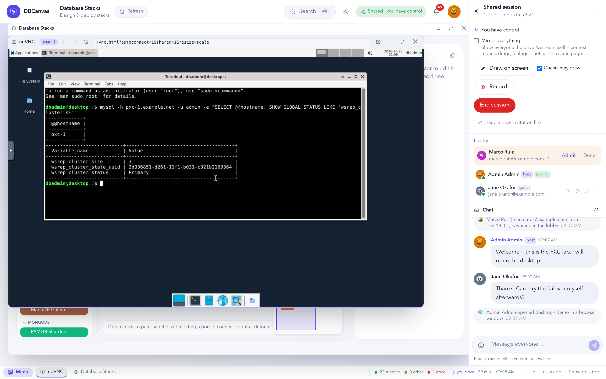
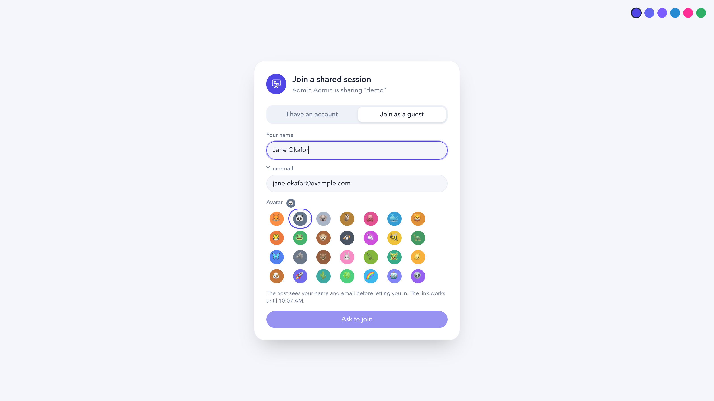
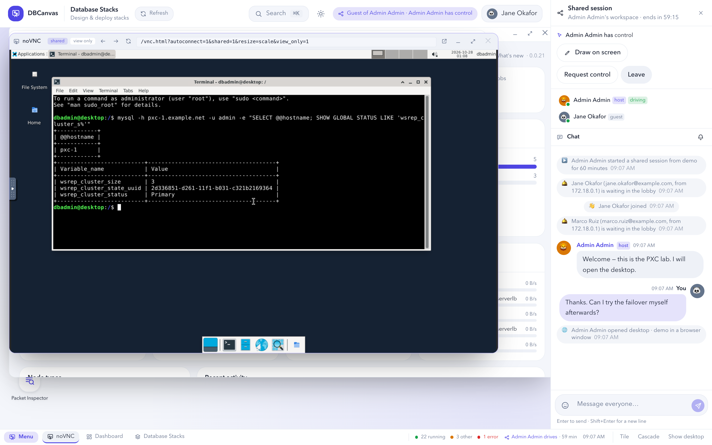
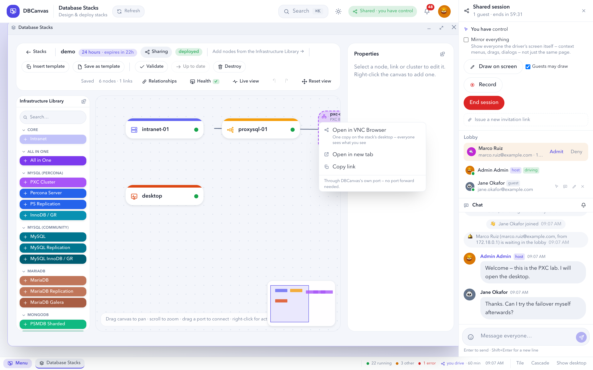
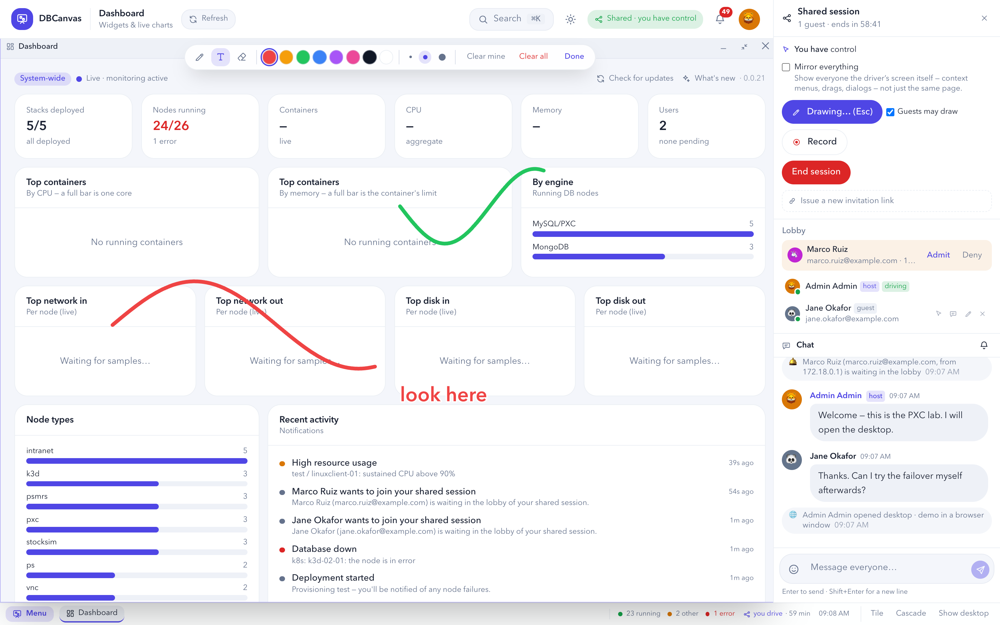
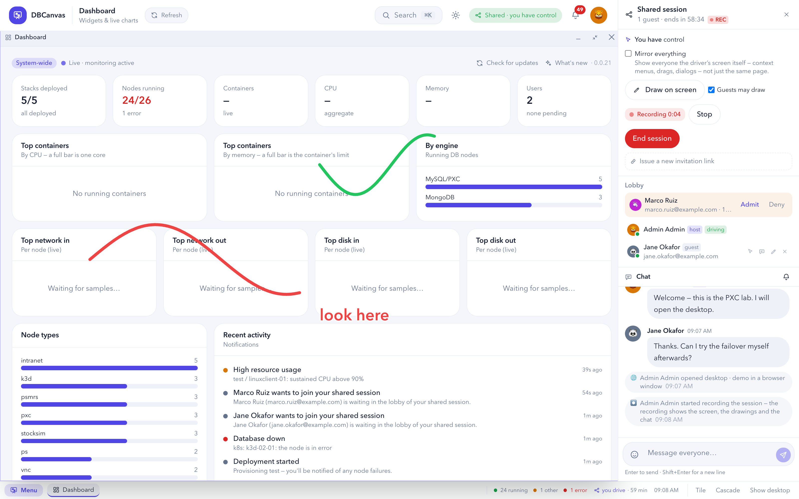

# Shared Sessions

A **shared session** lets colleagues watch you work in DBCanvas from their own browsers, chat with
you, draw on the screen, and take control when you hand it to them. You send a link; guests wait in
a lobby until you admit them, then follow you across the whole application. Nothing needs to be
installed or port-forwarded on their side: pages, terminals and VNC desktops all go through
DBCanvas's own address. A link lasts at most two hours.

> [!IMPORTANT]
> A guest you give control to can do everything you can in your workspace — deploy, destroy, open
> a root shell. Admit only people you would hand your keyboard to.

## Enable shared sessions

Shared sessions are off by default. An administrator turns them on in **Settings → Shared
sessions** with **Allow shared sessions**. The same row sets:

| Setting | Range | Default |
| --- | --- | --- |
| **Longest link** | 5–120 minutes | 120 |
| **Keep ended sessions** | 0–3,650 days (0 keeps them) | 90 |
| **Purge recordings after** | 1–3,650 days | 30 |

**Turn off (ends live sessions)** ends every live session at once.

Guests must be able to reach the address in the link:

| Where guests are | Set in `.env` |
| --- | --- |
| Same network | `APP_HOST=0.0.0.0` and `PUBLIC_URL=http://<this machine's address>:8080` |
| Through an SSH tunnel (`ssh -L 8080:127.0.0.1:8080 user@server.example.com`) | Nothing — the link's `localhost:8080` is their end of the tunnel |
| Through a port forward or proxy | `PUBLIC_URL` set to the forwarded address; websockets must pass through |

See [Configuration](CONFIGURATION.md) for both variables.

## Start a session

1. Click **Share** in the top bar on any page, or in a stack's canvas toolbar (this also files the
   transcript on that stack and lists **Earlier sessions on this stack** with their transcripts).
2. Choose how long it **Lasts**, and whether to **Mirror everything** and **Hide secrets** (below).
3. Click **Start and get the link**. The session panel opens with the link and **Copy link** —
   the link is shown only once.

**New link** (after a reload, **Issue a new invitation link**) replaces the link. The old link
stops admitting new people; guests already in stay.

## Join a session

The link opens a join screen:

- **I have an account** — a DBCanvas user signs in (or, if already signed in, joins with one
  click). You see their real name and avatar, marked **signed in as** their username. They still
  work in your workspace, not their own. You cannot join your own session.
- **Join as a guest** — anyone else enters a name and email (required, not verified) and picks an
  avatar.

Guests wait in the **Lobby**. You get a notification and a lobby entry with their avatar, name,
email or account, and address, with **Admit** and **Deny**. Nobody sees anything before you admit
them.

A guest's tab stays on the `/join/…` address; reloading it returns them to the session. Their other
tabs keep their own sign-in.

**Leaving is final for that link.** A guest who clicks **Leave**, or is removed or denied, cannot
rejoin from that browser with the same link. To invite them back, issue a **New link**; they join
the lobby again.

## What guests see

Everyone who is not driving **follows** the driver: the page, the open stack, the canvas position
and zoom, the selected node, and the pointer on the canvas. Following cannot be turned off; to look
around on their own, a guest asks for control.

On the desktop shell, a page the driver opens also opens on every follower's desktop. A guest's
**Menu** and desktop leave out the pages that belong to your account (Settings, API tokens, Manage
Users), and guests never see your notifications. The top bar always shows who has control.

### Mirror everything

Following puts everyone on the same page, but each browser draws its own copy, so menus, dragged
windows, dialogs and typing stay on the driver's screen. With **Mirror everything** on (the default
for a new session; the host can switch it in the panel), followers see a live, non-clickable
picture of the driver's screen beside their own session panel. When control moves, the mirror
follows the new driver. DBCanvas relays the picture and stores none of it.

Kept out of the mirror: your account pages (Settings, API tokens, Manage Users), your account and
notification menus and your session panel (shown as empty boxes), and password fields (always
masked). With **Hide secrets** on, masked credentials are also blanked wherever else they appear,
including connection strings and terminal lines.

## Hand over control

One person drives at a time — at first, you.

- A guest clicks **Request control**; you **Grant** or **Deny**. You can also **Give control** from
  the guest's row.
- While a guest drives, everyone follows them, and your canvas shows **Following … — view only**.
- **Take control back** returns it to you at any time; the guest can **Hand control back**.
- A driver who disconnects keeps control for 30 seconds, then loses it.

Watchers can read but not change anything; the server enforces this.

| | Watching | Driving |
| --- | --- | --- |
| Pages, stacks, node panels, results | Read | Read and change |
| Canvas | View only | Edit, deploy, destroy |
| Terminals | Watch | Type |
| Browser windows | Look; a VNC desktop is live but cannot be touched | Use |
| **Open in VNC Browser** | — | Yes |
| Close a shared terminal or window | No | Yes |

Never available to a guest, driving or not: your account, password, API tokens and notifications;
other users; administration and instance settings; and managing the session itself (admitting,
removing, giving control, ending). An administrator's guests are not administrators — they see the
host's stacks only.

## Terminals and browser windows

A terminal opened during a session is **shared**: one shell, shown to everyone, with its earlier
output for late arrivals. Only the driver can type in it or close it; others can minimize it.

Node web UIs (VNC desktop, PMM, webmail, HAProxy stats, SeaweedFS, OpenEverest and so on) each have
their own port, which guests cannot reach. For a guest, clicking such a link opens it in a
**browser window** inside DBCanvas, through DBCanvas's port. Right-clicking the link or node offers
**Open in VNC Browser** and, for non-guests, **Open in new tab**.

A browser window has **Back**, **Forward**, **Reload**, an editable address, **Open in a browser
tab** (still through DBCanvas), and the usual window controls ([Windows and the
taskbar](STACKS.md#windows-and-the-taskbar)). It also works outside a session. In a session, a
window opened by the driver or host opens on every screen and follows the driver's navigation; only
the driver can close it. A VNC desktop connects by itself in shared mode; watchers' keyboard,
pointer, clipboard and resize input is dropped by the server.

Pages in a browser window run on DBCanvas's own address. This suits the lab services DBCanvas
deploys; it is not a sandbox for arbitrary websites.

### Show one copy with Open in VNC Browser

A browser window shares only the page's address: each viewer loads their own copy with their own
logins, so a watcher sees a login page and cannot submit it. To show everyone exactly what the
driver sees, right-click the link or node and choose **Open in VNC Browser**. The page opens as a
Firefox tab on the stack's **Ubuntu VNC** desktop, shown as a shared window: one copy, one login,
only the driver's input.

- The stack needs a deployed **Ubuntu VNC** node; without one, DBCanvas tells you so.
- Watching guests do not get the option; a driving guest does, and it is recorded like any change.
- Firefox there never saves passwords, so a later driver cannot read your logins. The driver
  controls the whole desktop, terminal included.

## Hide secrets

With **Hide secrets** on, passwords are masked in everything sent to guests (node secrets, design
fields, a VNC desktop's password), and a driving guest who saves the design cannot overwrite a real
password with the mask. It does not stop a driving guest from reading a configuration file in a
terminal, and a password that a page shows as plain text reaches the mirror unmasked.

## Chat

Everyone admitted shares one chat in the panel. Messages are plain text. **Enter** sends;
**Shift+Enter** starts a new line. The **Emoji** button opens a picker, and typed emoticons such as
`:)`, `:D`, `:+1:`, `:tada:` and `<3` become emoji (not inside `` `code` ``, words or URLs).

A chime plays for messages from others, lobby arrivals and control requests (host), control handed
to you, expiry warnings and the end; the bell in the chat header mutes it for that browser. With
the panel hidden, its button counts unread messages.

The chat also shows events: joins, the lobby, control changes, every change a driving guest makes,
terminals and windows opened, and warnings 10 and 2 minutes before the link expires. The host can
**Mute** a guest (they keep watching) or **Remove** them.

## Draw on the screen

Anyone in the session can draw. **Draw on screen** in the panel opens a toolbar:

| Tool | What it does |
| --- | --- |
| **Pen** | Freehand line, visible to everyone as you draw |
| **Text** | Click, type, **Enter** (**Esc** discards) |
| **Eraser** | Drag over your own drawings; the host's eraser removes anyone's |
| Colours, Thin / Medium / Thick | Pen colour and weight, text size |
| **Clear mine** | Remove all your drawings |
| **Clear all** | Host only: remove every drawing |

**Done** or **Esc** stops drawing; drawings stay until erased or the session ends. Hover a drawing
while erasing to see whose it is. Drawings are positioned in proportion to the workspace, so they
line up exactly on a mirrored screen; without the mirror, layouts may differ slightly.

The host controls who draws: **Guests may draw** switches it for all guests, and the pencil on a
guest's row (**Stop them drawing** / **Let them draw**) for one guest, who is then marked **no
drawing**. The host can always draw.

Late arrivals see the drawings already up. Drawings are not in the transcript and disappear when
the session ends; a [recording](#record-a-session) keeps them.

## Record a session

1. Click **Record** in the panel.
2. In the browser's dialog, choose **this tab** (Chrome and Edge offer it first).

The recording is what you see in that tab: your workspace (or the driver's mirrored screen), the
drawings, and the session panel with chat and participants. Nothing is recorded from guests'
screens. Everyone sees a red **REC** while it runs, and the chat notes start and stop.

**Stop** in the panel ends it; so does the browser's *Stop sharing*, ending the session, or the
session expiring. Video is uploaded every few seconds, so a crashed or closed tab loses only the
last seconds; a recording that receives nothing for three minutes is finished with what arrived.
The file is WebM (MP4 in Safari), at most about 1 GB per hour.

### Download or purge a recording

Only the host can download a recording — not guests, other users or administrators. Find it under
**Your recordings** in the **Share** dialog (and in the panel right after the session ends):

| Item | What it does |
| --- | --- |
| **Download video** / **Play** | Save the video, or open it in a browser tab |
| **Transcript** / **JSON** | The whole session's chat and events, as text or JSON. A copy is kept with the recording, so it stays available as long as the video |
| **purged on** | The deletion date (default 30 days after the recording starts); pick another date to change it |
| Bin icon | Purge it now |

Recordings are deleted on their date, independently of the session's other records. Deleting your
account deletes your recordings. They are stored as files beside the database (`/data/recordings`
in the container), so back them up with it.

## End a session

A session ends when its time is up, when you click **End session**, or when an administrator turns
shared sessions off. Guests are disconnected, control returns to you, shared terminals close, and a
running recording is saved. The panel then offers the transcript (**Download transcript**) and the
recording.

## What is kept

| Kept | Details |
| --- | --- |
| Session | Stack, host, start, expiry, how it ended, whether secrets were hidden |
| Guests | Name, email, address; when they joined, were admitted and left |
| Transcript | Every chat message and event |
| Guest actions | Every change a driving guest made, with its result |
| Recordings | Video and a transcript copy, until the purge date |

Session records are kept for 90 days after the session ends (see **Keep ended sessions**), and are
deleted with the stack. Links and guest credentials are stored only as hashes. Download a
transcript from the panel after a session, or from the **Share** dialog's list of earlier sessions.

Not kept, unless recorded: terminal input and output, what happened inside a VNC desktop or web
page, and live state (who was online, pointers, drawings, open windows).

## API

Every part of a session — starting it, the lobby, control, drawing permissions, the live channel,
transcripts, recordings, and `POST /api/browse` for browser windows — has an endpoint. See [Shared
sessions in the API reference](API_REFERENCE.md#shared-sessions).
