# Stacks
A stack is a topology you draw on a canvas and deploy as real nodes — containers, or VirtualBox
VMs in hybrid mode. Add nodes and cluster **frames**, connect them, give the stack a **TTL**
(time to live), and deploy. Every deployed node gets a management panel with a web terminal,
credentials, certificates, users and backups.

> [!IMPORTANT]
> Stacks are **disposable lab infrastructure**, built for fast setup rather than durability or
> security, and meant to be torn down. Do not deploy production infrastructure with DBCanvas.

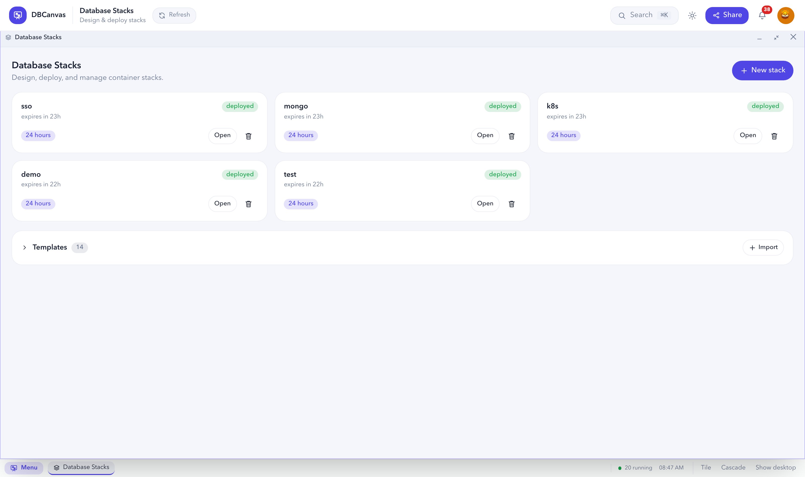

New to DBCanvas? [Getting started](GETTING_STARTED.md) walks through install, first stack,
deploy and connect. This page is the reference behind it.

## Build and deploy a stack

1. **Add an Intranet node first.** Right-click the canvas and pick **Core → Intranet**. Everything
   else stays greyed out until it is there: it provides the stack's DNS, a certificate authority
   (CA) every node trusts, OpenLDAP, mail (Roundcube webmail) and a Squid proxy that caches
   package downloads.
2. **Add nodes.** Right-click the canvas where you want a node and pick it from the
   **Infrastructure Library**. Hover an entry to see what it gives you, or why it is unavailable.
   To browse the whole catalog with search (it also matches aliases such as `redis`, `k8s` or
   `vault`) and a recently-used list, set **Settings → Adding nodes** to *Docked library*.
3. **Add clusters.** A cluster is a **frame**: a dashed box that owns its members. The frame's
   panel sets what is true of the whole cluster (name, version, replication mode); each member's
   panel sets what is true of that node.
4. **Connect nodes.** Drag from one node's port to another's. An **association line** (no
   arrow) relates two things — a ProxySQL fronting a cluster, a simulator driving a database. A
   **replication link** (with an arrow) between two cluster members, or between two Kubernetes
   frames, sets up cross-cluster replication from source to replica; a head at each end means
   bidirectional. Monitoring (PMM), backup targets, directories and key stores are picked from
   fields in the database's own panel.
5. **Set options** in the **Properties** panel on the right. Every field has a **?** that says
   what it does and when to change it.
6. Click **Validate** — a dry run that reports missing links, impossible topologies and host-port
   clashes without building anything.
7. Click **Deploy**. Nodes are provisioned in dependency order, with every step in the deployment
   console. A node that fails leaves the others running so you can get into it and look.

**Missing images.** If a node needs an image that has not been built on this host, Validate says
so and an administrator gets a **Build** button under the error. The demo applications are the
exception: they need a DBCanvas checkout and `make <name>-image` (for example
`make stocksim-image`).

## What you can put on the canvas

### Operating systems

| Node | OS choices |
| --- | --- |
| Percona products (PXC, Percona Server, PSMDB, PostgreSQL, Patroni, repmgr, Valkey, ProxySQL, HAProxy, PgBouncer, Orchestrator), MariaDB, MySQL Community, All in One | Oracle Linux 8, 9, 10; Ubuntu 22.04, 24.04 — only those the installed version catalog has packages for |
| Spock | Oracle Linux 8, 9, 10 |
| Linux Client | Oracle Linux 8, 9, 10; Ubuntu 22.04, 24.04; Debian 12, 13; CentOS 7 with `EOL=on` |
| Intranet, OpenBao | Oracle Linux 9 |
| Samba AD DC, Ubuntu VNC, Repository | Ubuntu 24.04 |
| PMM, Keycloak, SeaweedFS, Ceph, Watchtower, MClusterAdmin, Big Hole, simulators | A fixed container image; no OS choice |

Debian is for the Linux Client only, and only on the Docker backend; Validate rejects it on any
other node. The version pickers list what `make versions` found for each OS.

### Library at a glance

| Category | Entries |
| --- | --- |
| Core | Intranet |
| All in One | All in One |
| MySQL (Percona) | PXC Cluster · Percona Server · PS Replication · InnoDB / GR |
| MySQL (Community) | MySQL · MySQL Replication · MySQL InnoDB / GR |
| MariaDB | MariaDB · MariaDB Replication · MariaDB Galera |
| MongoDB | PSMDB Sharded · PSMDB Replica Set · PSMDB · MClusterAdmin · Big Hole (FTDC viewer) |
| PostgreSQL | PostgreSQL · Patroni Cluster · repmgr Cluster · Spock Cluster |
| Valkey | Valkey Cluster · Valkey |
| Kubernetes | K3D Cluster |
| Proxies & HA | ProxySQL · ProxySQL Cluster · HAProxy · PgBouncer · Orchestrator |
| Monitoring | PMM3 · PMM2 (`EOL=on` only) · Watchtower |
| Identity & Secrets | Samba AD DC · Keycloak · OpenBao |
| Storage & Clients | SeaweedFS · Ceph · Ubuntu VNC · Linux Client · Repository |
| App Simulators | Support Sim (Vector Search) · pgvector Support Sim · Stock Market Sim · Ledger Sim |

One per stack: Intranet, Samba AD DC, Keycloak, OpenBao, Ubuntu VNC and Watchtower.

### MySQL (Percona)

| Type | What you get | Members |
| --- | --- | --- |
| **PXC Cluster** | Percona XtraDB Cluster: synchronous multi-writer replication. Members can be data nodes or `garbd` arbitrators. | 1–9, default 3 |
| **Percona Server** | A standalone server, 5.7 / 8.0 / 8.4 / 9.7. | — |
| **PS Replication** | Async or semi-sync replication: one primary, read-only secondaries. Can be watched by an Orchestrator node. | 2–9, default 3 |
| **InnoDB / GR** | Group Replication, as an InnoDB Cluster (MySQL Shell) or raw GR, with optional MySQL Router on every member. | 1–9, default 3 |

Options shared by these: GTIDs, PMM monitoring, an Intranet-CA certificate, XtraBackup to
SeaweedFS, LDAP and Keycloak sign-in (below), OpenBao encryption (below), MySQL file tools (below)
and resource limits.

### MySQL (Community) and MariaDB

| Type | What you get | Members |
| --- | --- | --- |
| **MySQL** | Oracle's MySQL Community from repo.mysql.com, 8.0 / 8.4 / 9.7. | — |
| **MySQL Replication** | Async or semi-sync replication. | 2–9, default 3 |
| **MySQL InnoDB / GR** | Group Replication, as InnoDB Cluster (MySQL Shell + MySQL Router) or raw GR. | 3–9, default 3 |
| **MariaDB** | MariaDB from mariadb.org, 10.6 / 10.11 / 11.4 / 11.8 / 12.3. | — |
| **MariaDB Replication** | Async or semi-sync replication using MariaDB GTIDs. | 2–9, default 3 |
| **MariaDB Galera** | Galera cluster with `mariabackup` state transfers. | 3–9, default 3 |

These do not offer OpenBao encryption. They do offer the MySQL file tools.

### MySQL file tools
Every Percona Server, PXC, MySQL and MariaDB node or cluster can have offline file readers
installed into `/usr/local/bin`, from each project's latest GitHub release with its checksum
verified:

| Option | Tool | On |
| --- | --- | --- |
| Install innodump | [`innodump`](https://github.com/PrzemekMalkowski/innodump): a table's definition and rows from its `.ibd`, `.MYD` or MyRocks files | every server |
| Install binlogsum | [`binlogsum`](https://github.com/PrzemekMalkowski/binlogsum): a summary of a binary log from `mysqlbinlog` output | every server |
| Install gcache-inspector | [`gcache-inspector`](https://github.com/PrzemekMalkowski/gcache-inspector): the write-sets in `galera.cache` | PXC and MariaDB Galera |

On a cluster the option is on the cluster and installs on every data member (not on `garbd`
arbitrators). The tools are installed once each server is running, at the end of the deploy, and
a notification says what was installed. To add one to a running server, tick it and redeploy.

### MongoDB

| Type | What you get | Members |
| --- | --- | --- |
| **PSMDB** | Percona Server for MongoDB, standalone. LDAP, Kerberos or Keycloak OIDC sign-in, and OpenBao encryption. | — |
| **PSMDB Replica Set** | A replica set; the frame's label is the set name. PBM backups to SeaweedFS, optional [vector search](#vector-search-on-mongodb-mongot). | 1–9, default 3 |
| **PSMDB Sharded** | One mongos, a config-server replica set and three shards. | 5 or 13, default 13 |
| **MClusterAdmin** | A third-party MongoDB web administration panel ([below](#mclusteradmin)). | — |
| **Big Hole** | A third-party FTDC (`diagnostic.data`) viewer that runs in your browser ([below](#big-hole)). | — |

Every MongoDB node has **Download diagnostic.data with mongod.log** on its right-click menu
(mongos.log on a router): one `.tar.gz` containing a `<hostname>_log_diagnostic_data`
directory, ready for [FTDC Summary](FTDC_SUMMARY.md) or Big Hole.

### PostgreSQL

| Type | What you get | Members |
| --- | --- | --- |
| **PostgreSQL** | Percona Distribution for PostgreSQL 13–18, standalone. | — |
| **Patroni Cluster** | Percona PostgreSQL with Patroni and etcd: a leader, streaming replicas, automatic failover. | 3–7, default 3 |
| **repmgr Cluster** | PGDG PostgreSQL with repmgr and repmgrd. | 3–7, default 3 |
| **Spock Cluster** | Active-active (multi-master) PostgreSQL with pgEdge Spock; every member is writable. | 2–7, default 3 |

Options on the standalone node and Patroni (Percona packages): pgBackRest backups, PMM Query
Analytics extension (*pg_stat_statements* or *pg_stat_monitor*), pgAudit, set_user, pgbench data at
deploy, and pg_tde encryption. repmgr and Spock offer **Enable pg_stat_statements** instead. All
four offer [pgvector](#pgvector-on-postgresql) and [client authentication](#client-authentication-on-postgresql-pg_hba).
Only the standalone node offers LDAP, Kerberos and Keycloak sign-in.

### Valkey

| Type | What you get | Members |
| --- | --- | --- |
| **Valkey** | Standalone Valkey 9.1 from Percona. Optional OpenLDAP authentication (Oracle Linux only) and PMM. | — |
| **Valkey Cluster** | An all-master Valkey Cluster. | 3–7, default 3 |

### Kubernetes

| Type | What you get | Members |
| --- | --- | --- |
| **K3D Cluster** | A k3s cluster on the stack network, with MetalLB LoadBalancer addresses, optionally running a database operator. See [Kubernetes (K3D)](#kubernetes-k3d). | 1–3 k3s nodes, default 1 |

### Proxies and HA

| Type | What you get |
| --- | --- |
| **ProxySQL** / **ProxySQL Cluster** | ProxySQL in front of a PXC or Percona Server replication cluster. A cluster frame (1–9 nodes) shares one configuration. |
| **HAProxy** | TCP load balancer in front of exactly one Patroni, repmgr, Spock, PXC or Percona Server replication cluster. Writes on 5000, reads on 5001, stats on 7000. |
| **PgBouncer** | Connection pooler on 6432 in front of one PostgreSQL node or cluster. See [PgBouncer](#pool-postgresql-connections-with-pgbouncer). |
| **Orchestrator** | Percona Orchestrator: topology discovery and failure detection for MySQL replication. A replication frame points at it with **Monitored by (Orchestrator)**. |

### Monitoring

| Type | What you get |
| --- | --- |
| **PMM3** | Percona Monitoring and Management 3. Databases that pick it register themselves. Optional LDAP or Keycloak sign-in to Grafana. |
| **PMM2** | A PMM 2 server, 2.25.0 to 2.44.1, offered only with `EOL=on`. Login `admin` / `PMM_ADMIN_PASSWORD`. Nothing can be pointed at it, and it gets no Intranet certificate, SMTP, LDAP or Keycloak. amd64 only. |
| **Watchtower** | Lets a PMM node that points at it upgrade itself to a newer image from its own UI. |

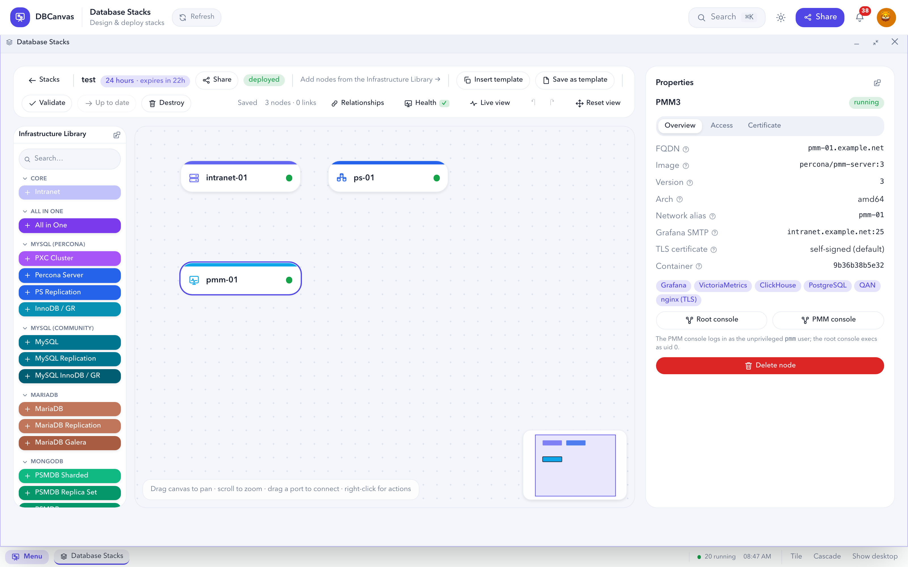

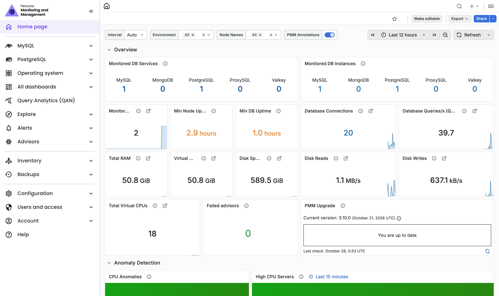

### Identity and secrets

| Type | What you get |
| --- | --- |
| **Samba AD DC** | Active Directory domain controller: LDAP and Kerberos for database sign-in. |
| **Keycloak** | OpenID Connect identity provider. Needs an Ubuntu VNC node, because its admin console is reachable only from inside the stack. |
| **OpenBao** | Vault-compatible secrets manager, used as the key store for data-at-rest encryption. Initialized and unsealed at deploy; its 5 unseal keys and root token are on its panel, which can re-unseal it after a restart with one click. Optional **PKI** mount for signing certificates. |

### Storage and clients

| Type | What you get |
| --- | --- |
| **SeaweedFS** | S3-compatible backup store with 1–10 buckets, optional HTTPS (**S3 TLS**). See [S3 backups](#browse-and-manage-s3-backups-seaweedfs). |
| **Ceph** | Block storage for K3D volumes (RBD images that can grow). OSD size 5–1000 GB, default 20. |
| **Ubuntu VNC** | XFCE desktop over web VNC with Firefox and Percona clients (MySQL client 8.4 with the OpenID Connect plugin). |
| **Linux Client** | A bare host with nothing installed. Optional database clients, Kubernetes tools and core-dump analysis. See [Linux Client](#linux-client). |
| **Repository** | A yum/apt mirror of Percona repositories plus a container registry. See [Repository](#mirror-packages-and-images-with-a-repository-node). |

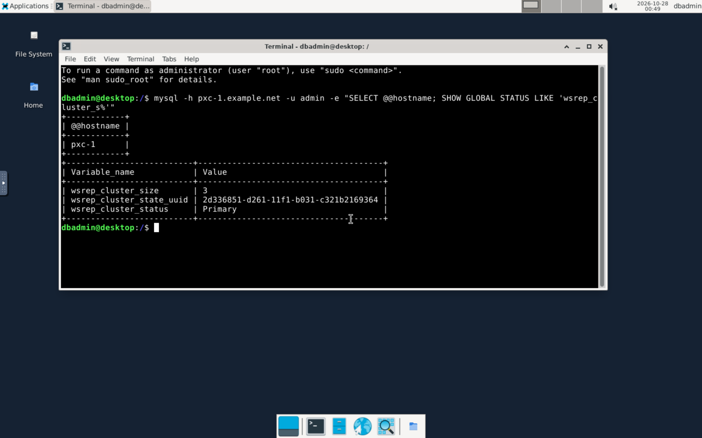

### All in One
One container running many database instances side by side — Percona Server, MySQL Community or
MariaDB (one MySQL flavour per node), PXC, PostgreSQL, Patroni, repmgr, Spock, PSMDB, Valkey,
ProxySQL, HAProxy and Orchestrator — each with its own port, data directory and systemd unit.
Relationships (PMM, the instance a proxy fronts) are drop-downs on each instance, not lines. See
[All in One](ALL_IN_ONE.md).

### Application simulators

Each simulator runs continuous load against the database it is linked to and publishes a live
dashboard on a host port. Draw an association line from the simulator to its target.

| Simulator | Workload | Link it to |
| --- | --- | --- |
| **Support Sim (Vector Search)** | A help desk that embeds tickets in-process (all-MiniLM-L6-v2, 384 dimensions, no API key) and answers, routes and merges them with `$vectorSearch`, scored against `$search` and hybrid search. Tabs: Live Desk, Search Showdown, Vector Lab, Index Workshop, Under the Hood. | PSMDB replica set or sharded cluster with **Vector search** on, or a K3D frame running the MongoDB operator with it on. Without mongot it falls back to an in-app scan. |
| **pgvector Support Sim** | The same desk on PostgreSQL, using a pgvector column and an HNSW index. Creates a `supportsim` database (or schema). | PostgreSQL, Patroni, repmgr or Spock; HAProxy or PgBouncer in front of one; or a K3D frame running a PostgreSQL operator. Turn on pgvector on the target. |
| **Stock Market Sim** | A stock-exchange app you operate. See below. | Any database (see below) |
| **Ledger Sim** | A JDBC order-and-payment ledger. See below. | MySQL-family or PostgreSQL |
| **Performance Sim** | Stressors that cause replication lag, with a live timeline of their effect. See below. | MySQL-family, PostgreSQL, MongoDB or Valkey |

The templates **PSMDB Vector Search + Support Sim** and **PostgreSQL + pgvector + Support Sim**
deploy a complete vector-search demo.

**Stock Market Sim** runs the same application on MySQL, PostgreSQL, MongoDB or Valkey, with
create/edit/delete for securities, portfolios and orders, a printable report and CSV exports.

- **Connection:** *linked* (an association line to any database node, cluster frame, K3D frame
  with a database operator, or a proxy in front of one cluster), *All in One* (pick an instance on
  an All in One node), or *manual* (host, port, user, password and database — including databases
  outside the stack — with a **Test connection** button).
- **Kubernetes targets** must be reachable from the stack network: set the proxy, router, pooler
  or database Service on the frame to **LoadBalancer** or **NodePort**. Validate warns if none is.
- **Send reads to HAProxy's read port** (behind an HAProxy node): display-only reads go to 5001,
  writes stay on 5000.
- **Load:** at the *High* level it grows the dataset to **dataset size** (default 5 GiB) and keeps
  a **working set** (default 50%) under random read, so cache sizing is measurable. **Database
  threads** defaults to 4.
- **Lab problems**, each only on engines that support it: an idle transaction (up to 24 h), extra
  tables (up to 5,000), temporary-table queries (memory or disk), lock contention (light or heavy,
  with real deadlocks), scan queries, and write pressure (*commits* or *redo*).

**Ledger Sim** drives an order-and-payment ledger over JDBC with a HikariCP pool. Use it to
compare drivers and pool settings rather than servers.

- **Drivers:** MySQL Connector/J, MariaDB Connector/J and pgJDBC; switch drivers on the dashboard
  while it runs.
- **Connection:** linked (MySQL-family or PostgreSQL node, frame, router or K3D frame) or manual
  (with **Test connection**). The dashboard shows the JDBC URL and every derived property, and lets
  you edit and re-apply them. A configuration that cannot connect is refused with the driver's
  SQLState and the working pool is kept.
- **Pooled or direct:** *direct* opens a fresh connection per transaction, so you can measure
  what pooling saves. Validate warns if a direct-mode node's workers could exceed
  `max_connections`.
- **Workload controls:** HikariCP settings, isolation level, revenue shards, hot-account share and
  deadlock share. Deadlocks, lock timeouts, retries and errors are counted separately, and a
  **balance check** shows zero on a consistent ledger.
- Not for MongoDB or Valkey. Build it with `make ledgersim-image` (it downloads from Maven Central).

**Performance Sim** makes a linked MySQL-family, PostgreSQL, MongoDB or Valkey server or cluster misbehave on purpose and shows
what each stressor does, to the cluster and to an application running against it. The node has
no options of its own: link it, deploy it, and choose everything on its dashboard.

- **Link:** an association line to a Percona Server, MySQL or MariaDB server or cluster frame
  (asynchronous replication, Group Replication, PXC, MariaDB Galera), a PostgreSQL node or a Patroni
  or repmgr cluster, a PS MongoDB node or PSMDB replica set, a Valkey node or Valkey Cluster, or an
  HAProxy, ProxySQL or PgBouncer node in front of one. A Spock cluster (logical replication) and a sharded MongoDB cluster are not
  targets yet. The sim connects to every data member (MySQL as `admin@'%'`, PostgreSQL as the
  superuser, MongoDB as the admin user, Valkey with the default user's password) and runs its workload
  through the write endpoint.
- **Replication lag stressors, MySQL family:**

  | Stressor | What it does | Where |
  | --- | --- | --- |
  | Large transactions | One large UPDATE on a prepared table at a fixed interval | All topologies |
  | No-op ALTER TABLE | Rebuilds a prepared table; on Galera, TOI (whole cluster) or RSU (one node) | All topologies |
  | FLUSH TABLES WITH READ LOCK | Holds the global read lock on chosen replicas. On Galera, one node, which desyncs and falls behind while the cluster keeps committing | All topologies |
  | Stop the applier | Stops the SQL thread; the receiver keeps going | Async replication |
  | Writes to a table without a primary key | Changes rows the replica has to search for | Async replication |
  | Single-threaded applier | One applier worker (one `wsrep` applier thread on Galera) | Async, Galera |
  | Delayed replica | A fixed `SOURCE_DELAY` (`MASTER_DELAY` on MariaDB) | Async replication |
  | Open transaction blocking DDL | Holds a table's metadata lock on chosen replicas, so a replicated ALTER waits | Async, Group Replication |

  A stressor the topology cannot support is listed with the reason.
- **Replication lag stressors, PostgreSQL** (Patroni, repmgr):

  | Stressor | What it does |
  | --- | --- |
  | Large transactions | One large UPDATE on a prepared table at a fixed interval |
  | Table rewrite | `VACUUM FULL` of a prepared table, replayed in full by the standbys |
  | Pause WAL replay | `pg_wal_replay_pause()` on chosen standbys |
  | Conflicting standby query | A transaction on chosen standbys that replay has to wait for, up to `max_standby_streaming_delay`, before cancelling it |
  | Delayed standby | `recovery_min_apply_delay` on chosen standbys |

  On PostgreSQL the sim uses its own `perfsim` database. On Patroni, a replay pause puts the cluster
  in maintenance mode while it holds (Patroni would otherwise resume replay), which turns off
  automatic failover until it is released; the delay is set in Patroni's configuration and applies
  to every standby.
- **Replication lag stressors, MongoDB** (replica sets):

  | Stressor | What it does |
  | --- | --- |
  | Bulk writes | One large `updateMany` on a prepared collection at a fixed interval |
  | Index build | Builds an index on a prepared collection, on every member at once |
  | fsyncLock on secondaries | `db.fsyncLock()` on chosen secondaries |
  | Delayed secondary | Makes chosen secondaries delayed members (priority 0, hidden, `secondaryDelaySecs`) in one reconfiguration, restored on release |

  Writes use the default `w: "majority"`, so locking or delaying a majority of members also stalls
  them. The sim uses its own `perfsim` database.
- **Replication lag stressors, Valkey** (Valkey Cluster; lag is measured with one heartbeat key per
  shard, so every replica is measured against its own primary):

  | Stressor | What it does |
  | --- | --- |
  | Large values | Writes multi-megabyte values at a fixed rate through every replica's stream |
  | Delete a big key | Builds a set of millions of members and deletes it with `DEL`, blocking the primary and then each replica; *blocking* turns `lazyfree-lazy-user-del` off on that primary for the one delete |
  | DEBUG SLEEP on replicas | Blocks chosen replicas' event loop repeatedly; offered only where `enable-debug-command` allows it |

  Valkey needs no prepared tables; the sim's keys start with `perfsim:`. A Valkey Cluster built by
  DBCanvas has primaries only, so on one there is no lag to cause; the large-value and delete
  stressors still show their effect on the primaries' latency.
- **Network and disk stressors** on chosen members: added latency (with jitter), packet loss (100%
  cuts the member off), a bandwidth cap, and write bandwidth, write IOPS or read bandwidth caps.
  DBCanvas applies them with the same `tc netem` and `io.max` code as a node's own limits, and
  polls the sim every two seconds for what it wants. They are applied only to the members it
  resolved for that sim, each releases at its maximum hold, and all of them are cleared if the sim
  stops answering for 20 seconds or is removed; clearing restores the node's own canvas settings.
  Disk limits need a Docker host on cgroup v2; the dashboard says when one cannot be set. A slow
  disk on one Galera node is the reliable way to make the cluster send flow control.
- **Datasets:** the large tables these need are prepared on the dashboard (500 MB to 50 GB, with or
  without a primary key) in 20,000-row batches, in the `perfsim` schema.
- **What it shows:** lag per member, measured with a heartbeat row the sim writes every 250 ms (so a
  stopped applier, a delayed replica and a Galera node are measured the same way); on Galera, each
  node's receive queue and flow control. A steady workload's throughput and p50/p99 latency, the
  writer's lock waits, threads and connections, a topology view, an impact card per stressor
  against a baseline with its recovery time, live sessions with blockers and waiters, and each
  member's replication status.
- **Safety:** every lock, pause and setting has a maximum hold and releases itself; **Stop all**
  releases everything; stopping the sim releases everything. Changes to a replica's settings are
  recorded in the `perfsim` schema first, so a sim that was killed undoes them when it starts again.
- **Record run** keeps a stretch of the timeline with its stressors, settings and events, exported
  as JSON. Settings and runs are kept in the `perfsim` schema and survive a redeploy.
- Build it with `make perfsim-image`.

### Resource limits and network conditions
Database nodes and cluster members can be limited on **CPU** and **memory**, **disk** read and
write rate (MB/s), and **network**: added latency, jitter, packet loss and a bandwidth cap.
Network shaping applies only to the node's database and cluster ports (unless you tick shaping
all traffic), is applied after the cluster forms, and can be changed and redeployed without
recreating the node. Network conditions are Docker-only.

## Sign in with a directory or single sign-on

Pick a directory or identity provider in the database's panel and it is wired at deploy:

| Method | Provider | Available on |
| --- | --- | --- |
| **LDAP** | Intranet OpenLDAP or Samba AD DC | Percona Server (not 5.7), PS Replication, PXC, PostgreSQL, PSMDB, PMM. Valkey: Intranet OpenLDAP, Oracle Linux only. |
| **Kerberos (GSSAPI)** | Samba AD DC | PostgreSQL, PSMDB |
| **Keycloak OIDC** | Keycloak | PMM; PostgreSQL 18; PSMDB; Percona Server and PXC 8.4.11-11 / 9.7.2-2 or newer |

The designer greys out combinations an engine cannot run: PostgreSQL cannot combine LDAP and
OIDC, and MongoDB cannot combine OIDC with LDAP or Kerberos. MySQL can mix LDAP and OIDC accounts
on one server.

**Keycloak SSO on Percona Server.** Turning it on keeps a 9.7 node on 9.7 and moves any other to
the latest 8.4. The deploy creates a realm and a public `mysql` client, sample users `jane` and
`john` in an `accounting` group, MySQL accounts bound to them, and an `oidc_demo` schema only
that group's role can read. The node's **Keycloak SSO** tab shows how to log in; the
`oidc-login` command on the node fetches a token and starts `mysql` with it. Activate the role
with `SET ROLE`. The connection must be encrypted (a Unix socket, or TCP with
`--ssl-mode=REQUIRED`).

## Encrypt data at rest with OpenBao

Add an **OpenBao** node, then tick *Encrypt with OpenBao* (or the equivalent encryption option)
on a supported database. Each database gets its own KV mount and a token scoped to it, and
verifies OpenBao with the Intranet CA. Encryption is a deploy-time choice: it cannot be turned on
later without recreating the data.

| Target | How it is encrypted |
| --- | --- |
| Percona Server | `component_keyring_vault` on 8.4; the `keyring_vault` plugin on 5.7 / 8.0. Not with XtraBackup. |
| PS Replication, PXC (frame) | Every member, each with its own mount; `default_table_encryption=ON`. |
| PSMDB (standalone) | `security.vault` |
| PostgreSQL, Patroni | `pg_tde`, PostgreSQL 17 or 18 only. Tables use `tde_heap` by default (also in `template1`). Optional **Encrypt WAL too**. A Patroni cluster shares one key. |

Not offered on MariaDB or MySQL Community.

**Encrypted PXC clusters also encrypt cluster traffic** (`pxc_encrypt_cluster_traffic=ON`), with
one Intranet-CA certificate shared by every member; *Generate per-node certificates* has no
effect on such a cluster. SST uses `xtrabackup-v2`.

The deploy checks every member has its keyring loaded and creates an encrypted test table; a
member that cannot fails instead of coming up unencrypted. The node's **Encryption** tab shows
the result.

## Kubernetes (K3D)

Add a **K3D Cluster** frame to run k3s on the stack network. Pods resolve the Intranet DNS and
reach PMM and SeaweedFS by name, and **MetalLB** hands out LoadBalancer addresses from the stack
subnet (8 per cluster, so several clusters can share a stack).

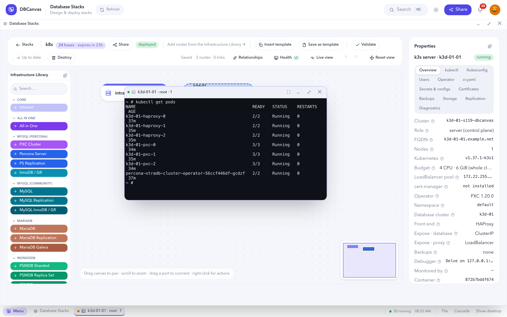

> *A one-node K3D cluster running the Percona Operator for MySQL (PXC), with `kubectl get pods
> -A` in its console: the PXC and HAProxy pods, MetalLB and the operator.*

### Frame options

| Option | Choices |
| --- | --- |
| Nodes | 1–3 k3s nodes (the first is the server) |
| Kubernetes version | Any k3s release in the catalog; newest by default |
| CPU / memory | A total split across the nodes; default 4 CPU / 8 GiB. Validate warns when it is too small (more for sharded MongoDB, async Percona Server or OpenEverest) |
| Disk limits | Read/write MB/s per k3s node |
| Operator | none, **PXC**, **Percona Server**, **MongoDB (PSMDB)**, **PostgreSQL** (Percona), **CloudNativePG**, **Crunchy PGO**, or **OpenEverest** |
| Operator version | Any catalogued release; latest by default |
| Namespace | Defaults to the operator's name |
| Shape | PXC: HAProxy or ProxySQL. Percona Server: group replication (HAProxy or MySQL Router) or async with Orchestrator (HAProxy). MongoDB: replica set or sharded. PostgreSQL: Patroni behind pgBouncer. CloudNativePG: 1–5 instances, optional PgBouncer pooler and kube-prometheus-stack monitoring. Crunchy PGO: 1–5 instances, optional pgMonitor |
| Expose | ClusterIP, NodePort or LoadBalancer per tier (database, proxy/router/pooler) |
| Volumes | k3s local-path, or **Ceph** (needs a Ceph node; volumes can grow); size per pod |
| Backups | A SeaweedFS node and bucket. Percona PostgreSQL and Crunchy PGO need **S3 TLS** on the SeaweedFS node |
| PMM | A PMM node; DBCanvas creates a service token (default lifetime 365 days) so the pmm-client sidecars register |
| Cluster add-ons | **cert-manager** (with version picker) |
| Debugging | *Run the operator under Delve* (Percona operators) |

Database users come from your `.env`, like every other DBCanvas database.

**Operator-specific options** (shown only when the selected operator version supports them):

| Operator | Option |
| --- | --- |
| PXC | Point-in-time recovery (binlog collector) with its own bucket; data-at-rest encryption with OpenBao |
| MongoDB | Data-at-rest encryption (1.13.0+); vector search with mongot (1.23.0+, tech preview); ClusterSync from a PSMDB frame on the canvas (1.23.0+) |
| Percona PostgreSQL | pgvector (2.6.0+); logical replicas, 0–3 (3.1.0+); persistent logging, on by default (3.1.0+); transparent data encryption with optional WAL encryption (3.1.0+, needs OpenBao). Logical replicas and encryption cannot be combined. |
| CloudNativePG, Crunchy PGO | pgvector (created in the application database at bootstrap) |

**OpenEverest** installs the OpenEverest platform from its Helm chart and the Percona operators you
tick (PXC, MongoDB, PostgreSQL; all three by default) through OLM. It creates no database — use
Everest's UI for that, including its backups and PMM. Open it with **Open OpenEverest** on the
panel and sign in as `admin` with `EVEREST_PASSWORD` from `.env`. Give the frame at least 6 CPU /
10 GiB.

### cert-manager and certificate issuers
Tick **cert-manager** under **Cluster add-ons** to install it before the operator, so the operator
issues database certificates through it instead of self-signing. The k3s node's panel shows
whether cert-manager is actually present.

With cert-manager on, a PXC, Percona Server or MongoDB (1.23.0+) frame offers a **Certificate
issuer**:

- **Operator's own self-signed CA** (default).
- **Intranet CA** — trusted by every node, pod and the VNC desktop.
- **OpenBao PKI** — a Vault Issuer signing with the Intranet CA through OpenBao (needs an OpenBao
  node). Certificates stop renewing while OpenBao is sealed.

**Host names in the certificates and the Intranet DNS** puts `<service>.<domain>` names in the
certificates and publishes every LoadBalancer Service in the Intranet DNS, so clients outside
Kubernetes can verify host names (`VERIFY_IDENTITY`, `verify-full`). The panel marks each name
**in cert** or **DNS only**.

### Work with a running cluster
The k3s server node's panel has these tabs (some depend on the operator):

| Tab | What it does |
| --- | --- |
| **Overview** | Operator, namespace, endpoints, cert-manager and issuer |
| **kubectl** | Run kubectl against the cluster |
| **Kubeconfig** | Copyable admin kubeconfig that works from any node in the stack |
| **Users** | Create Kubernetes users (X.509 client certificates) bound to `view`, `edit` or `admin` in a namespace, or `cluster-admin`, and copy their kubeconfig |
| **Operator** | Operator details; with Delve published, an IDE `launch.json` and clone command |
| **cr.yaml** | Edit the live custom resource as a form built from the cluster's CRD. **Review patch**, **Check** (server-side dry run) and **Apply** |
| **Secrets & configs** | View and edit Secrets and ConfigMaps. Values are masked until revealed; every change is dry-run first |
| **Certificates** | Every TLS Secret parsed and checked (dates, chain to `ca.crt`, strict `openssl verify`, key match), refreshed every 30 s |
| **ClusterSync** | Start, pause, resume and finalize a MongoDB ClusterSync |
| **Backups** | Backups, restores, bucket contents and manifests. See [Operator backups](OPERATOR_BACKUPS.md) |
| **Storage** | Volume sizes and use; grow volumes on Ceph |
| **Replication** | State of a cross-cluster replication link, and **Re-seed** |
| **Logical replicas** | Add, remove and re-seed Percona PostgreSQL logical replicas |
| **Diagnostics** | Capture the cluster with `pt-k8s-debug-collector` (amd64 only; needs `make k8scollector-image`) |

Also:

- **Enter pod console** (right-click the k3s server node): pick a namespace, pod and container,
  then a shell or the database client (`mysql`, `psql` or `mongosh`) already logged in as an
  administrator. The list is read live each time. From the CLI: `dbcanvas node pods` and
  `dbcanvas node console --pod` ([CLI](CLI.md)).
- **[Kubernetes States](KUBERNETES_STATES.md)**: every pod, workload, claim, service and custom
  resource as a live card.
- **[Operator Debugger](OPERATOR_DEBUGGER.md)**: with *Run the operator under Delve* ticked, the
  operator is built from its release source and run under Delve, and you can set breakpoints and
  force a reconcile from the browser. *Also publish the debugger to the host* (on by default)
  exposes Delve on port 40000 for an external IDE; turn it off if two debugged clusters would
  collide. Not available for CloudNativePG or Crunchy PGO.

### Replicate one PXC cluster into another
Draw a link between two K3D frames that both run the **PXC operator** and pick the direction.
Both frames need a SeaweedFS backup store. On Deploy:

1. The source's database pods get LoadBalancer addresses.
2. Both clusters deploy.
3. A backup of the source is taken and restored onto the replica.
4. The replica's replication channel is attached.

The **Replication** tab shows the channel state and last error, and **Re-seed** restores the
replica again. Deploy never re-seeds. Removing the link stops the channel and keeps the data.
Replication is one-way only. Start from the *Kubernetes — PXC operator, two clusters replicating*
template.

**Point-in-time recovery** (PXC) needs its own bucket. On the replica end it is turned on only
after replication is running.

## Linux Client

A bare host joined to the stack's DNS and CA, with nothing installed. Use its terminal to install
whatever you need, or tick tools to have them installed at deploy:

| Option | What is installed |
| --- | --- |
| Install kubectl | kubectl matching the K3D frame's Kubernetes version |
| Install Helm | Helm 3 |
| Install cmctl | cert-manager's CLI |
| Install cfssl and cfssljson | `cfssl` and `cfssljson` |
| Install innodump | [`innodump`](https://github.com/PrzemekMalkowski/innodump), which reads InnoDB, MyISAM and MyRocks table files offline |
| Install binlogsum | [`binlogsum`](https://github.com/PrzemekMalkowski/binlogsum), which summarizes a binary log from `mysqlbinlog` output |
| Install gcache-inspector | [`gcache-inspector`](https://github.com/PrzemekMalkowski/gcache-inspector), which reads a Galera `galera.cache` offline |
| MySQL client / MySQL Shell | Percona Server client and `mysqlsh`, series 8.0, 8.4 or 9.7 (8.4 / 9.7 on Debian 13) |
| mongosh | From Percona Server for MongoDB |
| psql | Percona Distribution for PostgreSQL client, 13–18 |
| ClusterSync | Percona ClusterSync for MongoDB (`pcsm`), installed but not started |
| Use this client for core-dump analysis | See [Core Dump Analyzer](CORE_DUMP_ANALYZER.md). Host directories must be under `GDB_MOUNT_ROOT` |

After deploy, the panel also has:

- **Kubeconfig** — **Copy to /root/.kube/config** merges every running cluster's kubeconfig into
  the node, one context per frame; **Current context** switches between them. Contexts you added
  yourself are kept.
- **Sample Client Code** (also on the right-click menu) — generates and runs a client program for
  any database in the stack. See [Sample Client Code](SAMPLE_CODE.md).

**CentOS 7** (`EOL=on` only): pick `centos (end of life)` / `7`. Yum points at
vault.centos.org and `percona-release` is installed. It has no systemd, so services do not run;
the terminal, file drops, Sample Client Code, kubectl/Helm/cmctl and the database clients
(MySQL 8.0, psql 13, no ClusterSync) work. No core-dump analysis. Docker backend only. See
[Sample Client Code](SAMPLE_CODE.md#centos-7).

## Vector search on MongoDB (mongot)

Tick **Vector search** on a **PSMDB Replica Set** or **PSMDB Sharded** frame to enable
`$vectorSearch` and `$search`. DBCanvas runs one mongot (Percona Search for MongoDB) per replica
set, on its first member; a sharded cluster gets one per shard.

- Needs PSMDB 8.3 or later; ticking the box moves the frame to 8.3.
- Needs Oracle Linux 8 or 9, or Ubuntu 22.04 or 24.04.
- Not on a standalone node — use a one-member replica set.
- If the member running mongot stops, `$vectorSearch` fails while ordinary queries keep working.
- Search indexes are not part of a backup; mongot rebuilds them.

On a K3D frame with the MongoDB operator 1.23.0 or later, the same box enables the operator's
mongot. It is a **tech preview**. With search on, a replica set exposed as LoadBalancer gets an
extra LoadBalancer Service per member and one for mongot's metrics (9946) and health (8080).

## pgvector on PostgreSQL

Tick **pgvector (vector similarity search)** on a PostgreSQL node or a Patroni, repmgr or Spock
frame. Every member gets the `vector` type, the distance operators `<->`, `<=>` and `<#>`, and
HNSW and IVFFlat indexes. The extension is created in `postgres` and `template1`, so databases
created later have it. The deploy log reports the pgvector version.

On a K3D frame it is available for the Percona PostgreSQL operator (2.6.0+), CloudNativePG and
Crunchy PGO.

## Pool PostgreSQL connections with PgBouncer

A **PgBouncer** node pools connections for exactly one PostgreSQL node or Patroni, repmgr or
Spock cluster. Draw an association line from the backend to the PgBouncer node. Clients connect
on port **6432** and select a pool by database name. The node's **Pooling** tab has admin-console
commands (`SHOW POOLS`, `SHOW SERVERS`). A running PgBouncer appears in Database Explorer and
Sample Code.

| Option | What it does |
| --- | --- |
| `pool_mode` | transaction (default), session or statement |
| `max_client_conn`, `default_pool_size`, `min_pool_size`, `reserve_pool_size`, `max_db_connections`, `server_idle_timeout` | Pool sizing; defaults 500, 20, 0, 0, 0, 0 |
| `ignore_startup_parameters` | Default `extra_float_digits,options,search_path` |
| `auth_type` | `scram-sha-256` (default), `md5`, `cert` or `trust`. `cert` needs **Generate certificate from Intranet CA**, disables the admin console over the Unix socket, cannot be used by simulators, and makes auth_query ineffective |
| auth_query | On by default: any PostgreSQL role can connect without being listed in `userlist.txt` |
| Routing | `rw` (a pool on the writable member), `rw-ro` (adds `<database>_ro` on a standby; Patroni, repmgr), `mesh` (one pool per member; Spock). Blank follows the backend |
| Pooled database | What the named pools open |
| Follow the writable member | On by default: re-points the pool after a failover without dropping clients |
| Probe interval | Seconds between checks; default 5 |
| `server_tls_sslmode` | How the pool connects to PostgreSQL; default `prefer` |

From the CLI: `dbcanvas compose` with `kind=pgbouncer` (`to=` the backend, `mode=` the pool mode).

## Client authentication on PostgreSQL (pg_hba)

Every PostgreSQL node and Patroni, repmgr or Spock frame has **Client authentication**: the
password method (`scram-sha-256` by default, `md5`, `trust` or none), and **Also accept client
certificates**, which adds a certificate rule above it:

```
hostssl all all 0.0.0.0/0 cert
host    all all 0.0.0.0/0 scram-sha-256
```

The form previews the rules in order. With the certificate rule on, every client connecting over
TLS must present a certificate, including a PgBouncer in front (DBCanvas gives it one). The option
needs the node's own certificate turned on.

## Back up and restore

**SeaweedFS targets.** Databases that back up to SeaweedFS pick a bucket on it. pgBackRest needs
the SeaweedFS node's **S3 TLS** on; Barman cloud works over plain HTTP.

**PostgreSQL Backup tab.** A PostgreSQL node or cluster with a backup store gets a **Backup** tab
with **Backup now** and, under *How to back up and restore*, ready-to-paste commands for listing,
checking WAL archiving, incremental backups, retention and point-in-time restore. Standalone and
Patroni use pgBackRest. A **repmgr** frame's **Backups** setting chooses *pgBackRest* or *Barman
cloud*; it is a deploy-time choice, and either keeps working after a switchover.

**Query Analytics.** PMM's QAN needs `pg_stat_statements` or `pg_stat_monitor`. On a PostgreSQL
node or Patroni frame with PMM picked, choose one under **Query Analytics extension**.

**Operating repmgr.** Every repmgr member has a **repmgr** tab with ready-to-paste commands for
`cluster show`, `node check`, switchover (with `--dry-run` first), manual promote/follow/rejoin,
and starting or stopping repmgrd. Switchover works because the deploy sets up SSH between the
members of each repmgr cluster.

## Browse and manage S3 backups (SeaweedFS)

A running SeaweedFS node's panel browses its buckets, so you can confirm a backup landed without
opening a shell. Backups nest under prefixes such as `pbm/<cluster>/` and
`pgbackrest/<cluster>/repo1/`.

**Files…** (or **Bucket file manager** on the right-click menu) opens a two-pane manager:
download, upload (drag and drop), delete, and copy objects between buckets, on the same or another
SeaweedFS node. Deleting a folder asks first.

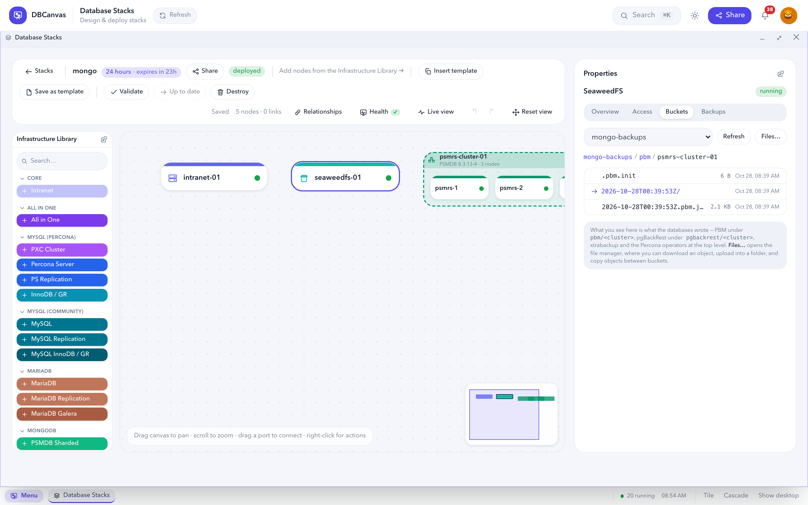

> *A PBM snapshot of a replica set in `mongo-backups/pbm/psmrs-00`.*

## Mirror packages and images with a Repository node

A **Repository** node mirrors the Percona package repositories and runs a container registry, so
nodes and K3D frames install from it instead of repo.percona.com and Docker Hub. Use it to
rehearse an air-gapped site or to avoid downloading the same packages repeatedly. It holds only
what you list:

| Setting | What it holds |
| --- | --- |
| OS releases and architectures | Any of Oracle Linux 8/9/10, Ubuntu 22.04/24.04, Debian 12/13; amd64 and/or arm64 |
| Package repositories | By repo.percona.com name (`ps-84-lts`, `ppg-17`, `psmdb-80`…), optionally pinned to versions and narrowed to package names or globs. Dependencies in the same repository come along. Without a version, only the newest build |
| Operator releases | PXC, PS, PSMDB, PG: source, manifests rewritten for this registry, their images, and Helm charts under `/charts` |
| Extra images | Any registry |
| Debug symbols | Off by default |

**Use it from a node.** Nodes and frames that install from Percona have a **Repository** field.
In **Fallback** mode (default) anything not mirrored still comes from upstream. In **Strict** mode
missing packages fail the install, which tests whether a mirror is complete. Repositories added
later are used on a node's next install.

**Use it from a K3D frame.** The frame's Repository field makes k3s pull images through the
registry. Tick the architecture k3s runs on the Repository; Validate warns if they differ.

The panel has **Overview** (contents, disk use, *Re-sync from upstream*), **How to use**
(copyable steps for yum/dnf, apt, operators and Docker), **Add packages** and **Sync log**. The
registry is on port 5000 inside the stack and on a published host port outside it. The first
deploy includes the first sync, so a long list makes a slow first deploy.

## MClusterAdmin

A node running [MClusterAdmin](https://github.com/PrzemekMalkowski/mclusteradmin), a web panel for
MongoDB topology, sharding, current operations, slow queries, indexes, users and oplog. Its UI is
published on a host port. It draws no lines: enter the connection URI in its own UI. amd64 image
(emulated on arm64).

Tick **Add MClusterAdmin credentials** on a MongoDB node or cluster to create two accounts
(SCRAM-SHA-256) on it, including every shard of a sharded cluster:

| Account | Roles | Default password |
| --- | --- | --- |
| `madmin` | `clusterMonitor`, `clusterManager`, `hostManager`, `dbAdminAnyDatabase`, `readAnyDatabase`, `userAdminAnyDatabase`, `read` on `local` | `MCLUSTERADMIN_PASSWORD` |
| `madmin-ro` | `clusterMonitor`, `readAnyDatabase`, `read` on `local` | `MCLUSTERADMIN_RO_PASSWORD` |

The passwords can be overridden on the MClusterAdmin node, whose panel shows them.
**Read-only panel** disables every write in the UI; sign in as `madmin-ro` to match.

## Big Hole

A node running [Big Hole](https://github.com/zelmario/Big-hole), a browser-only viewer for MongoDB
`diagnostic.data`: drag a folder or support tarball onto the page and it charts every metric. It
connects to nothing; nothing you open leaves your browser. Needs `make bighole-image`.

> [!NOTE]
> Open it on `localhost`. Over plain HTTP on another host name the browser denies the storage it
> needs and decoding fails partway. When you browse DBCanvas remotely, the panel gives you the
> `ssh -L` command to use.

[FTDC Summary](FTDC_SUMMARY.md) reads the same files and gives verdicts and findings instead of
every chart.

## Work with deployed nodes

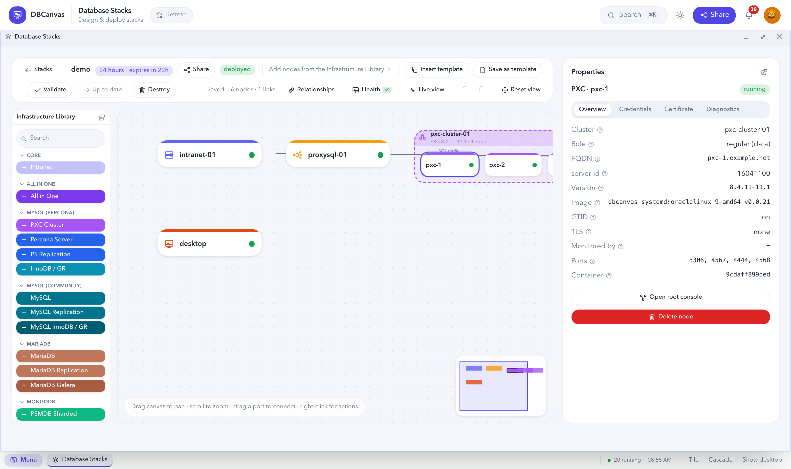

> *A deployed node's panel: version, image, ports, container, credentials, certificate, and a root
> console.*

**Deployed versions.** A running node records the exact version it deployed (`PS 8.4.10-10`,
`PMM 3.3.1`). It is in the node's properties and in the card's tooltip.

**Web terminals.** Open a root (or service) shell on any node in the browser. Sessions survive
navigation and open docked or undocked (set in **Settings**).

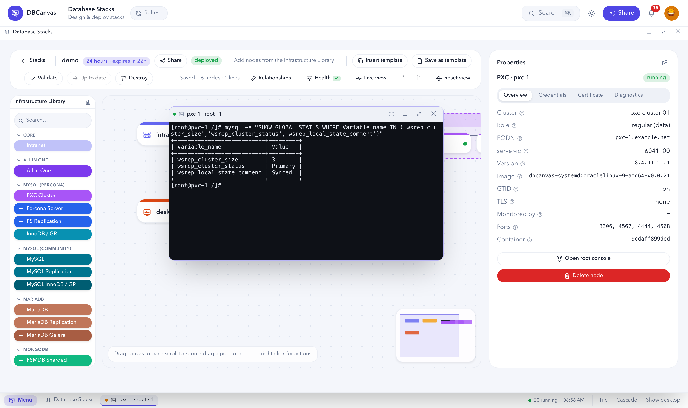

**Copy files onto a node.** Drag a file or folder from your desktop onto a node; DBCanvas asks
which directory to copy it into.

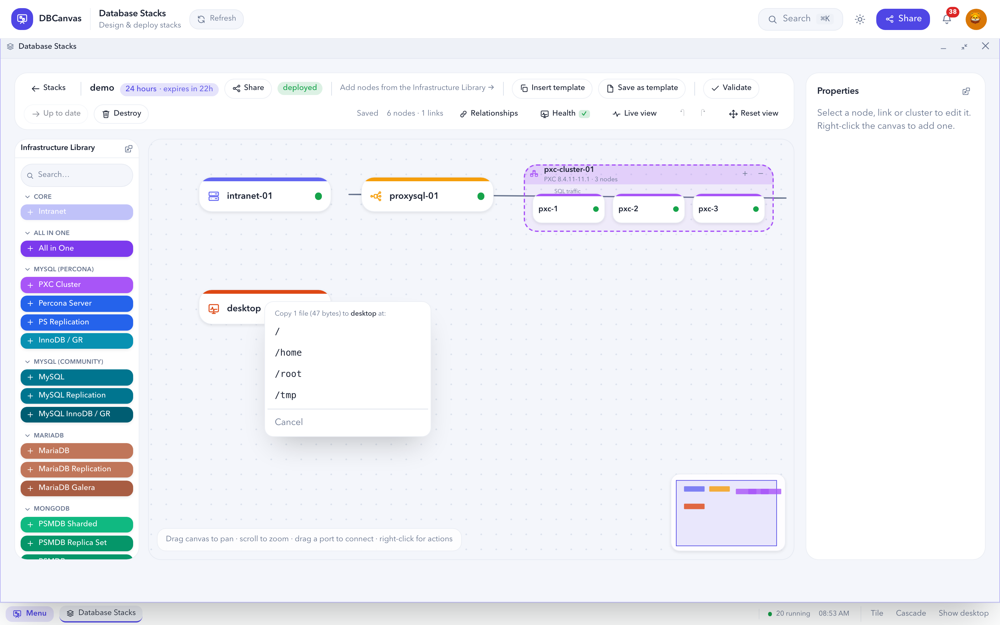

**File manager.** Right-click a running node and choose **File manager** to browse, upload,
download, create, rename, change permissions, delete and edit files. **Split** opens a second
pane on another node for copying between them.

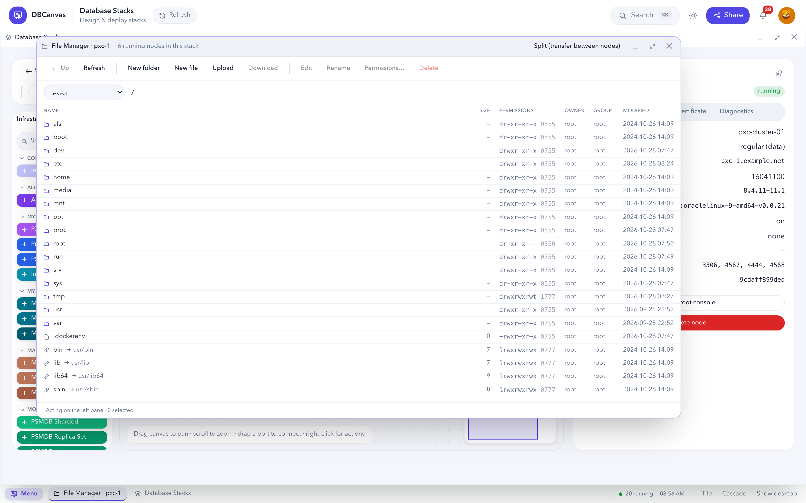

**Reach a node from your own machine.** When `CONTAINER_BIND_IP` keeps published ports on the
server's loopback, set `SSH_FORWARDING_HOST` in `.env` to the server's SSH address (`10.0.0.7` or
`10.0.0.7:2222`). Right-clicking a running node then offers **Copy SSH tunnel command**, an
`ssh -L` line forwarding every port the node publishes:

```
ssh -L 8443:127.0.0.1:8443 -L 8080:127.0.0.1:8080 dbuser@10.0.0.7 -p 22
```

Without `user@` in the setting, the login is your DBCanvas user name. Ports are read when you
click, since they change when a container restarts.

**Add DNS records.** The Intranet's **DNS** tab adds custom **A** (including wildcards such as
`*.apps`), **CNAME** and **PTR** records. A custom record replaces the automatic one with the
same name or address, survives redeploys, and is removed with the stack. Each has a copyable
`dig` command.

**Diagnostics captures.** From a running node's **Diagnostics** tab, capture and download
**pg_gather** (`GatherReport.html`) on PostgreSQL, **pt-stalk** with `pt-summary` and
`pt-mysql-summary` on MySQL/PXC, or a **pt-k8s-debug-collector** dump on a K3D server node. Open
a pt-stalk archive in [Stalk Summary](STALK_SUMMARY.md) and a cluster dump in
[Operator Summary](OPERATOR_SUMMARY.md).

## Templates — save a topology, deploy it again

A **template** is a saved canvas design — nodes, clusters, links and options — that you can reuse.

**Built-in templates:**

| Category | Template |
| --- | --- |
| Getting started | Starter — Percona Server |
| MySQL | PXC + ProxySQL + PMM · Percona Server replication + Orchestrator · InnoDB Cluster |
| PostgreSQL | Patroni + HAProxy · PostgreSQL + pgBackRest · PostgreSQL + pgvector + Support Sim |
| MongoDB | PSMDB replica set + PBM · PSMDB Vector Search + Support Sim · PSMDB sharded cluster |
| Valkey | Valkey Cluster |
| Kubernetes | Kubernetes — Percona Operator for MySQL (PXC) · Kubernetes — PXC operator, two clusters replicating |
| All in One | All-in-One playground |

They do not pin minor versions, so they deploy with whatever this installation's catalog offers.
Built-in templates can be applied and exported but not edited or deleted.

**Use a template:**
- **New stack → Start from** seeds a new stack.
- **Insert template** in the designer merges one into the current canvas. Ids are renewed,
  one-per-stack nodes (Intranet, Keycloak, VNC…) are not duplicated, clashing labels get a
  suffix (`pxc-1` → `pxc-1-2`), and the block is placed clear of existing nodes. Any change is
  reported.

**Save a template:** **Save as template** in the designer toolbar. Passwords and secrets, host
paths and fixed host ports are not saved; they fall back to this installation's `.env` and
auto-assigned ports.

**Share:** a saved template is private. An admin can publish one to everyone. Any template can be
**exported** to `.json` and **imported** into another installation.

## Deployment backends — Docker or Vagrant (hybrid)

Pick a **Deployment** backend in **Settings**. It applies to a stack's first deploy and is then
fixed for that stack; to try the other backend, create a new stack.

| Backend | What it provisions |
| --- | --- |
| **Docker** (default) | Every node is a Docker container. |
| **Vagrant (hybrid)** | Database nodes become VirtualBox VMs; everything else stays a container in the same stack. |

| VirtualBox VM | Docker container |
| --- | --- |
| Percona Server, PostgreSQL, PSMDB, Valkey, ProxySQL, HAProxy, PgBouncer, Linux Client (not Debian) | Intranet, K3D, PMM, Keycloak, OpenBao, SeaweedFS, Samba AD, Ubuntu VNC, Watchtower, and the other types |
| PXC, PS Replication, InnoDB / GR, PSMDB Replica Set and Sharded, Patroni, repmgr, Spock, Valkey Cluster, ProxySQL Cluster | |

VMs and containers share DNS, the CA, PMM and SeaweedFS. Each VM-capable node has **CPUs** and
**Memory (GiB)**: VM size on Vagrant (blank → `DBCANVAS_VM_CPUS` / `DBCANVAS_VM_MEMORY`), container
limits on Docker (blank → unlimited).

Hybrid needs DBCanvas running directly on the host with `vagrant` and `VBoxManage`; otherwise the
deploy falls back to Docker. See
[Configuration](CONFIGURATION.md#a-hybrid-stack-deployed-everything-as-containers).

## Around the stacks

### Dashboard
An overview of stacks, nodes, containers and users (admins see everything; users see their own),
plus live CPU, memory, network and disk charts. It samples only while visible.

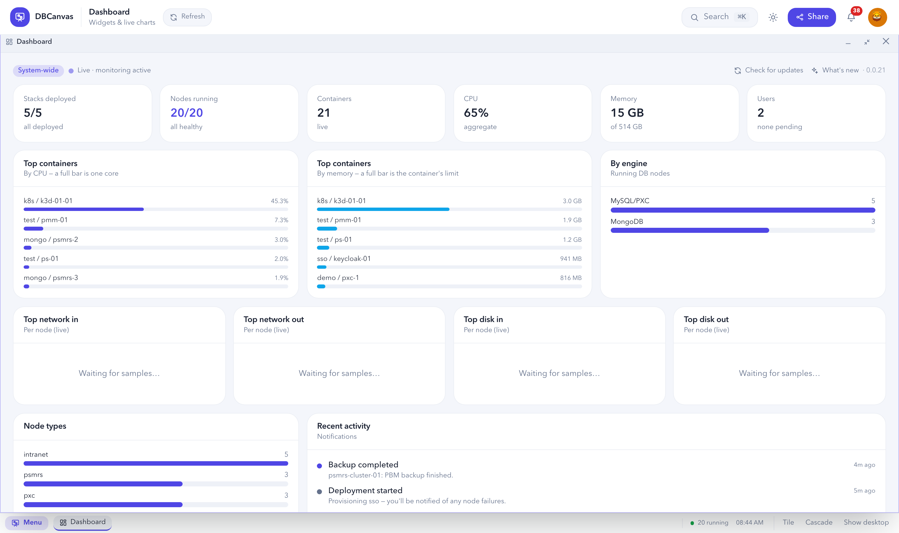

### Scratchboard
Boards of cards for notes, conversions and reading pasted output. Paste or drop text on a board
and it suggests the card that reads it; right-click to add any card; select text in a card to open
it in another.

- **Boards:** **+** adds one, double-click a tab to rename, **×** removes. "Send to Scratchboard"
  lands on the open board.
- **Cards:** grow with content until resized; double-click a title bar to collapse; the palette
  sets colours.
- **Arrows:** drag the dot on a card's right edge onto another card; click an arrow to remove it.
- **Undo** (Ctrl/⌘+Z) restores a closed card, cleared board or removed arrow.
- **Search** finds text on every board.
- **Board → Export / Import** saves a board as `.json` (Secrets included). **Download as
  Markdown** and **Copy as Markdown** give its text.

| Card | What it does |
| --- | --- |
| **Quick Note** | Text with Markdown preview |
| **Checklist** | Steps to tick off |
| **Transformer** | JSON pretty-print, minify, sort keys; JSON ↔ YAML; Base64 and URL encoding |
| **TLS Inspector** | A PEM bundle, CSR or Kubernetes TLS Secret: fields, plain-English summary, chain and key checks, host-name coverage |
| **Text Diff** | Side by side or inline; optionally JSON/YAML by meaning |
| **Certificate Compare** | Two certificates with differences highlighted |
| **Secret decoder** | Every key of a Secret decoded, masked until shown |
| **GTID sets** | Union, differences (errant transactions), containment, counts |
| **Log time** | Epoch, ISO 8601, MySQL, PostgreSQL and mongod timestamps converted, in any time zone |
| **Database units** | Decimal and binary byte sizes, `my.cnf` suffixes, page counts, durations |
| **MongoDB values** | ObjectId creation time and Extended JSON wrappers |
| **Connection URI** | A MySQL, PostgreSQL or MongoDB URI (or libpq string) split into parts, password masked, TLS behaviour explained |
| **Log filter** | Keep or drop lines by text or `/regex/`; collapse near-duplicate lines |
| **Query digest** | A MySQL slow log summarized as pt-query-digest 3.x does |
| **Redactor** | Masks addresses, host names, e-mails, user names, secrets and more, consistently; a mapping table shows originals on demand |
| **JWT / OIDC decoder** | Header and claims with times, Keycloak roles, signature check against a pasted key, and warnings |
| **Replication status** | MySQL `SHOW REPLICA STATUS`, MongoDB `rs.status()` and PostgreSQL replication views read into a verdict per channel or member |
| **Config compare** | Two `my.cnf`, `SHOW VARIABLES`, `postgresql.conf`, `pg_settings` or `mongod.conf` compared by meaning |
| **EXPLAIN reader** | MySQL or PostgreSQL EXPLAIN as a tree with findings |
| **InnoDB status reader** | `SHOW ENGINE INNODB STATUS`: deadlocks, semaphores, history list, buffer pool, LSN |

**Send to Scratchboard** is available from the K3D **Certificates** tab (certificates only, never
`tls.key`), **Secrets & configs**, the **cr.yaml** form, and Log Summary.

**Privacy.** Boards are temporary: closing or reloading the browser drops them. With **Settings →
Scratchboard → Allow keeping boards**, the pin on a tab saves that board to your account,
encrypted, on the DBCanvas server; turning the setting off deletes kept boards. Card content is
never written to browser storage, and every card runs in the browser. In a shared session cards
are hidden from guests unless you click the eye on a card.

### Notifications
The bell shows node deployment failures, data generation results, stacks destroyed or **expiring
soon**, completed backups, high resource usage, and (for admins) accounts awaiting approval.

### The desktop
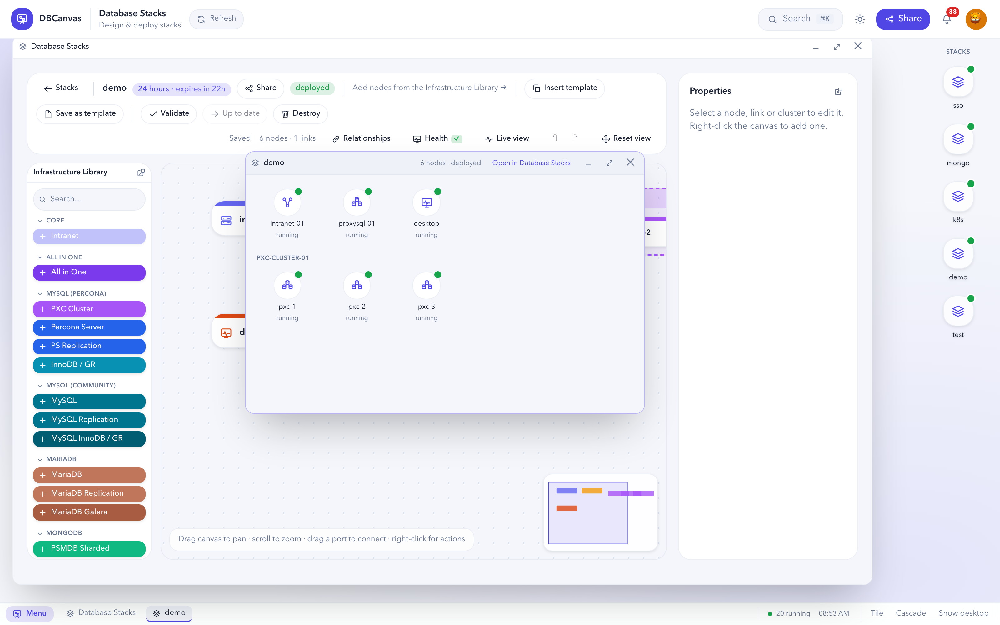

DBCanvas opens as a desktop. Every page opens in its own window; double-click a desktop icon to
open one. The **Menu** button at the left of the taskbar lists every page in groups (Workspace,
Data and queries, Diagnose, Learn, System) with a search box. Right-click a page in the Menu, or
its icon, to open another window of it. ⌘K finds a page from anywhere.

The front window sets the top bar's title, **Refresh** and address (`#benchmark`). A minimized
page keeps its state and stops polling. **Settings → Tabs** limits how many pages can be open.

Your **stacks** are icons down the right, each with a state dot (green deployed, grey draft, red
expired). Double-click one for a folder of its nodes, grouped by cluster. Double-click a node to
open its web UI or root console; right-click for consoles, web UIs (in a new tab or the stack's
VNC browser) and **Open in Database Stacks**. The taskbar's right end shows running, starting
and failed node counts, the shared-session driver and time left, and the clock.

To use the sidebar and tab strip instead, choose **Layout → Classic** in the Appearance menu (the
sun icon in the top bar); **Desktop** switches back. This is saved per browser.

### Windows and the taskbar
Pages, undocked terminals, node web UIs and file managers open as **windows**. Drag the title bar
to move; drag any edge or corner to resize; double-click the title bar to maximize. Drag to the
left or right edge to snap to half the screen, to a corner for a quarter, or to the top to
maximize. Right-click a title bar for Maximize, Minimize, Snap left, Snap right and Close (and Dock
for a terminal).

Terminals can share a window as tabs. Drag a terminal window by its title bar, or drag a tab, onto
another terminal window to add it there as a tab, or onto the terminal dock to dock it. Drag a tab
along a tab strip to rearrange the tabs, or onto another strip to put it at that position. To detach a
tab into a window of its own, drag it off onto the desktop, click its detach icon, or right-click it
and choose **Detach into a window**. **Dock all tabs** docks every tab in the window, and closing
the window closes all of its tabs.

The **taskbar** has **Menu**, a button per window (click to raise, again to minimize), the
terminal dock toggle, the session panel when hidden, and **Tile**, **Cascade** and **Show
desktop**. Right-click the desktop for **Tile windows** and **Cascade windows**. Minimized windows
keep running.

### Settings
Per-user preferences, saved to your account:

| Setting | Choices |
| --- | --- |
| Terminal | Docked (default) or undocked |
| Deployment | [Docker or Vagrant hybrid](#deployment-backends--docker-or-vagrant-hybrid) |
| Tabs | How many pages can be open at once; 2–40, default 20 |
| Adding nodes | Canvas menu or docked library |
| Theme | Light, Dark, Midnight, Solarized, Synthwave, Forest |
| Look | Modern (default), Industrial (dense, monospace headings), Editorial (serif, spacious), Soft (rounded pills) |

Theme, Layout and Look can also be changed from the Appearance menu in the top bar. All
typefaces are system fonts, so nothing is downloaded.

### Manage Users (admin)
Registration needs admin approval by default: admins approve, reject, disable, re-approve and
delete accounts. **Settings → Registration** can let new accounts in immediately with the user
role; admins are notified either way.

Deleting an account deletes its stacks and their containers. Over the API you can first move an
account's stacks to another owner; see [the API reference](API_REFERENCE.md#users-admin).

**Locked out?** Reset an admin password from the host:

```bash
docker exec -it dbcanvas-app-1 dbcanvas_reset_password
```

It prompts for the new password, names the admin it changes, and signs that account out
everywhere. With more than one admin, add `-user <name>`.

---

See also: [Configuration & commands](CONFIGURATION.md) · [Architecture](ARCHITECTURE.md)
